# Governance Scan Summary - johnzastrow public repositories

Generated: 2026-11-25 21:58 UTC  
Method: [governance-scan skill v1.0](https://github.com/MichaelHynesRoux/INFO-7375-Governance-Scan-Skill) (read-only inventory) applied to each public, non-fork repository of [johnzastrow](https://github.com/johnzastrow), excluding this results repository.  
Repositories scanned: **43**. Per-repo inventories: `<repo>.json`; questionnaire answers: `<repo>_Governance.md`.

> This is a technical inventory, not an approval verdict. Per the skill, judgment happens in the evaluation step that compares these facts against the business questionnaire. Full interface and data-access detection is defined only for Python and Node.js; other languages were scanned for dependencies, configuration, and secret patterns (see each JSON's `scan_metadata.notes`).

## 1. Overview

| Metric | Value |
|---|---|
| Repositories scanned | 43 |
| Total critical findings | 36 |
| Total high findings | 92 |
| Total low findings | 178 |
| Repos with at least one critical | 6 |
| Repos with at least one high | 7 |
| Repos with no severity-tagged findings | 19 |

### Findings by severity (all repos)

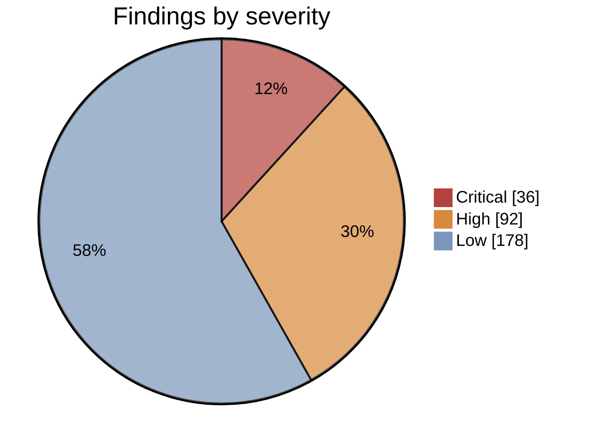

### Languages detected (repos per language)

A repository can contain several languages, so counts sum to more than the number of repositories.

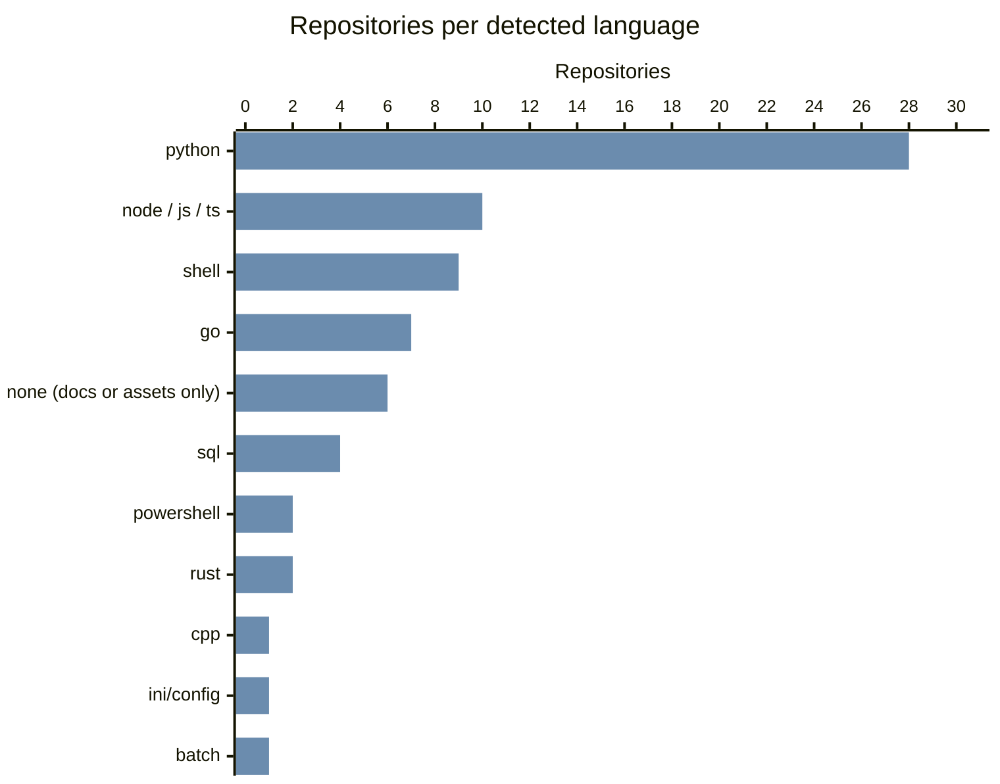

### Critical findings per repository

Only repositories with at least one critical finding are shown.

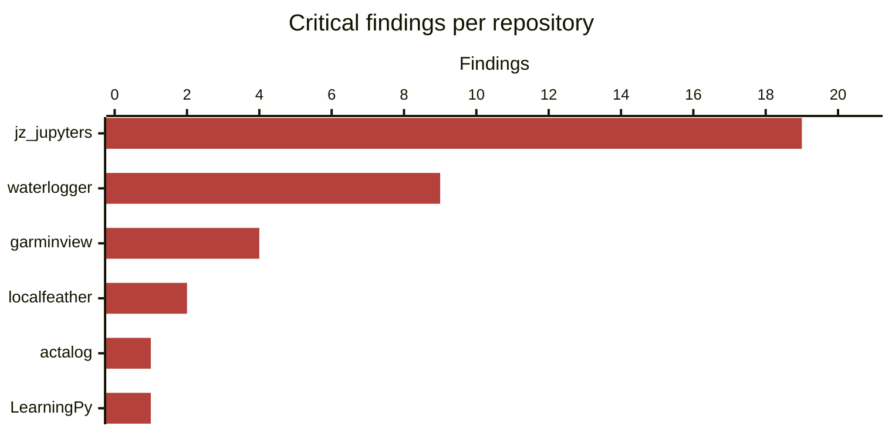

### High findings per repository

Only repositories with at least one high finding are shown.

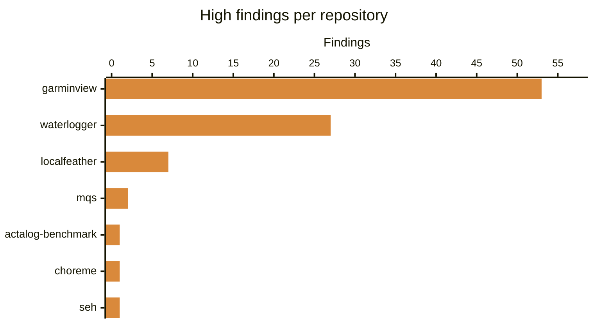

## 2. Matrices

### 2.1 Severity matrix

| Repository | Languages | Critical | High | Low | Total |
|---|---|--:|--:|--:|--:|
| [actalog](#actalog) | go, javascript, vue, shell, python | 1 | 0 | 29 | 30 |
| [actalog-benchmark](#actalog-benchmark) | go | 0 | 1 | 0 | 1 |
| [bittabby](#bittabby) | go, javascript | 0 | 0 | 7 | 7 |
| [choreme](#choreme) | go, typescript, vue, javascript, sql | 0 | 1 | 14 | 15 |
| [DocQGISProject](#docqgisproject) | python | 0 | 0 | 2 | 2 |
| [garminview](#garminview) | python, typescript, vue, shell | 4 | 53 | 16 | 73 |
| [gob](#gob) | - | 0 | 0 | 0 | 0 |
| [johnzastrow](#johnzastrow) | - | 0 | 0 | 0 | 0 |
| [jz_jupyters](#jz_jupyters) | python, jupyter | 19 | 0 | 1 | 20 |
| [LearningPy](#learningpy) | python | 1 | 0 | 3 | 4 |
| [lineup](#lineup) | python | 0 | 0 | 1 | 1 |
| [localfeather](#localfeather) | python, cpp, shell, sql | 2 | 7 | 20 | 29 |
| [mainegeo](#mainegeo) | - | 0 | 0 | 0 | 0 |
| [mapsplat](#mapsplat) | python | 0 | 0 | 1 | 1 |
| [mapsplat4](#mapsplat4) | python, node, shell, powershell | 0 | 0 | 1 | 1 |
| [marimo-qgis](#marimo-qgis) | python, shell | 0 | 0 | 0 | 0 |
| [metadatamgr](#metadatamgr) | python | 0 | 0 | 1 | 1 |
| [mqs](#mqs) | python, shell | 0 | 2 | 2 | 4 |
| [mqs4](#mqs4) | python | 0 | 0 | 2 | 2 |
| [ms](#ms) | python | 0 | 0 | 0 | 0 |
| [mydocmost](#mydocmost) | node | 0 | 0 | 24 | 24 |
| [myvinyl](#myvinyl) | python | 0 | 0 | 7 | 7 |
| [niva](#niva) | python, node | 0 | 0 | 1 | 1 |
| [orgphoto](#orgphoto) | python | 0 | 0 | 0 | 0 |
| [pgeo](#pgeo) | python, node | 0 | 0 | 9 | 9 |
| [photochomper](#photochomper) | python, shell | 0 | 0 | 0 | 0 |
| [postgis_linear_referencing](#postgis_linear_referencing) | sql | 0 | 0 | 0 | 0 |
| [pydataminer](#pydataminer) | python | 0 | 0 | 0 | 0 |
| [QGIS](#qgis) | batch, powershell, python, ini/config | 0 | 0 | 0 | 0 |
| [qgis-plugin-skill](#qgis-plugin-skill) | python, shell, yaml, markdown | 0 | 0 | 0 | 0 |
| [qgis-vscode-setup](#qgis-vscode-setup) | python | 0 | 0 | 0 | 0 |
| [QGISModes](#qgismodes) | python | 0 | 0 | 0 | 0 |
| [seh](#seh) | python | 0 | 1 | 1 | 2 |
| [starshipsuits](#starshipsuits) | - | 0 | 0 | 0 | 0 |
| [stratavis](#stratavis) | - | 0 | 0 | 0 | 0 |
| [surveyart](#surveyart) | python | 0 | 0 | 0 | 0 |
| [systers](#systers) | rust | 0 | 0 | 0 | 0 |
| [tictactoe](#tictactoe) | go, rust, python, javascript | 0 | 0 | 14 | 14 |
| [trilium-farmer](#trilium-farmer) | - | 0 | 0 | 0 | 0 |
| [utilities](#utilities) | shell | 0 | 0 | 0 | 0 |
| [vidstack](#vidstack) | python | 0 | 0 | 1 | 1 |
| [waterlogger](#waterlogger) | go | 9 | 27 | 16 | 52 |
| [waxgrove](#waxgrove) | go, typescript, sql | 0 | 0 | 5 | 5 |

### 2.2 Version control

| Repository | Git repo | Commits sampled | Remote | .gitignore | .gitignore gaps |
|---|---|--:|---|---|--:|
| actalog | yes | 20 | yes | yes | 3 |
| actalog-benchmark | yes | 20 | yes | yes | 1 |
| bittabby | yes | 20 | yes | yes | 0 |
| choreme | yes | 20 | yes | yes | 3 |
| DocQGISProject | yes | 20 | yes | yes | 2 |
| garminview | yes | 20 | yes | yes | 4 |
| gob | yes | 3 | yes | no | 1 |
| johnzastrow | yes | 11 | yes | no | 1 |
| jz_jupyters | yes | 20 | yes | yes | 3 |
| LearningPy | yes | 20 | yes | yes | 6 |
| lineup | yes | 20 | yes | yes | 4 |
| localfeather | yes | 20 | yes | yes | 1 |
| mainegeo | yes | 2 | yes | no | 1 |
| mapsplat | yes | 20 | yes | yes | 2 |
| mapsplat4 | yes | 20 | yes | yes | 0 |
| marimo-qgis | yes | 20 | yes | yes | 3 |
| metadatamgr | yes | 17 | yes | yes | 1 |
| mqs | yes | 20 | yes | yes | 2 |
| mqs4 | yes | 13 | yes | yes | 1 |
| ms | yes | 13 | yes | no | 1 |
| mydocmost | yes | 20 | yes | yes | 3 |
| myvinyl | yes | 20 | yes | yes | 1 |
| niva | yes | 20 | yes | yes | 1 |
| orgphoto | yes | 20 | yes | yes | 3 |
| pgeo | yes | 20 | yes | yes | 2 |
| photochomper | yes | 20 | yes | yes | 2 |
| postgis_linear_referencing | yes | 16 | yes | no | 2 |
| pydataminer | yes | 7 | yes | yes | 2 |
| QGIS | yes | 20 | yes | no | 1 |
| qgis-plugin-skill | yes | 13 | yes | yes | 2 |
| qgis-vscode-setup | yes | 1 | yes | yes | 1 |
| QGISModes | yes | 20 | yes | yes | 1 |
| seh | yes | 20 | yes | yes | 3 |
| starshipsuits | yes | 11 | yes | yes | 0 |
| stratavis | yes | 2 | yes | yes | 1 |
| surveyart | yes | 1 | yes | yes | 1 |
| systers | yes | 20 | yes | yes | 2 |
| tictactoe | yes | 19 | yes | yes | 1 |
| trilium-farmer | yes | 6 | yes | yes | 1 |
| utilities | yes | 10 | yes | yes | 1 |
| vidstack | yes | 8 | yes | yes | 4 |
| waterlogger | yes | 20 | yes | yes | 3 |
| waxgrove | yes | 20 | yes | yes | 0 |

### 2.3 Dependencies

| Repository | Ecosystems (manifests) | Declared deps | Dependency findings |
|---|---|--:|--:|
| actalog | python (0), node (4), go (1) | 65 | 6 |
| actalog-benchmark | go (2) | 8 | 2 |
| bittabby | go (2) | 14 | 3 |
| choreme | node (3), go (2) | 27 | 5 |
| DocQGISProject | python (3) | 0 | 2 |
| garminview | python (2), node (2) | 48 | 6 |
| gob | none | 0 | 0 |
| johnzastrow | none | 0 | 0 |
| jz_jupyters | python (0) | 0 | 2 |
| LearningPy | python (0) | 0 | 2 |
| lineup | python (2) | 4 | 2 |
| localfeather | python (1) | 14 | 3 |
| mainegeo | none | 0 | 0 |
| mapsplat | python (1) | 0 | 2 |
| mapsplat4 | python (3), node (0) | 0 | 4 |
| marimo-qgis | python (3) | 9 | 4 |
| metadatamgr | python (2) | 0 | 3 |
| mqs | python (5) | 0 | 3 |
| mqs4 | python (3) | 1 | 3 |
| ms | python (0) | 0 | 2 |
| mydocmost | node (5) | 249 | 5 |
| myvinyl | python (2) | 9 | 3 |
| niva | python (2), node (2) | 1 | 4 |
| orgphoto | python (2) | 5 | 2 |
| pgeo | python (6), node (2), github_actions (2) | 23 | 5 |
| photochomper | python (1) | 16 | 3 |
| postgis_linear_referencing | none | 0 | 0 |
| pydataminer | python (0) | 0 | 2 |
| QGIS | python (0), cpp (1) | 5 | 3 |
| qgis-plugin-skill | python (0) | 0 | 1 |
| qgis-vscode-setup | python (2) | 1 | 2 |
| QGISModes | python (1) | 2 | 3 |
| seh | python (2) | 8 | 4 |
| starshipsuits | github_actions (2) | 4 | 2 |
| stratavis | none | 0 | 0 |
| surveyart | python (0) | 0 | 2 |
| systers | rust (2) | 11 | 2 |
| tictactoe | python (0), node (0), go (2), rust (3) | 150 | 6 |
| trilium-farmer | none | 0 | 0 |
| utilities | shell (0) | 0 | 1 |
| vidstack | python (3) | 5 | 4 |
| waterlogger | go (2) | 9 | 3 |
| waxgrove | node (4), go (2) | 29 | 3 |

### 2.4 Secrets and credentials

| Repository | Committed secret files | Hardcoded secrets (C/H/L) | Proper handling sites | .env example |
|---|--:|---|--:|---|
| actalog | 3 | 1/0/2 | 4 | yes |
| actalog-benchmark | 0 | 0/0/0 | 2 | no |
| bittabby | 0 | 0/0/0 | 5 | yes |
| choreme | 0 | 0/1/8 | 3 | yes |
| DocQGISProject | 0 | 0/0/2 | 2 | no |
| garminview | 1 | 0/0/2 | 3 | yes |
| gob | 0 | 0/0/0 | 0 | no |
| johnzastrow | 0 | 0/0/0 | 0 | no |
| jz_jupyters | 0 | 19/0/1 | 0 | no |
| LearningPy | 0 | 1/0/3 | 0 | no |
| lineup | 0 | 0/0/0 | 0 | no |
| localfeather | 0 | 0/2/1 | 4 | yes |
| mainegeo | 0 | 0/0/0 | 0 | no |
| mapsplat | 0 | 0/0/0 | 0 | no |
| mapsplat4 | 0 | 0/0/0 | 3 | no |
| marimo-qgis | 0 | 0/0/0 | 2 | no |
| metadatamgr | 0 | 0/0/0 | 4 | no |
| mqs | 0 | 0/0/0 | 2 | no |
| mqs4 | 0 | 0/0/0 | 2 | no |
| ms | 0 | 0/0/0 | 0 | no |
| mydocmost | 0 | 0/0/3 | 5 | yes |
| myvinyl | 0 | 0/0/0 | 4 | yes |
| niva | 0 | 0/0/1 | 4 | no |
| orgphoto | 0 | 0/0/0 | 0 | no |
| pgeo | 0 | 0/0/0 | 5 | yes |
| photochomper | 0 | 0/0/0 | 0 | no |
| postgis_linear_referencing | 0 | 0/0/0 | 0 | no |
| pydataminer | 0 | 0/0/0 | 0 | no |
| QGIS | 0 | 0/0/0 | 1 | no |
| qgis-plugin-skill | 0 | 0/0/0 | 2 | no |
| qgis-vscode-setup | 0 | 0/0/0 | 1 | no |
| QGISModes | 0 | 0/0/0 | 0 | no |
| seh | 0 | 0/0/0 | 4 | yes |
| starshipsuits | 0 | 0/0/0 | 1 | no |
| stratavis | 0 | 0/0/0 | 0 | no |
| surveyart | 0 | 0/0/0 | 0 | no |
| systers | 0 | 0/0/0 | 1 | no |
| tictactoe | 0 | 0/0/0 | 5 | no |
| trilium-farmer | 0 | 0/0/0 | 1 | no |
| utilities | 0 | 0/0/0 | 0 | no |
| vidstack | 0 | 0/0/0 | 0 | no |
| waterlogger | 0 | 0/1/6 | 2 | no |
| waxgrove | 0 | 0/0/0 | 6 | no |

### 2.5 Interfaces and entry points

| Repository | Entry point types | Routes | Routes without detected auth | Network binding | CORS wide open |
|---|---|--:|--:|---|---|
| actalog | cli, scheduled, spa, web_api | 240 | 23 | 0.0.0.0 (default SERVER_HOST in configs/config.go; Docker pu | no |
| actalog-benchmark | cli | 0 | 0 | none (client only; makes outbound HTTP(S) requests to the us | no |
| bittabby | cli, scheduled_job, web_app | 70 | 7 | :8080 (all interfaces, BITT_ADDR default); compose.fluidgrid | no |
| choreme | cli, scheduled_job, web_api, web_ui | 49 | 6 | default HOST=localhost (config.go); Dockerfile sets HOST=0.0 | yes |
| DocQGISProject | cli, gui, processing_provider, qgis_plugin | 0 | 0 | none observed (no listening socket and no outbound HTTP code | no |
| garminview | cli, notebook, scheduled_job, web_api, web_ui | 69 | 69 | uvicorn --host 0.0.0.0 --port 8000 (backend/entrypoint.sh);  | no |
| gob | none | 0 | 0 | none | no |
| johnzastrow | none | 0 | 0 | none | no |
| jz_jupyters | cli, gui, notebook | 0 | 0 | none - no server or listener | no |
| LearningPy | cli, notebook | 0 | 0 | none | no |
| lineup | cli, gui | 0 | 0 | none | no |
| localfeather | cli, dev_server, device_firmware, service, web_api, web_ui | 25 | 11 | 0.0.0.0:5000 (server/run.py:43 and gunicorn --bind 0.0.0.0:5 | no |
| mainegeo | none | 0 | 0 | none | no |
| mapsplat | ci_workflow, qgis_plugin, web_static_server_generated | 1 | 1 | generated serve.py defaults to 127.0.0.1:8000; --host 0.0.0. | yes |
| mapsplat4 | cli, qgis_plugin | 1 | 1 | 127.0.0.1 by default for generated serve.py (0.0.0.0 only vi | yes |
| marimo-qgis | cli, notebook, qgis_plugin, web_api | 8 | 0 | 127.0.0.1 only (random port, bridge); marimo launched with i | no |
| metadatamgr | cli, qgis_plugin | 0 | 0 | none - desktop plugin, no listener | no |
| mqs | cli, gui, qgis_plugin, qgis_processing_scripts | 1 | 1 | 0.0.0.0 (http.server.HTTPServer(("", PORT)) in the generated | yes |
| mqs4 | cli, desktop_gui, qgis_plugin, qgis_processing_script | 0 | 0 | none | no |
| ms | background_agents, notebook | 0 | 0 | Not set in code. RUN_ON_VPS.md documents JupyterHub bind_url | no |
| mydocmost | cli, scheduled_job, web_api, web_frontend | 101 | 21 | 0.0.0.0 (HOST env default; main app PORT 3000, collab server | yes |
| myvinyl | cli, scheduled, web_app | 66 | 7 | 127.0.0.1 by default (src/myvinyl/__main__.py); container CM | no |
| niva | cli, language_server, qgis_plugin, vscode_extension | 0 | 0 | none observed (no listening socket in scanned code; LSP uses | no |
| orgphoto | cli | 0 | 0 | none | no |
| pgeo | cli, reverse_proxy, web_api, web_frontend | 8 | 0 | FastAPI Docker image runs uvicorn on 0.0.0.0:4500 inside the | no |
| photochomper | cli | 0 | 0 | none | no |
| postgis_linear_referencing | sql_script | 0 | 0 | none - no listener | no |
| pydataminer | arcgis_script_tool | 0 | 0 | none | no |
| QGIS | cli | 0 | 0 | none | no |
| qgis-plugin-skill | cli | 0 | 0 | none | no |
| qgis-vscode-setup | cli, qgis_console_script | 0 | 0 | none | no |
| QGISModes | dev_script, qgis_plugin | 0 | 0 | none | no |
| seh | cli, scheduled_job, script | 0 | 0 | none (no network listener) | no |
| starshipsuits | static_site | 0 | 0 | none (static files; served by Netlify or GitHub Pages) | no |
| stratavis | none | 0 | 0 | none | no |
| surveyart | cli | 0 | 0 | none - no listener | no |
| systers | cli | 0 | 0 | none - no listener | no |
| tictactoe | cli, web_api, web_client_wasm | 20 | 14 | 127.0.0.1 by default for the tic-tac-toe servers (go/cmd/ttt | no |
| trilium-farmer | none | 0 | 0 | not applicable (stdio transport per README; no code present) | no |
| utilities | cli | 0 | 0 | none (no listeners; port-check.sh and network-info.sh only i | no |
| vidstack | cli, script | 0 | 0 | none (no network listener) | no |
| waterlogger | service, web_app | 45 | 4 | Default config host 'localhost' port 2342; configurable to 0 | yes |
| waxgrove | background_jobs, cli, web_api, web_client | 51 | 5 | 127.0.0.1:8080 by default (internal/config/config.go); Docke | no |

### 2.6 Data access

| Repository | Databases | SQL injection risk | External APIs | File system access | Office/collab sources | Sensitive-data indicators |
|---|---|---|--:|--:|--:|--:|
| actalog | sqlite / postgresql / mysql-mariadb (selected by DB_DRIVER) | low | 3 | 5 | 3 | 6 |
| actalog-benchmark | none | none | 2 | 3 | 0 | 2 |
| bittabby | mariadb/mysql (optional, BITT_DB_DRIVER/BITT_DB_DSN), sqlite (default, modernc.org/sqlite, /data/bitt.db) | none | 2 | 2 | 2 | 5 |
| choreme | sqlite / postgresql / mysql (selected by DB_TYPE) | none | 1 | 1 | 0 | 2 |
| DocQGISProject | none | none | 0 | 3 | 0 | 2 |
| garminview | mariadb (mysql+pymysql) or sqlite, selected by GARMINVIEW_DB_BACKEND, sqlite (GarminDB files garmin.db, garmin_activities.db, garmin_monitoring.db etc.) | low | 4 | 3 | 2 | 4 |
| gob | none | none | 0 | 0 | 0 | 0 |
| johnzastrow | none | none | 0 | 0 | 0 | 0 |
| jz_jupyters | mysql, sqlite | none | 1 | 5 | 4 | 2 |
| LearningPy | sqlite | none | 4 | 3 | 2 | 4 |
| lineup | sqlite | low | 0 | 4 | 1 | 1 |
| localfeather | mariadb/mysql (pymysql via SQLAlchemy), sqlite (development fallback) | none | 0 | 2 | 0 | 3 |
| mainegeo | none | none | 0 | 0 | 0 | 0 |
| mapsplat | none | none | 1 | 4 | 0 | 0 |
| mapsplat4 | sqlite (MBTiles read) | none | 5 | 4 | 0 | 2 |
| marimo-qgis | sqlite (in-memory version probe) | none | 3 | 4 | 0 | 1 |
| metadatamgr | sqlite/geopackage | low | 0 | 5 | 0 | 3 |
| mqs | postgresql (QGIS project store), sqlite (GeoPackage inventory), sqlite (GeoPackage/SpatiaLite layer rename), sqlite (metadata manager database) | low | 2 | 4 | 0 | 4 |
| mqs4 | postgresql, sqlite (GeoPackage inventory), sqlite (GeoPackage/SpatiaLite rename), sqlite (metadata cache database) | low | 2 | 6 | 0 | 4 |
| ms | none | none | 3 | 3 | 1 | 0 |
| mydocmost | postgresql, redis | none | 7 | 2 | 2 | 4 |
| myvinyl | sqlite | none | 2 | 2 | 1 | 4 |
| niva | PostgreSQL/PostGIS and other databases via named QGIS connections (`sql @conn`, `load @conn.table`, `save @conn.table`), sqlite (GeoPackage) via stdlib sqlite3 | none | 5 | 3 | 2 | 3 |
| orgphoto | sqlite | none | 0 | 2 | 0 | 1 |
| pgeo | duckdb / sqlite (read-only Who's On First) for data preparation, postgresql (PostGIS) loader/owner role, postgresql (PostGIS) via asyncpg and PostgREST | low | 8 | 4 | 2 | 2 |
| photochomper | sqlite | none | 0 | 4 | 1 | 2 |
| postgis_linear_referencing | postgresql (PostGIS) | none | 0 | 1 | 0 | 0 |
| pydataminer | none | none | 0 | 3 | 1 | 2 |
| QGIS | sqlite (GeoPackage) | none | 4 | 4 | 0 | 1 |
| qgis-plugin-skill | none | none | 0 | 2 | 0 | 0 |
| qgis-vscode-setup | none | none | 0 | 4 | 0 | 0 |
| QGISModes | none | none | 0 | 4 | 0 | 0 |
| seh | sqlite (default), postgresql, mariadb via SQLAlchemy | low | 2 | 3 | 3 | 3 |
| starshipsuits | none | none | 0 | 0 | 0 | 0 |
| stratavis | none | none | 0 | 0 | 0 | 0 |
| surveyart | none | none | 0 | 4 | 0 | 0 |
| systers | sqlite | none | 0 | 4 | 0 | 2 |
| tictactoe | sqlite | none | 0 | 4 | 0 | 3 |
| trilium-farmer | none | none | 1 | 0 | 0 | 0 |
| utilities | none | none | 0 | 6 | 0 | 2 |
| vidstack | sqlite (GeoNames GeoPackage geonames.gpkg) | none | 0 | 5 | 0 | 2 |
| waterlogger | sqlite (default) or mariadb via gorm | none | 0 | 4 | 2 | 3 |
| waxgrove | sqlite | none | 3 | 1 | 0 | 3 |

### 2.7 Data leaving the organization

| Repository | Data sources touched | Sources where data leaves the organization |
|---|--:|---|
| actalog | 5 | SMTP server (SMTP_HOST) used to send verification, reset and announcement emails; youtube.com video links stored with WOD/movement entries |
| actalog-benchmark | 2 | ActaLog instance API (user-supplied URL) |
| bittabby | 4 | SMTP server (configurable); ntfy server (configurable, ntfy.sh style) |
| choreme | 2 | SMTP server (configured, not yet clearly used by code) |
| DocQGISProject | 2 | none |
| garminview | 5 | Actalog server (user-configured URL); Ollama / OpenAI-compatible LLM endpoint (workout note text) |
| gob | 0 | none |
| johnzastrow | 0 | none |
| jz_jupyters | 5 | none |
| LearningPy | 4 | none |
| lineup | 3 | none |
| localfeather | 2 | none |
| mainegeo | 0 | none |
| mapsplat | 3 | none |
| mapsplat4 | 4 | none |
| marimo-qgis | 4 | none |
| metadatamgr | 2 | none |
| mqs | 4 | plugins.qgis.org XML-RPC |
| mqs4 | 4 | plugins.qgis.org (plugin upload) |
| ms | 4 | none |
| mydocmost | 7 | SMTP / Postmark mail service; tel.docmost.com telemetry; Configured AI provider (OpenAI/Gemini/Ollama/compatible) |
| myvinyl | 3 | Discogs API (api.discogs.com, i.discogs.com) |
| niva | 5 | ntfy.sh (or configured ntfy server); SMTP server (user-configured, Gmail default for Gmail senders) |
| orgphoto | 2 | none |
| pgeo | 3 | none |
| photochomper | 3 | none |
| postgis_linear_referencing | 2 | none |
| pydataminer | 2 | none |
| QGIS | 2 | QGIS plugin repository (plugins.qgis.org), QGIS news feed (feed.qgis.org), OpenStreetMap tiles, Mapzen terrain tiles on s3.amazonaws.com (configured in QGIS profile ini) |
| qgis-plugin-skill | 2 | GitHub Releases (via github.token in CI) |
| qgis-vscode-setup | 2 | none |
| QGISModes | 2 | none |
| seh | 4 | SMTP server (default smtp.gmail.com) |
| starshipsuits | 0 | none |
| stratavis | 0 | none |
| surveyart | 2 | none |
| systers | 3 | none |
| tictactoe | 2 | none |
| trilium-farmer | 1 | none |
| utilities | 3 | none |
| vidstack | 3 | none |
| waterlogger | 2 | none |
| waxgrove | 3 | Spotify Web API (api.spotify.com, accounts.spotify.com); MusicBrainz API (musicbrainz.org) |

### 2.8 Configuration and deployment

| Repository | Containerized | Deploy config files | Env vars referenced | README | README covers deployment |
|---|---|--:|--:|---|---|
| actalog | yes | 11 | 52 | yes | yes |
| actalog-benchmark | no | 2 | 0 | yes | yes |
| bittabby | yes | 6 | 25 | yes | yes |
| choreme | yes | 7 | 19 | yes | yes |
| DocQGISProject | no | 4 | 2 | yes | yes |
| garminview | yes | 8 | 14 | yes | yes |
| gob | no | 0 | 0 | no | no |
| johnzastrow | no | 0 | 0 | yes | no |
| jz_jupyters | no | 0 | 0 | yes | no |
| LearningPy | no | 0 | 0 | yes | no |
| lineup | no | 0 | 0 | yes | no |
| localfeather | no | 4 | 1 | yes | yes |
| mainegeo | no | 0 | 0 | yes | no |
| mapsplat | no | 4 | 0 | yes | yes |
| mapsplat4 | no | 8 | 2 | yes | yes |
| marimo-qgis | no | 4 | 8 | yes | yes |
| metadatamgr | no | 8 | 2 | yes | yes |
| mqs | no | 5 | 2 | yes | yes |
| mqs4 | no | 2 | 2 | yes | yes |
| ms | no | 0 | 0 | yes | yes |
| mydocmost | yes | 6 | 59 | yes | yes |
| myvinyl | yes | 6 | 13 | yes | yes |
| niva | no | 4 | 32 | yes | yes |
| orgphoto | no | 3 | 0 | yes | yes |
| pgeo | yes | 11 | 20 | yes | yes |
| photochomper | no | 1 | 0 | yes | yes |
| postgis_linear_referencing | no | 0 | 0 | yes | no |
| pydataminer | no | 0 | 0 | yes | no |
| QGIS | no | 4 | 1 | yes | yes |
| qgis-plugin-skill | no | 4 | 1 | yes | yes |
| qgis-vscode-setup | no | 0 | 1 | no | no |
| QGISModes | no | 0 | 0 | yes | yes |
| seh | no | 2 | 4 | yes | yes |
| starshipsuits | no | 3 | 0 | yes | yes |
| stratavis | no | 0 | 0 | yes | no |
| surveyart | no | 0 | 0 | yes | yes |
| systers | no | 1 | 4 | yes | yes |
| tictactoe | no | 2 | 30 | yes | yes |
| trilium-farmer | no | 0 | 4 | yes | yes |
| utilities | no | 0 | 0 | yes | yes |
| vidstack | no | 1 | 0 | yes | no |
| waterlogger | yes | 9 | 1 | yes | yes |
| waxgrove | yes | 5 | 14 | yes | yes |

### 2.9 Network endpoints (all repositories)

Every external API host and network mail/collaboration source recorded in the inventories. "Leaves host network" is no for loopback or private-LAN addresses, yes otherwise; configurable endpoints count as yes because they can point off-host.

| Repository | Endpoint | Kind | Access | Leaves host network | Source file |
|---|---|---|---|---|---|
| actalog | SMTP server configured via SMTP_HOST (net/smtp, email verification, password reset, announcements) | external API | write | yes | pkg/email/email.go |
| actalog | youtube.com (video links/embeds entered on WOD and movement forms) | external API | read | yes | web/src/views/WODCreateView.vue |
| actalog | OTEL_EXPORTER_OTLP_ENDPOINT (referenced only in docker/docker-compose.yml) | external API | write | yes | docker/docker-compose.yml |
| actalog | outbound SMTP via SMTP_HOST (no mailbox read) | email_mailbox | write | yes | pkg/email/email.go |
| actalog-benchmark | user-supplied ActaLog instance (--url); committed report shows https://al.fluidgrid.site | external API | read_write | yes | internal/client/client.go |
| actalog-benchmark | same target: POST /api/auth/login, GET /api/version, /api/workouts, /api/movements, /api/wods, /api/pr-movements, /api/notifications/count; POST /api/benchmark (server-side benchmark, up to 500000 records) | external API | read_write | yes | internal/metrics/endpoints.go |
| bittabby | configurable SMTP server (BITT_SMTP_HOST) | external API | write | yes | internal/notify/notify.go |
| bittabby | ntfy server (BITT_NTFY_URL, ntfy.sh default examples) | external API | write | yes | internal/notify/notify.go |
| bittabby | SMTP host from config (net/smtp); outbound reminders only | email_mailbox | write | yes | internal/notify/notify.go |
| choreme | SMTP server from SMTP_HOST (example smtp.gmail.com in .env.example) | external API | write | yes | internal/config/config.go |
| garminview | Garmin Connect (via garmindb_cli / garminconnect library; credentials from mounted ~/.GarminDb config) | external API | read | yes | backend/garminview/api/routes/sync.py |
| garminview | Actalog server (URL and credentials stored in app_config; user-configured) | external API | read_write | yes | backend/garminview/ingestion/actalog_client.py |
| garminview | Actalog server write-back (POST of matched Garmin data) | external API | write | yes | backend/garminview/ingestion/actalog_writeback.py |
| garminview | Ollama or OpenAI-compatible LLM server (default http://localhost:11434, configurable URL; receives workout note text) | external API | write | yes | backend/garminview/ingestion/notes_parser.py |
| jz_jupyters | api.github.com | external API | read | yes | matpltlib/timeline.py |
| LearningPy | se.mantishub.io | external API | read | yes | mantis_bak.py |
| LearningPy | www.bloomberg.com | external API | read | yes | beautiful_soup/beautiful.py |
| LearningPy | 207.246.85.12 | external API | read | yes | beautiful_soup/beautiful2db.py |
| LearningPy | www.facebook.com / www.google.com / www.yahoo.com / login.live.com (Selenium tutorial examples) | external API | unclear | yes | base_selen.py |
| mapsplat | unpkg.com (maplibre-gl@4.7.1, pmtiles@3.2.0) | external API | read | yes | exporter.py |
| mapsplat4 | unpkg.com (MapLibre GL JS and PMTiles JS bundles, downloaded for offline mode and referenced by exported viewer) | external API | read | yes | exporter.py |
| mapsplat4 | build.protomaps.com / maps.protomaps.com / protomaps.github.io (basemap PMTiles and styles) | external API | read | yes | basemap_helpers.py |
| mapsplat4 | tile.openstreetmap.org, basemaps.cartocdn.com, server.arcgisonline.com, a.tile.opentopomap.org (XYZ basemap tiles) | external API | read | yes | mapsplat_dockwidget.py |
| mapsplat4 | user-supplied basemap/style URLs (HEAD/ranged GET probe, https/http only) | external API | read | yes | mapsplat_dockwidget.py |
| mapsplat4 | raw.githubusercontent.com (Protomaps license text) | external API | read | yes | scripts/gen_basemap_styles.mjs |
| marimo-qgis | github.com (downloads repository zip of example/notebooks folders) | external API | read | yes | plugin/environment.py |
| marimo-qgis | PyPI via pip (installs marimo and user-requested packages) | external API | read | yes | plugin/ui/process.py |
| marimo-qgis | astral.sh (uv install hint text only) | external API | unclear | yes | processing/launch_marimo.py |
| mqs | plugins.qgis.org (XML-RPC plugin upload) | external API | write | yes | Plugins/metadata_manager/plugin_upload.py |
| mqs | unpkg.com (MapLibre/pmtiles JS loaded by generated map HTML) and build.protomaps.com / protomaps.github.io (basemap tiles/fonts) | external API | read | yes | Plugins/mapsplat/exporter.py |
| mqs4 | plugins.qgis.org (XML-RPC upload of plugin zip with username/password) | external API | write | yes | Plugins/metadata_manager/plugin_upload.py |
| mqs4 | user-specified PostgreSQL host | external API | read_write | yes | Scripts/qgis_project_manager.py |
| ms | archive.apache.org | external API | read | yes | image_classification/image_class.ipynb |
| ms | CIFAR-10 download via keras.datasets.cifar10.load_data (upstream dataset host, not named in code) | external API | read | yes | image_classification/stage2_image_class.ipynb |
| ms | localhost:9092 (Apache Kafka broker, local) | external API | read_write | no | image_classification/stage2_image_class.ipynb |
| mydocmost | tel.docmost.com | external API | write | yes | apps/server/src/integrations/telemetry/telemetry.service.ts |
| mydocmost | api.github.com | external API | read | yes | apps/server/src/integrations/security/version.service.ts |
| mydocmost | configurable OpenAI / OpenAI-compatible / Gemini / Ollama endpoint (AI_DRIVER, OPENAI_API_URL) | external API | write | yes | apps/server/src/integrations/environment/environment.validation.ts |
| mydocmost | configurable S3 endpoint (AWS_S3_ENDPOINT) | external API | read_write | yes | apps/server/package.json |
| mydocmost | SMTP/Postmark (MAIL_DRIVER) | external API | write | yes | apps/server/src/integrations/mail/drivers/smtp.driver.ts |
| mydocmost | login.microsoftonline.com / accounts.google.com (SSO references) | external API | unclear | yes | apps/client/src |
| mydocmost | embed.diagrams.net (draw.io embed, DRAWIO_URL) | external API | read | yes | apps/client/src/features/editor |
| mydocmost | SMTP_HOST (configurable) via nodemailer; outbound only | email_mailbox | write | yes | apps/server/src/integrations/mail/drivers/smtp.driver.ts |
| myvinyl | api.discogs.com | external API | read | yes | src/myvinyl/discogs.py |
| myvinyl | i.discogs.com | external API | read | yes | src/myvinyl/discogs.py |
| niva | ntfy.sh (default; NIVA_NTFY_SERVER overridable) | external API | write | yes | niva/utilities.py |
| niva | user-configured SMTP host (smtp.gmail.com default for gmail senders) | external API | write | yes | niva/utilities.py |
| niva | user-supplied WFS/WMS/ArcGIS REST/XYZ URLs (read only, http/https only) | external API | read | yes | niva/remote.py |
| niva | github.com (marimo on-ramp release zip download) | external API | read | yes | niva/setup/marimo.py |
| niva | micro.mamba.pm (install hint text only) | external API | read | yes | niva/pdal_doctor.py |
| niva | SMTP host from NIVA_SMTP_HOST (send only, optional attachment) | email_mailbox | write | yes | niva/utilities.py |
| pgeo | www2.census.gov | external API | read | yes | scripts/fetch_data.sh |
| pgeo | download.geofabrik.de | external API | read | yes | scripts/fetch_data.sh |
| pgeo | data.whosonfirst.org | external API | read | yes | scripts/fetch_data.sh |
| pgeo | batch.openaddresses.io | external API | read | yes | scripts/fetch_data.sh |
| pgeo | stac.overturemaps.org | external API | read | yes | pgeo/src/pgeo/load/sources.py |
| pgeo | prd-tnm.s3.amazonaws.com | external API | read | yes | scripts/fetch_data.sh |
| pgeo | build.protomaps.com | external API | read | yes | scripts/fetch_data.sh |
| pgeo | raw.githubusercontent.com | external API | read | yes | scripts/vendor_web.sh |
| QGIS | plugins.qgis.org | external API | read | yes | Profiles/profiles/default/QGIS/QGIS3.ini |
| QGIS | feed.qgis.org | external API | read | yes | Profiles/profiles/default/QGIS/QGIS3.ini |
| QGIS | tile.openstreetmap.org | external API | read | yes | Profiles/profiles/default/QGIS/QGIS3.ini |
| QGIS | s3.amazonaws.com (Mapzen terrain tiles) | external API | read | yes | Profiles/profiles/default/QGIS/QGIS3.ini |
| seh | monitoringapi.solaredge.com | external API | read | yes | src/seh/api/client.py |
| seh | smtp.gmail.com (default SEH_SMTP_HOST; configurable) | external API | write | yes | src/seh/config/logging.py |
| seh | SMTP server from SEH_SMTP_HOST (default smtp.gmail.com), sends sync success/failure notifications | email_mailbox | write | yes | src/seh/config/logging.py |
| trilium-farmer | Trilium Notes ETAPI (URL from TRILIUM_URL; README example http://192.168.1.102:8080) | external API | read_write | no | README.md |
| waxgrove | api.spotify.com | external API | read_write | yes | internal/spotify/client.go |
| waxgrove | accounts.spotify.com | external API | write | yes | internal/spotify/auth.go |
| waxgrove | musicbrainz.org | external API | read | yes | internal/musicbrainz/client.go |

## 3. Repository sections

Each section has a small data flow diagram built only from that repository's JSON. Arrows follow the recorded `access_type`: an arrow into the app means read, out of the app means write, a double-headed arrow means read/write, and a dashed line means unclear. Local data and network endpoints are drawn as separate small diagrams (split further when long) so each prints at a readable size. Endpoints that leave the host network are labelled EXTERNAL and shaded red; loopback or private-LAN endpoints are labelled LAN. Diagrams are sized to print on letter paper; labels are shortened, and the full endpoint text is in the table under each diagram. Local file access is shown as one node; databases and network endpoints are itemized.

### actalog

Link: https://github.com/johnzastrow/actalog | Languages: go, javascript, vue, shell, python | Findings: critical 1, high 0, low 29 | Inventory: [actalog.json](actalog.json) | Questionnaire: [actalog_Governance.md](actalog_Governance.md)

**What this application can do**

- Lets registered users log CrossFit workouts, track personal records, view progress charts, performance history, calendars and leaderboards, and import/export their data as CSV or JSON (authenticated; subscription required for write operations).
- Lets anyone without a login register (when enabled), log in, reset a password, and browse the public catalog of standard movements, WODs and workout templates.
- Lets admins manage users (create, disable, change role, force or set passwords, unlock), organizations, subscriptions, class scheduling, packages and documents, audit and email logs, data quality merges, announcements, and create/download/restore full database backups.
- Lets coaches or admins view session rosters and check in or mark no-shows for class sessions.
- Serves uploaded avatar files publicly at /uploads/* and public Swagger API documentation at /api/docs/*.

**Who can reach it:** Binds to 0.0.0.0:8080 by default and is designed to be reachable by any user who can reach the host (optionally behind a Caddy reverse proxy). Most routes require a JWT; the public routes are login/registration/password reset, version, Swagger docs, the standard movement/WOD/template catalog, /health and /uploads/*.

**Data flow**

*Local data*

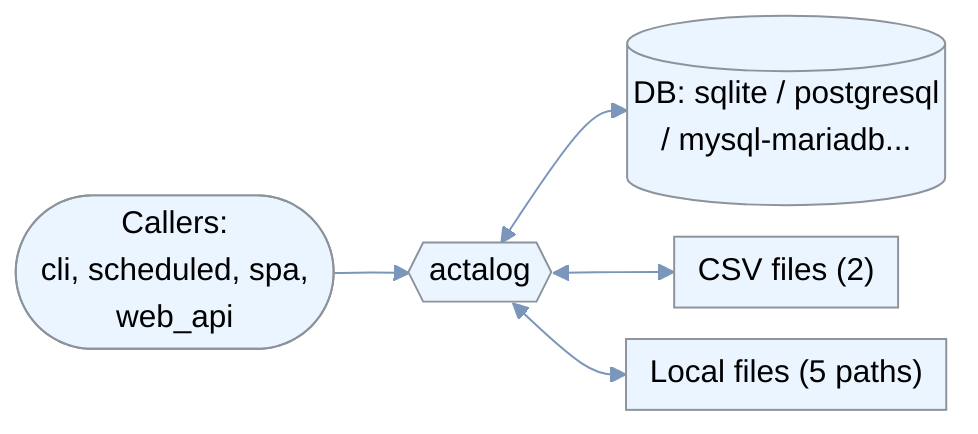

*Network endpoints*

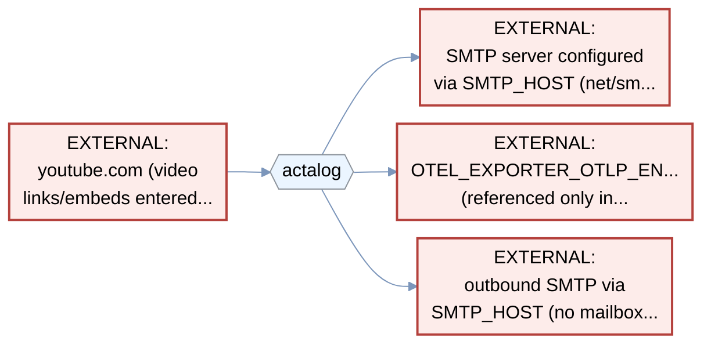

**Network endpoints**

| Endpoint | Kind | Access | Leaves host network | Source file |
|---|---|---|---|---|
| SMTP server configured via SMTP_HOST (net/smtp, email verification, password reset, announcements) | external API | write | yes | pkg/email/email.go |
| youtube.com (video links/embeds entered on WOD and movement forms) | external API | read | yes | web/src/views/WODCreateView.vue |
| OTEL_EXPORTER_OTLP_ENDPOINT (referenced only in docker/docker-compose.yml) | external API | write | yes | docker/docker-compose.yml |
| outbound SMTP via SMTP_HOST (no mailbox read) | email_mailbox | write | yes | pkg/email/email.go |

**Data sources touched**

| Source | Access | Leaves organization |
|---|---|---|
| Application database (SQLite by default; PostgreSQL or MariaDB/MySQL selectable) holding users, workouts, WODs, movements, subscriptions, audit logs | read_write | no |
| Uploaded avatars and backup zips on local volumes (uploads, backups) | read_write | no |
| SMTP server (SMTP_HOST) used to send verification, reset and announcement emails | write | yes |
| User-uploaded CSV imports (including a Wodify performance export) and CSV/JSON exports | read_write | no |
| youtube.com video links stored with WOD/movement entries | read | yes |

**Top findings**

- Critical: password-shaped string committed in docker/trouble/docker-compose.yml:22 (MARIADB_ROOT_PASSWORD error-message default), tracked and not gitignored
- Low: tracked docker/.env.postgres, docker/.env.mariadb (placeholders) and web/certs/localhost-key.pem (dev key)
- 217 of 236 /api routes sit behind JWT middleware (120 admin-only); 19 public API routes plus /health, /uploads/*, / are recorded as low
- JWT_SECRET may be empty unless APP_ENV=production; default bind 0.0.0.0; registration enabled by default

**Unauthorized-action red flags**

- docker/trouble/docker-compose.yml contains a password-shaped string tied to MARIADB_ROOT_PASSWORD in a tracked file.
- Swagger UI (/api/docs/*) and the standard catalog are served without authentication.
- JWT secret may be empty in non-production APP_ENV (default), which would make tokens forgeable if left unset.
- Admin backup download/restore and user password-set endpoints exist (admin-only); a compromised admin account exposes the full database.
- Tracked data exports contain personal data (author email and workout notes; a gym customer name).

### actalog-benchmark

Link: https://github.com/johnzastrow/actalog-benchmark | Languages: go | Findings: critical 0, high 1, low 0 | Inventory: [actalog-benchmark.json](actalog-benchmark.json) | Questionnaire: [actalog-benchmark_Governance.md](actalog-benchmark_Governance.md)

**What this application can do**

- Measures connectivity (DNS, TCP, TLS), health, API endpoint latency, frontend assets and concurrent load against a user-specified ActaLog server.
- Logs in to the target with a supplied email and password and calls authenticated API endpoints with the returned JWT.
- Can trigger the server's /api/benchmark endpoint, which generates up to 500000 records server-side.
- Writes JSON and Markdown reports and compares earlier result files.

**Who can reach it:** Local command-line tool run by the user; no listener. It reaches whatever host the user points it at, including production instances.

**Data flow**

*Local data*

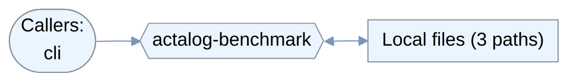

*Network endpoints*

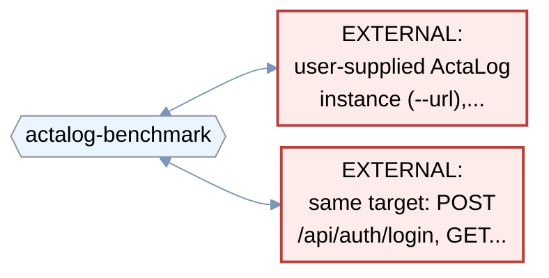

**Network endpoints**

| Endpoint | Kind | Access | Leaves host network | Source file |
|---|---|---|---|---|
| user-supplied ActaLog instance (--url); committed report shows https://al.fluidgrid.site | external API | read_write | yes | internal/client/client.go |
| same target: POST /api/auth/login, GET /api/version, /api/workouts, /api/movements, /api/wods, /api/pr-movements, /api/notifications/count; POST /api/benchmark (server-side benchmark, up to 500000 records) | external API | read_write | yes | internal/metrics/endpoints.go |

**Data sources touched**

| Source | Access | Leaves organization |
|---|---|---|
| ActaLog instance API (user-supplied URL) | read_write (login POST, GETs, server-side benchmark POST) | yes |
| Local JSON/Markdown report files | read_write | no |

**Top findings**

- Password supplied through --pass CLI flag (cmd/actalog-bench/main.go)
- Committed report discloses a personal email address and production URL
- No hardcoded secrets or secret files found

**Unauthorized-action red flags**

- Password accepted as a --pass command-line argument
- A committed report contains a personal email address and the production URL of the tested instance
- Load testing and the server-side benchmark can create heavy load or records on the target

### bittabby

Link: https://github.com/johnzastrow/bittabby | Languages: go, javascript | Findings: critical 0, high 0, low 7 | Inventory: [bittabby.json](bittabby.json) | Questionnaire: [bittabby_Governance.md](bittabby_Governance.md)

**What this application can do**

- Lets signed-in users keep shared running-balance 'tabs' for money owed between people: post charges, record payments, adjustments, late fees and interest, loan terms, and undo entries as reversing entries.
- Lets admins create users, enable/disable accounts, configure email and ntfy notification delivery, and grant a 'can reconcile' permission.
- Lets permitted users upload bank CSV exports and match, confirm, record or ignore bank lines against recorded payments.
- Sends payment reminders by email (SMTP) and ntfy when an external cron calls POST /internal/tick with the shared secret.
- Lets users upload and view profile avatars.

**Who can reach it:** Listens on :8080 (all interfaces) by default. Every application route is behind a session login (requireAuth, requireAdmin, or requireReconcile); only /healthz, /static, /sw.js, /setup, /login, /logout are open, and /internal/tick requires a bearer secret. Session cookies are only marked Secure when BITT_SECURE_COOKIES=true.

**Data flow**

*Local data*

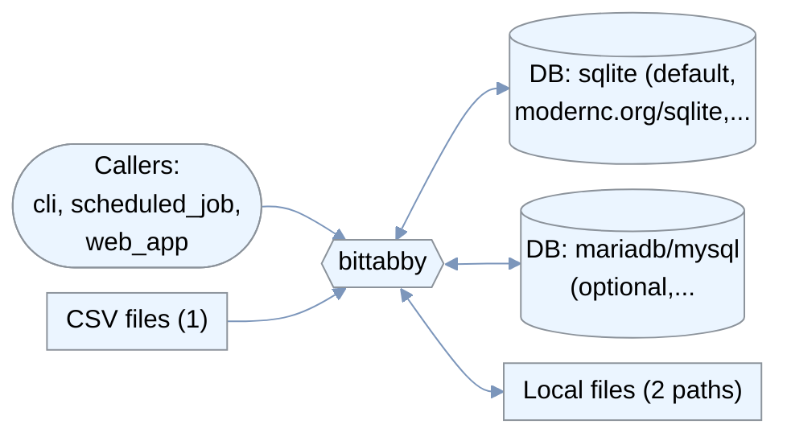

*Network endpoints*

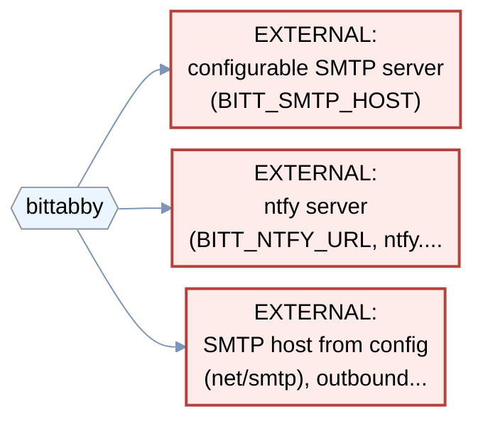

**Network endpoints**

| Endpoint | Kind | Access | Leaves host network | Source file |
|---|---|---|---|---|
| configurable SMTP server (BITT_SMTP_HOST) | external API | write | yes | internal/notify/notify.go |
| ntfy server (BITT_NTFY_URL, ntfy.sh default examples) | external API | write | yes | internal/notify/notify.go |
| SMTP host from config (net/smtp); outbound reminders only | email_mailbox | write | yes | internal/notify/notify.go |

**Data sources touched**

| Source | Access | Leaves organization |
|---|---|---|
| SQLite database file (or optional MariaDB) holding users, tabs, ledger entries, bank lines | read_write | no |
| User-uploaded bank statement CSV files | read | no |
| SMTP server (configurable) | write (reminder emails with names/amounts) | yes |
| ntfy server (configurable, ntfy.sh style) | write (reminder notifications) | yes |

**Top findings**

- No hardcoded secrets or committed secret files found outside test fixtures
- Unauthenticated routes are limited to health, static, setup, login/logout (low)
- Secure cookie flag defaults to off; compose uses :latest image tag
- Optional notification egress to SMTP and ntfy servers

**Unauthorized-action red flags**

- Financial ledger and bank statement lines are personal financial data stored unencrypted in a local SQLite/MariaDB database.
- Notification content may leave the network through SMTP and ntfy (ntfy.sh if configured).
- BITT_SECURE_COOKIES defaults to false.
- GET/POST /setup is open until the first account is created.

### choreme

Link: https://github.com/johnzastrow/choreme | Languages: go, typescript, vue, javascript, sql | Findings: critical 0, high 1, low 14 | Inventory: [choreme.json](choreme.json) | Questionnaire: [choreme_Governance.md](choreme_Governance.md)

**What this application can do**

- Lets anyone who can reach the server register a new household and its first user, and log in to receive a 24-hour JWT.
- Lets authenticated family members view and update their own profile, and (admin/manager roles) list household users and generate invites.
- Manages family savings accounts: deposits, withdrawals, transfer requests with approval, spending limits and interest rates, with role checks in handlers; a scheduler accrues interest and resets limits.
- Chore, assignment, reward, redemption, ledger, audit and report endpoints exist but are largely stubs returning placeholder responses.

**Who can reach it:** HTTP server; binds to localhost by default but the Docker image binds 0.0.0.0:8080 and compose publishes ports. Registration, login and household join are unauthenticated; all other /api/v1 routes require a JWT. CORS allows any origin.

**Data flow**

*Local data*

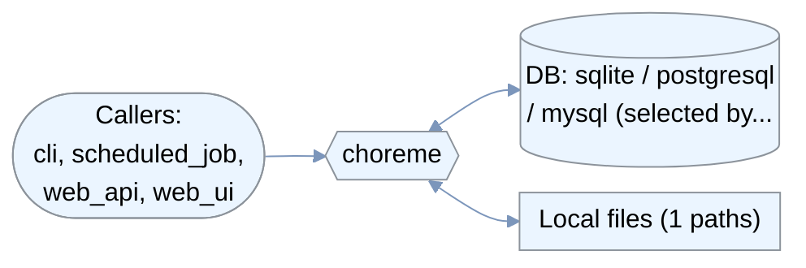

*Network endpoints*

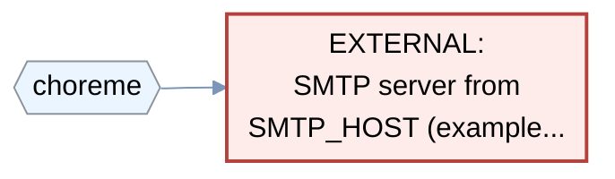

**Network endpoints**

| Endpoint | Kind | Access | Leaves host network | Source file |
|---|---|---|---|---|
| SMTP server from SMTP_HOST (example smtp.gmail.com in .env.example) | external API | write | yes | internal/config/config.go |

**Data sources touched**

| Source | Access | Leaves organization |
|---|---|---|
| Application database (SQLite file, PostgreSQL or MySQL) holding users, households, balances and transfers | read_write | no |
| SMTP server (configured, not yet clearly used by code) | write (planned notification emails) | yes |

**Top findings**

- JWT secret defaults to a hardcoded value in internal/config/config.go if JWT_SECRET is unset (high)
- Wildcard CORS with credentials; Docker image binds 0.0.0.0 and runs as root
- Placeholder credentials in docker-compose.yml (low); compiled binaries tracked in git

**Unauthorized-action red flags**

- JWT signing secret falls back to the hardcoded default 'your-secret-key' when JWT_SECRET is unset (Dockerfile does not set it); anyone who knows the default could forge tokens with any role
- docker-compose.yml ships placeholder JWT secret and weak DB passwords
- Access-Control-Allow-Origin: * with Allow-Credentials: true on all responses
- Docker container runs as root
- Financial-style data (balances, transfers) of minors stored; no rate limiting seen on login

### DocQGISProject

Link: https://github.com/johnzastrow/DocQGISProject | Languages: python | Findings: critical 0, high 0, low 2 | Inventory: [DocQGISProject.json](DocQGISProject.json) | Questionnaire: [DocQGISProject_Governance.md](DocQGISProject_Governance.md)

**What this application can do**

- Reads a QGIS project and writes Markdown, HTML, PDF and JSON documentation (layers, styles, layouts, settings) into a folder the user chooses, with credentials redacted by default.
- Rebuilds a new QGIS project file from the generated JSON, optionally remapping data folders and attaching QGIS auth configs.
- Optionally captures screenshots of QGIS dialogs, skipping pages that show data sources or logins.

**Who can reach it:** Runs locally inside QGIS (dialog, Processing toolbox, Python console). No network listener or outbound network code found.

**Data flow**

*Local data*

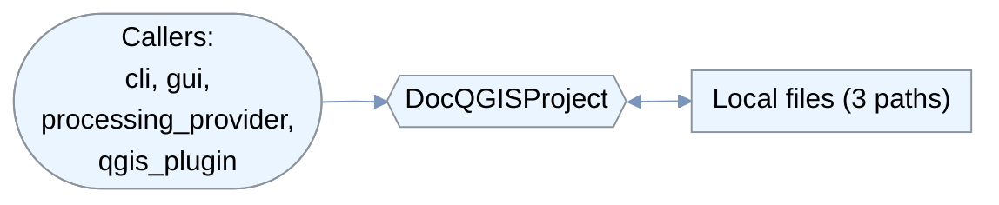

**Network endpoints**

None recorded.

**Data sources touched**

| Source | Access | Leaves organization |
|---|---|---|
| Local QGIS project files (.qgz/.qgs) and the datasets they reference (for counts and extents) | read | no |
| Output folder on local disk (reports, JSON, images, QML, QPT, rebuilt .qgz) | write | no |

**Top findings**

- Two placeholder passwords in test fixtures (low, allowlisted for detect-secrets)
- .gitignore does not exclude .env / key / credential files
- No routes, no network code, no database access found; credentials are redacted from outputs by design

**Unauthorized-action red flags**

- With redact=false or paths=absolute the generated reports/JSON could contain credentials or full home-folder paths; both default to safe values
- Generated JSON embeds the project's data-source list, which could reveal internal server names

### garminview

Link: https://github.com/johnzastrow/garminview | Languages: python, typescript, vue, shell | Findings: critical 4, high 53, low 16 | Inventory: [garminview.json](garminview.json) | Questionnaire: [garminview_Governance.md](garminview_Governance.md)

**What this application can do**

- Shows personal Garmin (and Polar/MyFitnessPal/Actalog) health and training data - sleep, HR, weight, activities, training load, nutrition - in a web dashboard, to anyone who can reach the server; no login is required.
- Lets anyone who can reach it export health metrics as CSV or JSON for any date range.
- Lets anyone who can reach it read all app configuration (including the stored Actalog password), change configuration and schedules, upload MyFitnessPal exports, trigger Garmin downloads and Actalog syncs, and import files from a server directory path.
- Runs scheduled background syncs against Garmin Connect via GarminDB and against an Actalog server, and parses workout notes with a configurable LLM endpoint.

**Who can reach it:** Whoever can reach the published frontend port (default 8080 on the host, listening on all interfaces) - the API behind it has no authentication on any route. In local development it is reachable from the same machine only if bound to localhost.

**Data flow**

*Local data*

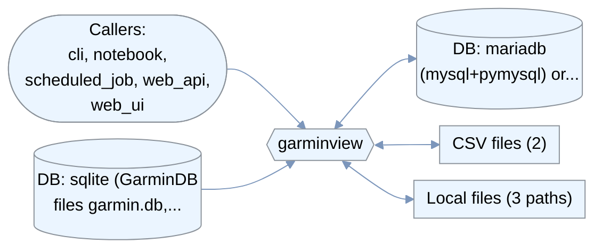

*Network endpoints*

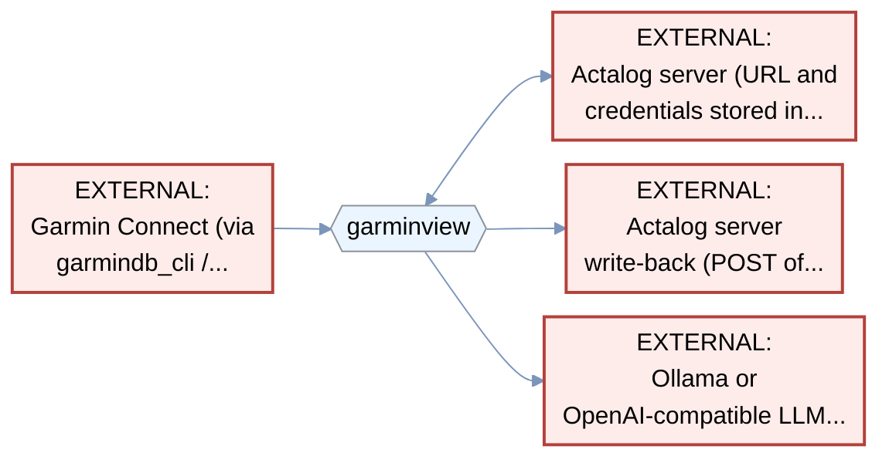

**Network endpoints**

| Endpoint | Kind | Access | Leaves host network | Source file |
|---|---|---|---|---|
| Garmin Connect (via garmindb_cli / garminconnect library; credentials from mounted ~/.GarminDb config) | external API | read | yes | backend/garminview/api/routes/sync.py |
| Actalog server (URL and credentials stored in app_config; user-configured) | external API | read_write | yes | backend/garminview/ingestion/actalog_client.py |
| Actalog server write-back (POST of matched Garmin data) | external API | write | yes | backend/garminview/ingestion/actalog_writeback.py |
| Ollama or OpenAI-compatible LLM server (default http://localhost:11434, configurable URL; receives workout note text) | external API | write | yes | backend/garminview/ingestion/notes_parser.py |

**Data sources touched**

| Source | Access | Leaves organization |
|---|---|---|
| MariaDB or SQLite application database (health, nutrition, workouts, app_config) | read_write | no |
| GarminDB SQLite files and Garmin Connect (via garmindb_cli) | read (download) | no |
| Actalog server (user-configured URL) | read_write | yes |
| Ollama / OpenAI-compatible LLM endpoint (workout note text) | write (sends text) | yes |
| MyFitnessPal and Polar export files | read | no |

**Top findings**

- No authentication on any API route, including admin, config, export and sync endpoints
- backend/.env with a credential-bearing database URL is tracked in git (critical)
- GET /admin/config exposes the stored Actalog password; /export/* returns bulk personal health data (critical)

**Unauthorized-action red flags**

- backend/.env is tracked in git and contains a database connection string with credentials (value redacted)
- GET /admin/config returns all app_config values, including the stored Actalog password in plaintext, without any authentication
- /export/csv and /export/json return bulk personal health data without authentication
- POST /admin/actalog/test-connection makes outbound requests to a caller-supplied URL (SSRF-style) without authentication
- Workout note text is sent to a configurable LLM endpoint; if that is a third-party service, user data leaves the network
- A personal MyFitnessPal export zip and sync logs are committed to the repository

### gob

Link: https://github.com/johnzastrow/gob | Languages: - | Findings: critical 0, high 0, low 0 | Inventory: [gob.json](gob.json) | Questionnaire: [gob_Governance.md](gob_Governance.md)

**What this application can do**

- Nothing executable: the repository holds a requirements/ideas note (notes.md) for forum-style software and a logo.

**Who can reach it:** No executable code or network service; content is only readable by whoever can access the GitHub repository.

**Data flow**

No data stores, files or network endpoints recorded in the inventory.

**Network endpoints**

None recorded.

**Data sources touched:** none recorded.

**Top findings**

- No code, dependencies or secrets found; notes.md lists planned forum software features
- No README and no .gitignore present

**Unauthorized-action red flags**

- None recorded.

### johnzastrow

Link: https://github.com/johnzastrow/johnzastrow | Languages: - | Findings: critical 0, high 0, low 0 | Inventory: [johnzastrow.json](johnzastrow.json) | Questionnaire: [johnzastrow_Governance.md](johnzastrow_Governance.md)

**What this application can do**

- Nothing executable: the repository only holds the README displayed on the author's GitHub profile.

**Who can reach it:** Public README on GitHub; no running application.

**Data flow**

No data stores, files or network endpoints recorded in the inventory.

**Network endpoints**

None recorded.

**Data sources touched:** none recorded.

**Top findings**

- no severity-tagged findings
- repository contains only a profile README (no code)

**Unauthorized-action red flags**

- None recorded.

### jz_jupyters

Link: https://github.com/johnzastrow/jz_jupyters | Languages: python, jupyter | Findings: critical 19, high 0, low 1 | Inventory: [jz_jupyters.json](jz_jupyters.json) | Questionnaire: [jz_jupyters_Governance.md](jz_jupyters_Governance.md)

**What this application can do**

- Reads weather, gas and electric-utility views from a MySQL 'weather' database on localhost or 192.168.1.110 using a hardcoded username and password, and plots them as charts saved to PNG files.
- Reads local CSV, Excel and SQLite files and plots or prints the contents (tutorial examples).
- Fetches the Matplotlib release list from the public GitHub API to draw a timeline chart.
- Includes tutorial notebooks and scripts for pandas, matplotlib, bokeh, and Python basics; some write to hardcoded C:\ paths.

**Who can reach it:** Nothing is served: scripts run only for whoever executes them locally and connect out to a local or private-LAN MySQL server. Because the repo is on GitHub, the hardcoded database credentials are visible to anyone who can read the repository.

**Data flow**

*Local data (part 1 of 2)*

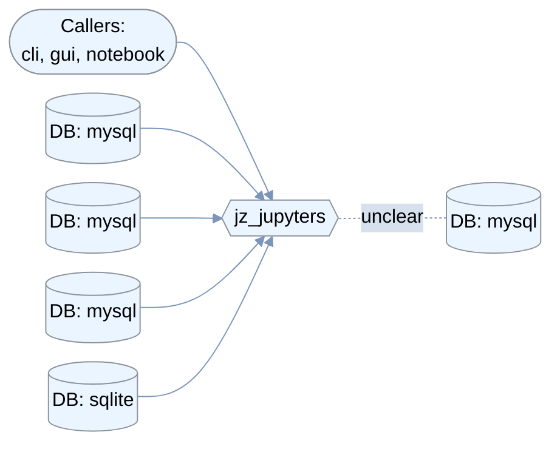

*Local data (part 2 of 2)*

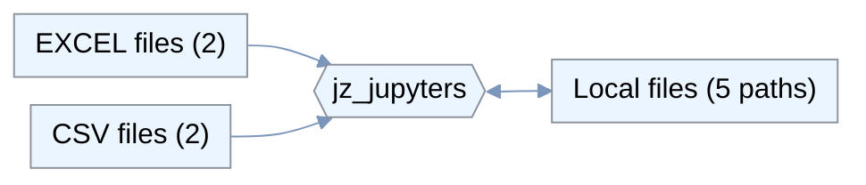

*Network endpoints*

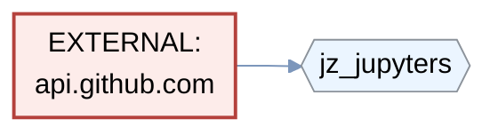

**Network endpoints**

| Endpoint | Kind | Access | Leaves host network | Source file |
|---|---|---|---|---|
| api.github.com | external API | read | yes | matpltlib/timeline.py |

**Data sources touched**

| Source | Access | Leaves organization |
|---|---|---|
| MySQL database 'weather' (localhost:3306 and 192.168.1.110:3306) | read | no |
| MySQL 'application' database on localhost (root, empty password) in a tutorial notebook | unclear | no |
| SQLite files (matpltlib/population.db and similar) | read | no |
| CSV and Excel files in the repo (data.csv, petals.xlsx, weather*.csv) | read | no |
| GitHub REST API (api.github.com) | read (public release list) | no |

**Top findings**

- Hardcoded MySQL password (user jcz) repeated across 15 tracked scripts and notebooks (19 occurrences)
- No dependency manifest despite pandas, matplotlib, sqlalchemy, numpy usage
- Committed binary data files (SQLite .db, xlsx, csv, zip)
- No server or routes - tutorial/exploration code only

**Unauthorized-action red flags**

- Same MySQL password for user 'jcz' hardcoded in 19 tracked files (scripts and notebooks), including a private LAN host address
- Hardcoded Windows paths (C:\data, C:\Code) in tutorial code
- Binary database and data files (.db, .xlsx, .csv, .zip) committed to the repo

### LearningPy

Link: https://github.com/johnzastrow/LearningPy | Languages: python | Findings: critical 1, high 0, low 3 | Inventory: [LearningPy.json](LearningPy.json) | Questionnaire: [LearningPy_Governance.md](LearningPy_Governance.md)

**What this application can do**

- Automates a browser login (Selenium/Firefox) to a MantisHub site and downloads a backup, using a username and password typed into the script.
- Scrapes stock index quotes from public web pages and stores them in a local SQLite database.
- Analyzes an electricity usage CSV in a notebook and runs assorted Python learning exercises (strings, dicts, water-chemistry calculator, birthday and age scripts).

**Who can reach it:** Run locally by whoever executes the scripts; no server, no listening ports. The repository (public GitHub remote) exposes the committed credential and data files to anyone who can read it.

**Data flow**

*Local data*

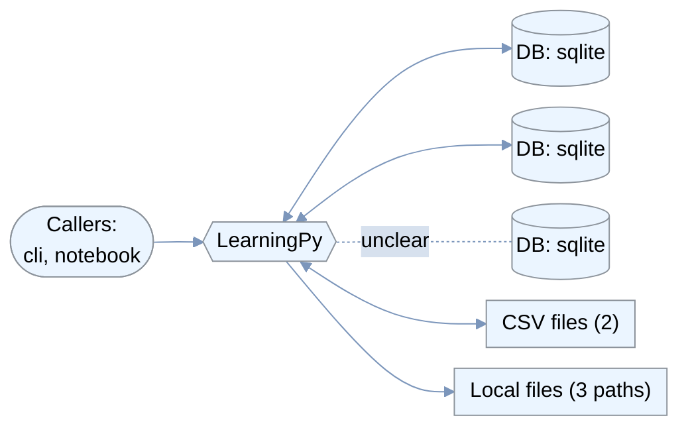

*Network endpoints*

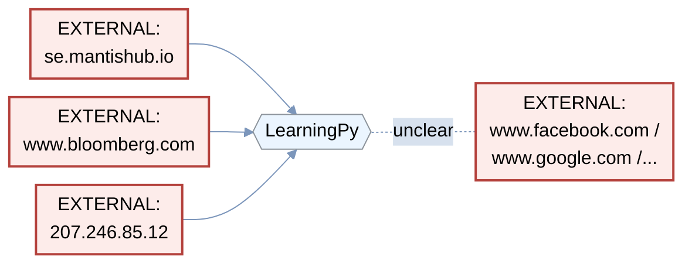

**Network endpoints**

| Endpoint | Kind | Access | Leaves host network | Source file |
|---|---|---|---|---|
| se.mantishub.io | external API | read | yes | mantis_bak.py |
| www.bloomberg.com | external API | read | yes | beautiful_soup/beautiful.py |
| 207.246.85.12 | external API | read | yes | beautiful_soup/beautiful2db.py |
| www.facebook.com / www.google.com / www.yahoo.com / login.live.com (Selenium tutorial examples) | external API | unclear | yes | base_selen.py |

**Data sources touched**

| Source | Access | Leaves organization |
|---|---|---|
| se.mantishub.io (MantisHub backup page) | read | no |
| Bloomberg and a bare-IP quote page (scraped) | read | no |
| Local SQLite files (example.db, flights.db, example2.db) | read_write | no |
| USE2023-08_12_2025.csv electricity usage | read | no |

**Top findings**

- Hardcoded real-looking MantisHub password (and email) in mantis_bak.py
- Placeholder passwords in Selenium tutorial scripts (low)
- No dependency manifest; .gitignore omits .env, *.db, *.log, .idea

**Unauthorized-action red flags**

- mantis_bak.py contains a real-looking MantisHub email and password committed to git.
- Utility usage CSV with account/meter-style identifiers and four SQLite databases are committed.
- Scripts automate logins to third-party sites (Facebook, Microsoft, MantisHub) via Selenium.

### lineup

Link: https://github.com/johnzastrow/lineup | Languages: python | Findings: critical 0, high 0, low 1 | Inventory: [lineup.json](lineup.json) | Questionnaire: [lineup_Governance.md](lineup_Governance.md)

**What this application can do**

- Loads a CSV of duplicate/similar photo groups, caches it in a local SQLite database, and shows groups with thumbnails, master markers and a list view.
- Lets the local user move or permanently delete selected image files from disk.
- Exports the database back to CSV and keeps a recent-databases list in the user's home directory.

**Who can reach it:** Desktop application run locally by the person who starts it; no network listener and no login. It acts with that user's file-system permissions.

**Data flow**

*Local data*

```mermaid
%%{init: {"theme":"base","flowchart":{"useMaxWidth":true,"nodeSpacing":16,"rankSpacing":38,"padding":6},"themeVariables":{"background":"#ffffff","primaryColor":"#ebf5ff","primaryTextColor":"#000000","primaryBorderColor":"#8c939b","lineColor":"#7c96bb","secondaryColor":"#d7e1ee","tertiaryColor":"#c3d2e5","fontFamily":"\"Inter\", \"Noto Sans SC\", sans-serif","fontSize":"18","pie1":"#b4413c","pie2":"#d9893b","pie3":"#7c96bb","pie4":"#73A78D","pie5":"#CB9B7A","pie6":"#6B8CAE","pie7":"#c3d2e5","pie8":"#8c939b"}}}%%
flowchart LR
    APP{{"lineup"}}
    U(["Callers:<br>cli, gui"]) --> APP
    D1[("DB: sqlite")]
    APP <--> D1
    O2["CSV files (1)"]
    APP <--> O2
    F3["Local files (4 paths)"]
    APP <--> F3
    classDef ext fill:#fdecea,stroke:#b4413c,stroke-width:2px,color:#000000
```

**Network endpoints**

None recorded.

**Data sources touched**

| Source | Access | Leaves organization |
|---|---|---|
| CSV duplicate report from photochomper | read | no |
| Local SQLite database .lineup_cache.db | read_write | no |
| User photo files on local disk | read_write (move/delete) | no |

**Top findings**

- Latent SQL injection pattern (f-string column name) in search_images; no untrusted caller found
- Gitignored .image_cache/ and uv.lock are tracked; cache metadata contains a local Windows user path
- App permanently deletes user files; no secrets, routes or external APIs found

**Unauthorized-action red flags**

- Permanently deletes image files (Path.unlink) with no recycle bin; no network or external data transfer found.

### localfeather

Link: https://github.com/johnzastrow/localfeather | Languages: python, cpp, shell, sql | Findings: critical 2, high 7, low 20 | Inventory: [localfeather.json](localfeather.json) | Questionnaire: [localfeather_Governance.md](localfeather_Governance.md)

**What this application can do**

- Accepts temperature/humidity/pressure readings from ESP32 devices over HTTP and stores them in MariaDB; unknown devices self-register and wait for approval.
- Lets anyone who can reach the server approve, edit or delete devices through /api/devices endpoints with no login.
- Returns the full device inventory (IP and MAC addresses, names, locations) and recent readings to any unauthenticated caller.
- Provides a login-protected web dashboard where admins approve, rename, delete devices, regenerate API keys and edit location/notes.
- Distributes ESP32 firmware over HTTP (OTA) to any caller who knows a version string; no signature or checksum handling seen.

**Who can reach it:** Bound to 0.0.0.0:5000 over plain HTTP, so reachable by anyone on the network (or internet if forwarded). The web UI requires login, but the device-management API, readings list and OTA endpoints have no authentication.

**Data flow**

*Local data*

```mermaid
%%{init: {"theme":"base","flowchart":{"useMaxWidth":true,"nodeSpacing":16,"rankSpacing":38,"padding":6},"themeVariables":{"background":"#ffffff","primaryColor":"#ebf5ff","primaryTextColor":"#000000","primaryBorderColor":"#8c939b","lineColor":"#7c96bb","secondaryColor":"#d7e1ee","tertiaryColor":"#c3d2e5","fontFamily":"\"Inter\", \"Noto Sans SC\", sans-serif","fontSize":"18","pie1":"#b4413c","pie2":"#d9893b","pie3":"#7c96bb","pie4":"#73A78D","pie5":"#CB9B7A","pie6":"#6B8CAE","pie7":"#c3d2e5","pie8":"#8c939b"}}}%%
flowchart LR
    APP{{"localfeather"}}
    U(["Callers:<br>cli, dev_server,<br>device_firmware,<br>service, web_api, web_ui"]) --> APP
    D1[("DB: mariadb/mysql<br>(pymysql via SQLAlchemy)")]
    APP <--> D1
    D2[("DB: sqlite (development<br>fallback)")]
    APP <--> D2
    F3["Local files (2 paths)"]
    APP <--> F3
    classDef ext fill:#fdecea,stroke:#b4413c,stroke-width:2px,color:#000000
```

**Network endpoints**

None recorded.

**Data sources touched**

| Source | Access | Leaves organization |
|---|---|---|
| MariaDB localfeather database (users, devices, readings, firmware, updates) | read_write | no |
| SQLite development database (optional) | read_write | no |

**Top findings**

- Unauthenticated device approve/delete/update API endpoints (server/app/api/devices.py)
- Default SECRET_KEY fallback in server/app/__init__.py:30
- Seed script creates admin/admin123 account
- Flask debug=True bound to 0.0.0.0 in server/run.py
- Unauthenticated device inventory (IP/MAC) and OTA firmware download

**Unauthorized-action red flags**

- POST /api/devices/<id>/approve and DELETE /api/devices/<id> have no authentication (code comments say auth to be added)
- GET /api/devices exposes IP and MAC addresses and locations without login
- Default Flask SECRET_KEY fallback and admin123/viewer123 seed credentials
- run.py runs Flask debug=True on 0.0.0.0
- OTA firmware download is unauthenticated and no integrity verification is visible
- No CSRF protection or TLS found

### mainegeo

Link: https://github.com/johnzastrow/mainegeo | Languages: - | Findings: critical 0, high 0, low 0 | Inventory: [mainegeo.json](mainegeo.json) | Questionnaire: [mainegeo_Governance.md](mainegeo_Governance.md)

**What this application can do**

- Nothing executable: the repository stores SVG illustration files of Maine geography and terrain.

**Who can reach it:** No executable code or network service; content is only readable by whoever can access the GitHub repository.

**Data flow**

No data stores, files or network endpoints recorded in the inventory.

**Network endpoints**

None recorded.

**Data sources touched:** none recorded.

**Top findings**

- No executable code, dependencies or secrets found; repository holds SVG artwork only
- No .gitignore present

**Unauthorized-action red flags**

- None recorded.

### mapsplat

Link: https://github.com/johnzastrow/mapsplat | Languages: python | Findings: critical 0, high 0, low 1 | Inventory: [mapsplat.json](mapsplat.json) | Questionnaire: [mapsplat_Governance.md](mapsplat_Governance.md)

**What this application can do**

- Exports a QGIS project's vector and raster layers to a self-contained static web map (PMTiles + MapLibre GL JS style and HTML viewer).
- Downloads MapLibre GL JS and PMTiles JavaScript assets from unpkg.com at export time (no checksum verification) to bundle them for offline use, falling back to CDN links on failure.
- Generates a serve.py local web server that serves the exported map directory with HTTP Range support and Access-Control-Allow-Origin: * on every response.

**Who can reach it:** The plugin runs inside the user's QGIS. The generated serve.py binds to 127.0.0.1 by default (local only) with no authentication; if started with --host 0.0.0.0 it serves the exported map to anyone on the network. README documents deploying exports to static hosts and Linux VPS (Caddy/Nginx).

**Data flow**

*Local data*

```mermaid
%%{init: {"theme":"base","flowchart":{"useMaxWidth":true,"nodeSpacing":16,"rankSpacing":38,"padding":6},"themeVariables":{"background":"#ffffff","primaryColor":"#ebf5ff","primaryTextColor":"#000000","primaryBorderColor":"#8c939b","lineColor":"#7c96bb","secondaryColor":"#d7e1ee","tertiaryColor":"#c3d2e5","fontFamily":"\"Inter\", \"Noto Sans SC\", sans-serif","fontSize":"18","pie1":"#b4413c","pie2":"#d9893b","pie3":"#7c96bb","pie4":"#73A78D","pie5":"#CB9B7A","pie6":"#6B8CAE","pie7":"#c3d2e5","pie8":"#8c939b"}}}%%
flowchart LR
    APP{{"mapsplat"}}
    U(["Callers:<br>ci_workflow,<br>qgis_plugin,<br>web_static_server_gen..."]) --> APP
    F1["Local files (4 paths)"]
    APP <--> F1
    classDef ext fill:#fdecea,stroke:#b4413c,stroke-width:2px,color:#000000
```

*Network endpoints*

```mermaid
%%{init: {"theme":"base","flowchart":{"useMaxWidth":true,"nodeSpacing":16,"rankSpacing":38,"padding":6},"themeVariables":{"background":"#ffffff","primaryColor":"#ebf5ff","primaryTextColor":"#000000","primaryBorderColor":"#8c939b","lineColor":"#7c96bb","secondaryColor":"#d7e1ee","tertiaryColor":"#c3d2e5","fontFamily":"\"Inter\", \"Noto Sans SC\", sans-serif","fontSize":"18","pie1":"#b4413c","pie2":"#d9893b","pie3":"#7c96bb","pie4":"#73A78D","pie5":"#CB9B7A","pie6":"#6B8CAE","pie7":"#c3d2e5","pie8":"#8c939b"}}}%%
flowchart LR
    APP{{"mapsplat"}}
    E2["EXTERNAL:<br>unpkg.com<br>(maplibre-gl@4.7.1,..."]
    E2 --> APP
    class E2 ext
    classDef ext fill:#fdecea,stroke:#b4413c,stroke-width:2px,color:#000000
```

**Network endpoints**

| Endpoint | Kind | Access | Leaves host network | Source file |
|---|---|---|---|---|
| unpkg.com (maplibre-gl@4.7.1, pmtiles@3.2.0) | external API | read | yes | exporter.py |

**Data sources touched**

| Source | Access | Leaves organization |
|---|---|---|
| QGIS project layers (local vector/raster data) | read | no |
| Exported map package files in the output folder | write | no |
| unpkg.com (MapLibre/PMTiles JS assets) | read | no |

**Top findings**

- Generated serve.py has no auth and wildcard CORS, default bind 127.0.0.1 (low); becomes exposed with --host 0.0.0.0
- Remote JS assets downloaded from unpkg.com without checksum
- No dependency manifest beyond QGIS metadata.txt; CI installs unpinned pip packages

**Unauthorized-action red flags**

- Generated serve.py sends Access-Control-Allow-Origin: * with no authentication; safe by default on 127.0.0.1 but exposed if bound to 0.0.0.0
- JavaScript libraries are downloaded from unpkg.com at export time over HTTPS without integrity checks

### mapsplat4

Link: https://github.com/johnzastrow/mapsplat4 | Languages: python, node, shell, powershell | Findings: critical 0, high 0, low 1 | Inventory: [mapsplat4.json](mapsplat4.json) | Questionnaire: [mapsplat4_Governance.md](mapsplat4_Governance.md)

**What this application can do**

- Exports the layers, styling, labels and layer order of the open QGIS project into a self-contained static web map (PMTiles plus MapLibre GL JS).
- Runs ogr2ogr/GDAL and the pmtiles command line tool on the user's own layer data to build tiles.
- Optionally downloads MapLibre/PMTiles scripts and probes basemap URLs on the internet.
- Writes a serve.py helper that starts a local static web server (127.0.0.1 by default) with CORS open to all origins to preview the exported map.

**Who can reach it:** A desktop QGIS plugin used by whoever runs QGIS. The optional generated serve.py binds to 127.0.0.1 by default and has no authentication; it is reachable from the network only if started with --host 0.0.0.0. Exported maps are static and intended to be published publicly if hosted.

**Data flow**

*Local data*

```mermaid
%%{init: {"theme":"base","flowchart":{"useMaxWidth":true,"nodeSpacing":16,"rankSpacing":38,"padding":6},"themeVariables":{"background":"#ffffff","primaryColor":"#ebf5ff","primaryTextColor":"#000000","primaryBorderColor":"#8c939b","lineColor":"#7c96bb","secondaryColor":"#d7e1ee","tertiaryColor":"#c3d2e5","fontFamily":"\"Inter\", \"Noto Sans SC\", sans-serif","fontSize":"18","pie1":"#b4413c","pie2":"#d9893b","pie3":"#7c96bb","pie4":"#73A78D","pie5":"#CB9B7A","pie6":"#6B8CAE","pie7":"#c3d2e5","pie8":"#8c939b"}}}%%
flowchart LR
    APP{{"mapsplat4"}}
    U(["Callers:<br>cli, qgis_plugin"]) --> APP
    D1[("DB: sqlite (MBTiles<br>read)")]
    D1 --> APP
    F2["Local files (4 paths)"]
    APP <--> F2
    classDef ext fill:#fdecea,stroke:#b4413c,stroke-width:2px,color:#000000
```

*Network endpoints (part 1 of 2)*

```mermaid
%%{init: {"theme":"base","flowchart":{"useMaxWidth":true,"nodeSpacing":16,"rankSpacing":38,"padding":6},"themeVariables":{"background":"#ffffff","primaryColor":"#ebf5ff","primaryTextColor":"#000000","primaryBorderColor":"#8c939b","lineColor":"#7c96bb","secondaryColor":"#d7e1ee","tertiaryColor":"#c3d2e5","fontFamily":"\"Inter\", \"Noto Sans SC\", sans-serif","fontSize":"18","pie1":"#b4413c","pie2":"#d9893b","pie3":"#7c96bb","pie4":"#73A78D","pie5":"#CB9B7A","pie6":"#6B8CAE","pie7":"#c3d2e5","pie8":"#8c939b"}}}%%
flowchart LR
    APP{{"mapsplat4"}}
    E3["EXTERNAL:<br>unpkg.com (MapLibre GL<br>JS and PMTiles JS..."]
    E3 --> APP
    E4["EXTERNAL:<br>build.protomaps.com /<br>maps.protomaps.com /..."]
    E4 --> APP
    E5["EXTERNAL:<br>tile.openstreetmap.org,<br>basemaps.cartocdn.com..."]
    E5 --> APP
    E6["EXTERNAL:<br>user-supplied<br>basemap/style URLs..."]
    E6 --> APP
    class E3,E4,E5,E6 ext
    classDef ext fill:#fdecea,stroke:#b4413c,stroke-width:2px,color:#000000
```

*Network endpoints (part 2 of 2)*

```mermaid
%%{init: {"theme":"base","flowchart":{"useMaxWidth":true,"nodeSpacing":16,"rankSpacing":38,"padding":6},"themeVariables":{"background":"#ffffff","primaryColor":"#ebf5ff","primaryTextColor":"#000000","primaryBorderColor":"#8c939b","lineColor":"#7c96bb","secondaryColor":"#d7e1ee","tertiaryColor":"#c3d2e5","fontFamily":"\"Inter\", \"Noto Sans SC\", sans-serif","fontSize":"18","pie1":"#b4413c","pie2":"#d9893b","pie3":"#7c96bb","pie4":"#73A78D","pie5":"#CB9B7A","pie6":"#6B8CAE","pie7":"#c3d2e5","pie8":"#8c939b"}}}%%
flowchart LR
    APP{{"mapsplat4"}}
    E7["EXTERNAL:<br>raw.githubusercontent...<br>(Protomaps license text)"]
    E7 --> APP
    class E7 ext
    classDef ext fill:#fdecea,stroke:#b4413c,stroke-width:2px,color:#000000
```

**Network endpoints**

| Endpoint | Kind | Access | Leaves host network | Source file |
|---|---|---|---|---|
| unpkg.com (MapLibre GL JS and PMTiles JS bundles, downloaded for offline mode and referenced by exported viewer) | external API | read | yes | exporter.py |
| build.protomaps.com / maps.protomaps.com / protomaps.github.io (basemap PMTiles and styles) | external API | read | yes | basemap_helpers.py |
| tile.openstreetmap.org, basemaps.cartocdn.com, server.arcgisonline.com, a.tile.opentopomap.org (XYZ basemap tiles) | external API | read | yes | mapsplat_dockwidget.py |
| user-supplied basemap/style URLs (HEAD/ranged GET probe, https/http only) | external API | read | yes | mapsplat_dockwidget.py |
| raw.githubusercontent.com (Protomaps license text) | external API | read | yes | scripts/gen_basemap_styles.mjs |

**Data sources touched**

| Source | Access | Leaves organization |
|---|---|---|
| QGIS project layers chosen by the user (files/databases already loaded in QGIS) | read | no |
| Output folder bundle on local disk or a static host the user copies it to | write | no |
| Public basemap/tile hosts (Protomaps, OpenStreetMap, Carto, Esri, OpenTopoMap) and unpkg.com | read | no |
| MBTiles file (sqlite) | read | no |

**Top findings**

- No secrets or committed secret files; detect-secrets and bandit run in CI
- Generated serve.py has open CORS and no auth (binds 127.0.0.1 by default)
- No dependency manifest or lockfile; dev tools fetched unpinned

**Unauthorized-action red flags**

- Generated serve.py sends Access-Control-Allow-Origin: * and has no authentication (reachable beyond localhost if --host 0.0.0.0).
- Exported viewer loads MapLibre and PMTiles from unpkg.com unless offline bundling is chosen.
- Exported map bundles contain the user's layer data, which becomes public if the folder is hosted publicly.

### marimo-qgis

Link: https://github.com/johnzastrow/marimo-qgis | Languages: python, shell | Findings: critical 0, high 0, low 0 | Inventory: [marimo-qgis.json](marimo-qgis.json) | Questionnaire: [marimo-qgis_Governance.md](marimo-qgis_Governance.md)

**What this application can do**

- Runs marimo reactive notebooks on QGIS's own Python interpreter, launched from a dock inside QGIS.
- Exposes a token-protected localhost HTTP bridge that lets notebooks read the open QGIS project (layers, features, extent, selection), insert layers back into it, and run any QGIS Processing algorithm.
- Installs marimo and any packages the user names into QGIS's Python with pip, and can download example notebooks from GitHub.
- Scaffolds new notebook files and writes launch logs to disk.

**Who can reach it:** Desktop use only. The bridge binds 127.0.0.1 on a random port and requires a per-session bearer token on every request, so it is reachable only by local processes that know the token. Notebooks themselves can run arbitrary Python as the QGIS user.

**Data flow**

*Local data*

```mermaid
%%{init: {"theme":"base","flowchart":{"useMaxWidth":true,"nodeSpacing":16,"rankSpacing":38,"padding":6},"themeVariables":{"background":"#ffffff","primaryColor":"#ebf5ff","primaryTextColor":"#000000","primaryBorderColor":"#8c939b","lineColor":"#7c96bb","secondaryColor":"#d7e1ee","tertiaryColor":"#c3d2e5","fontFamily":"\"Inter\", \"Noto Sans SC\", sans-serif","fontSize":"18","pie1":"#b4413c","pie2":"#d9893b","pie3":"#7c96bb","pie4":"#73A78D","pie5":"#CB9B7A","pie6":"#6B8CAE","pie7":"#c3d2e5","pie8":"#8c939b"}}}%%
flowchart LR
    APP{{"marimo-qgis"}}
    U(["Callers:<br>cli, notebook,<br>qgis_plugin, web_api"]) --> APP
    D1[("DB: sqlite (in-memory<br>version probe)")]
    D1 --> APP
    F2["Local files (4 paths)"]
    APP --> F2
    classDef ext fill:#fdecea,stroke:#b4413c,stroke-width:2px,color:#000000
```

*Network endpoints*

```mermaid
%%{init: {"theme":"base","flowchart":{"useMaxWidth":true,"nodeSpacing":16,"rankSpacing":38,"padding":6},"themeVariables":{"background":"#ffffff","primaryColor":"#ebf5ff","primaryTextColor":"#000000","primaryBorderColor":"#8c939b","lineColor":"#7c96bb","secondaryColor":"#d7e1ee","tertiaryColor":"#c3d2e5","fontFamily":"\"Inter\", \"Noto Sans SC\", sans-serif","fontSize":"18","pie1":"#b4413c","pie2":"#d9893b","pie3":"#7c96bb","pie4":"#73A78D","pie5":"#CB9B7A","pie6":"#6B8CAE","pie7":"#c3d2e5","pie8":"#8c939b"}}}%%
flowchart LR
    APP{{"marimo-qgis"}}
    E3["EXTERNAL:<br>github.com (downloads<br>repository zip of..."]
    E3 --> APP
    E4["EXTERNAL:<br>PyPI via pip (installs<br>marimo and..."]
    E4 --> APP
    E5["EXTERNAL:<br>astral.sh (uv install<br>hint text only)"]
    APP -.-|unclear| E5
    class E3,E4,E5 ext
    classDef ext fill:#fdecea,stroke:#b4413c,stroke-width:2px,color:#000000
```

**Network endpoints**

| Endpoint | Kind | Access | Leaves host network | Source file |
|---|---|---|---|---|
| github.com (downloads repository zip of example/notebooks folders) | external API | read | yes | plugin/environment.py |
| PyPI via pip (installs marimo and user-requested packages) | external API | read | yes | plugin/ui/process.py |
| astral.sh (uv install hint text only) | external API | unclear | yes | processing/launch_marimo.py |

**Data sources touched**

| Source | Access | Leaves organization |
|---|---|---|
| Open QGIS project layers (via local bridge) | read_write | no |
| github.com repository zip (examples) | read | no |
| PyPI via pip | read | no |
| Sample GeoPackage/SpatiaLite files in repo | read | no |

**Top findings**

- No severity-tagged findings: all bridge routes require a bearer token and bind 127.0.0.1
- Unpinned pandas/numpy in pyproject.toml; runtime pip installs into QGIS Python
- Local bridge can run arbitrary Processing algorithms

**Unauthorized-action red flags**

- POST /api/run executes any Processing algorithm with caller-supplied parameters (guarded only by the local bearer token).
- Notebooks launched by the plugin execute arbitrary Python on QGIS's interpreter by design.
- pip installs of unpinned packages into the QGIS Python environment at run time.

### metadatamgr

Link: https://github.com/johnzastrow/metadatamgr | Languages: python | Findings: critical 0, high 0, low 1 | Inventory: [metadatamgr.json](metadatamgr.json) | Questionnaire: [metadatamgr_Governance.md](metadatamgr_Governance.md)

**What this application can do**

- Scans a user-selected folder tree for geospatial datasets and writes an inventory of files (format, CRS, size, metadata status) into a local GeoPackage.
- Lets a QGIS user create and edit layer metadata through a 4-step wizard with contact and link management, and saves it to a local database cache, .qmd sidecar files, or embedded GeoPackage metadata.
- Parses existing FGDC, ESRI, ISO 19115 and embedded metadata from local files to pre-fill forms.
- Shows a metadata quality dashboard with completion statistics by directory, format and CRS.
- Records the scanning user's OS username, machine hostname and OS version in the inventory records for multi-user tracking.

**Who can reach it:** Runs inside the user's own QGIS desktop session; no listener, no authentication and none needed. Anyone with filesystem access to the shared GeoPackage can read the inventory, including recorded usernames and hostnames.

**Data flow**

*Local data*

```mermaid
%%{init: {"theme":"base","flowchart":{"useMaxWidth":true,"nodeSpacing":16,"rankSpacing":38,"padding":6},"themeVariables":{"background":"#ffffff","primaryColor":"#ebf5ff","primaryTextColor":"#000000","primaryBorderColor":"#8c939b","lineColor":"#7c96bb","secondaryColor":"#d7e1ee","tertiaryColor":"#c3d2e5","fontFamily":"\"Inter\", \"Noto Sans SC\", sans-serif","fontSize":"18","pie1":"#b4413c","pie2":"#d9893b","pie3":"#7c96bb","pie4":"#73A78D","pie5":"#CB9B7A","pie6":"#6B8CAE","pie7":"#c3d2e5","pie8":"#8c939b"}}}%%
flowchart LR
    APP{{"metadatamgr"}}
    U(["Callers:<br>cli, qgis_plugin"]) --> APP
    D1[("DB: sqlite/geopackage")]
    APP <--> D1
    D2[("DB: sqlite/geopackage")]
    APP <--> D2
    F3["Local files (5 paths)"]
    APP -.-|unclear| F3
    classDef ext fill:#fdecea,stroke:#b4413c,stroke-width:2px,color:#000000
```

**Network endpoints**

None recorded.

**Data sources touched**

| Source | Access | Leaves organization |
|---|---|---|
| Local GeoPackage/SQLite inventory and metadata database (geospatial_inventory and related tables) | read_write | no |
| Local geospatial data files and metadata sidecars (shp, gpkg, FGDC/ESRI/ISO XML, .qmd) | read_write (reads datasets and metadata; writes .qmd and embedded metadata) | no |

**Top findings**

- No secrets, secret files or provider keys found; CI runs detect-secrets and bandit
- f-string SQL for table name guarded by _safe_identifier (latent, low)
- No dependency manifest; relies on QGIS host libraries
- Inventory records capture OS username, hostname and OS version
- Developer test scripts contain hardcoded Windows paths including a user profile path

**Unauthorized-action red flags**

- Records OS username and machine hostname of each scanner in the inventory database (personal/operational data stored without any stated consent or retention policy)
- Writes metadata sidecar files and embedded metadata into the user's data directories

### mqs

Link: https://github.com/johnzastrow/mqs | Languages: python, shell | Findings: critical 0, high 2, low 2 | Inventory: [mqs.json](mqs.json) | Questionnaire: [mqs_Governance.md](mqs_Governance.md)

**What this application can do**

- Inventories vector/raster files in directory trees into a GeoPackage and records the scanning OS username and file paths.
- Edits and writes QGIS .qmd metadata (including contact email/phone) for datasets via a wizard.
- Exports a QGIS project as a PMTiles web map and writes a serve.py that serves the folder over HTTP on all interfaces with permissive CORS and no login.
- Reads and edits QGIS project XML stored in a PostgreSQL table using credentials typed into a GUI.
- Renames vector layers/tables in bulk, with file backups.
- Uploads a plugin zip to plugins.qgis.org using the author's credentials.

**Who can reach it:** Desktop tools run locally by the user. The one network listener is the optional serve.py generated for exported web maps: it binds all interfaces with no authentication, so anyone on the local network can read the exported map folder while it is running.

**Data flow**

*Local data*

```mermaid
%%{init: {"theme":"base","flowchart":{"useMaxWidth":true,"nodeSpacing":16,"rankSpacing":38,"padding":6},"themeVariables":{"background":"#ffffff","primaryColor":"#ebf5ff","primaryTextColor":"#000000","primaryBorderColor":"#8c939b","lineColor":"#7c96bb","secondaryColor":"#d7e1ee","tertiaryColor":"#c3d2e5","fontFamily":"\"Inter\", \"Noto Sans SC\", sans-serif","fontSize":"18","pie1":"#b4413c","pie2":"#d9893b","pie3":"#7c96bb","pie4":"#73A78D","pie5":"#CB9B7A","pie6":"#6B8CAE","pie7":"#c3d2e5","pie8":"#8c939b"}}}%%
flowchart LR
    APP{{"mqs"}}
    U(["Callers:<br>cli, gui, qgis_plugin,<br>qgis_processing_scripts"]) --> APP
    D1[("DB: sqlite (GeoPackage<br>inventory)")]
    APP <--> D1
    D2[("DB: sqlite<br>(GeoPackage/SpatiaLit...")]
    APP <--> D2
    D3[("DB: postgresql (QGIS<br>project store)")]
    APP <--> D3
    D4[("DB: sqlite (metadata<br>manager database)")]
    APP <--> D4
    F5["Local files (4 paths)"]
    APP <--> F5
    classDef ext fill:#fdecea,stroke:#b4413c,stroke-width:2px,color:#000000
```

*Network endpoints*

```mermaid
%%{init: {"theme":"base","flowchart":{"useMaxWidth":true,"nodeSpacing":16,"rankSpacing":38,"padding":6},"themeVariables":{"background":"#ffffff","primaryColor":"#ebf5ff","primaryTextColor":"#000000","primaryBorderColor":"#8c939b","lineColor":"#7c96bb","secondaryColor":"#d7e1ee","tertiaryColor":"#c3d2e5","fontFamily":"\"Inter\", \"Noto Sans SC\", sans-serif","fontSize":"18","pie1":"#b4413c","pie2":"#d9893b","pie3":"#7c96bb","pie4":"#73A78D","pie5":"#CB9B7A","pie6":"#6B8CAE","pie7":"#c3d2e5","pie8":"#8c939b"}}}%%
flowchart LR
    APP{{"mqs"}}
    E6["EXTERNAL:<br>plugins.qgis.org<br>(XML-RPC plugin upload)"]
    APP --> E6
    E7["EXTERNAL:<br>unpkg.com<br>(MapLibre/pmtiles JS..."]
    E7 --> APP
    class E6,E7 ext
    classDef ext fill:#fdecea,stroke:#b4413c,stroke-width:2px,color:#000000
```

**Network endpoints**

| Endpoint | Kind | Access | Leaves host network | Source file |
|---|---|---|---|---|
| plugins.qgis.org (XML-RPC plugin upload) | external API | write | yes | Plugins/metadata_manager/plugin_upload.py |
| unpkg.com (MapLibre/pmtiles JS loaded by generated map HTML) and build.protomaps.com / protomaps.github.io (basemap tiles/fonts) | external API | read | yes | Plugins/mapsplat/exporter.py |

**Data sources touched**

| Source | Access | Leaves organization |
|---|---|---|
| Local vector/raster files and GeoPackages | read_write | no |
| PostgreSQL qgis_projects table (user-supplied host) | read_write | no |
| plugins.qgis.org XML-RPC | write (plugin zip upload) | yes |
| unpkg.com / protomaps hosts (loaded by exported web map in the viewer's browser) | read | no |

**Top findings**

- Generated serve.py (Plugins/mapsplat/exporter.py) binds all interfaces, CORS *, no auth
- F-string table names in SQL (inventory_processor.py, batchvectorrename.py) - local-only, low
- .gitignore does not exclude .env / key / credential files
- No committed secrets found

**Unauthorized-action red flags**

- Generated serve.py binds 0.0.0.0 with Access-Control-Allow-Origin * and no authentication
- plugin_upload.py accepts the password via -w/--password command-line option (visible in shell history/process list) though it prompts if omitted
- Inventory records the OS username of the scanner and file paths into a database

### mqs4

Link: https://github.com/johnzastrow/mqs4 | Languages: python | Findings: critical 0, high 0, low 2 | Inventory: [mqs4.json](mqs4.json) | Questionnaire: [mqs4_Governance.md](mqs4_Governance.md)

**What this application can do**

- Scans user-chosen directories for geospatial files (vector, raster, metadata files) and builds an inventory GeoPackage with extents; records the scanning user name and machine name.
- Lets a user create and edit layer metadata (contacts, keywords, links) through a wizard and writes it to a local cache database and .qmd files.
- Batch-renames vector layers and their files/tables with backup copies; converts vectors into GeoPackages; extracts styles from QGIS projects.
- Reads QGIS project files, can connect to a PostgreSQL server with user-supplied credentials to read and update project content stored in a database table, and can export modified project XML.
- Includes a command-line uploader that sends a plugin zip with username and password to plugins.qgis.org.

**Who can reach it:** Desktop tools run locally by the QGIS user; no network listener and no authentication layer of their own.

**Data flow**

*Local data*

```mermaid
%%{init: {"theme":"base","flowchart":{"useMaxWidth":true,"nodeSpacing":16,"rankSpacing":38,"padding":6},"themeVariables":{"background":"#ffffff","primaryColor":"#ebf5ff","primaryTextColor":"#000000","primaryBorderColor":"#8c939b","lineColor":"#7c96bb","secondaryColor":"#d7e1ee","tertiaryColor":"#c3d2e5","fontFamily":"\"Inter\", \"Noto Sans SC\", sans-serif","fontSize":"18","pie1":"#b4413c","pie2":"#d9893b","pie3":"#7c96bb","pie4":"#73A78D","pie5":"#CB9B7A","pie6":"#6B8CAE","pie7":"#c3d2e5","pie8":"#8c939b"}}}%%
flowchart LR
    APP{{"mqs4"}}
    U(["Callers:<br>cli, desktop_gui,<br>qgis_plugin,<br>qgis_processing_script"]) --> APP
    D1[("DB: sqlite (GeoPackage<br>inventory)")]
    APP <--> D1
    D2[("DB: sqlite<br>(GeoPackage/SpatiaLit...")]
    APP <--> D2
    D3[("DB: sqlite (metadata<br>cache database)")]
    APP <--> D3
    D4[("DB: postgresql")]
    APP <--> D4
    F5["Local files (6 paths)"]
    APP <--> F5
    classDef ext fill:#fdecea,stroke:#b4413c,stroke-width:2px,color:#000000
```

*Network endpoints*

```mermaid
%%{init: {"theme":"base","flowchart":{"useMaxWidth":true,"nodeSpacing":16,"rankSpacing":38,"padding":6},"themeVariables":{"background":"#ffffff","primaryColor":"#ebf5ff","primaryTextColor":"#000000","primaryBorderColor":"#8c939b","lineColor":"#7c96bb","secondaryColor":"#d7e1ee","tertiaryColor":"#c3d2e5","fontFamily":"\"Inter\", \"Noto Sans SC\", sans-serif","fontSize":"18","pie1":"#b4413c","pie2":"#d9893b","pie3":"#7c96bb","pie4":"#73A78D","pie5":"#CB9B7A","pie6":"#6B8CAE","pie7":"#c3d2e5","pie8":"#8c939b"}}}%%
flowchart LR
    APP{{"mqs4"}}
    E6["EXTERNAL:<br>plugins.qgis.org<br>(XML-RPC upload of..."]
    APP --> E6
    E7["EXTERNAL:<br>user-specified<br>PostgreSQL host"]
    APP <--> E7
    class E6,E7 ext
    classDef ext fill:#fdecea,stroke:#b4413c,stroke-width:2px,color:#000000
```

**Network endpoints**

| Endpoint | Kind | Access | Leaves host network | Source file |
|---|---|---|---|---|
| plugins.qgis.org (XML-RPC upload of plugin zip with username/password) | external API | write | yes | Plugins/metadata_manager/plugin_upload.py |
| user-specified PostgreSQL host | external API | read_write | yes | Scripts/qgis_project_manager.py |

**Data sources touched**

| Source | Access | Leaves organization |
|---|---|---|
| Local geospatial files and directories chosen by the user (scanned and renamed) | read_write | no |
| Inventory/metadata GeoPackage and SQLite cache databases | read_write | no |
| PostgreSQL database holding QGIS projects (qgis_project_manager.py, user-supplied host) | read_write | unclear (depends on the host the user enters) |
| plugins.qgis.org (plugin upload) | write (plugin zip and credentials) | yes |

**Top findings**

- Local desktop QGIS tools: no routes, no hardcoded secrets or committed secret files
- Low: f-string table names in SQL (inventory_processor.py:638/664, batchvectorrename.py:791), values come from local UI
- qgis_project_manager.py handles PostgreSQL passwords from project URIs and a GUI field
- Scripts/ requires psycopg2 but has no dependency manifest

**Unauthorized-action red flags**

- Inventory records capture the OS user name and machine host name of whoever ran the scan.
- qgis_project_manager.py parses and can display/test PostgreSQL credentials embedded in QGIS project datasource URIs.
- plugin_upload.py transmits a username and password to plugins.qgis.org over HTTPS XML-RPC (author-supplied, interactive prompt).

### ms

Link: https://github.com/johnzastrow/ms | Languages: python | Findings: critical 0, high 0, low 0 | Inventory: [ms.json](ms.json) | Questionnaire: [ms_Governance.md](ms_Governance.md)

**What this application can do**

- Downloads the public CIFAR-10 image dataset, trains CNN, ResNet and (stage 2) MobileNet classifiers, and runs them as Kafka-connected agents that classify 500 test images and compare accuracy against a Judge ensemble result.
- Downloads and starts a local Apache Kafka 3.5.0 and ZooKeeper from archive.apache.org via shell commands inside the notebook.
- Documentation describes installing JupyterHub on an Ubuntu VPS bound to 0.0.0.0:8000 and opening port 8000 in the firewall.

**Who can reach it:** Notebook project with no server of its own. Reachable by whoever runs the notebook; if the documented JupyterHub setup is followed it is exposed on all interfaces of the VPS on port 8000, protected only by JupyterHub Linux-user login.

**Data flow**

*Local data*

```mermaid
%%{init: {"theme":"base","flowchart":{"useMaxWidth":true,"nodeSpacing":16,"rankSpacing":38,"padding":6},"themeVariables":{"background":"#ffffff","primaryColor":"#ebf5ff","primaryTextColor":"#000000","primaryBorderColor":"#8c939b","lineColor":"#7c96bb","secondaryColor":"#d7e1ee","tertiaryColor":"#c3d2e5","fontFamily":"\"Inter\", \"Noto Sans SC\", sans-serif","fontSize":"18","pie1":"#b4413c","pie2":"#d9893b","pie3":"#7c96bb","pie4":"#73A78D","pie5":"#CB9B7A","pie6":"#6B8CAE","pie7":"#c3d2e5","pie8":"#8c939b"}}}%%
flowchart LR
    APP{{"ms"}}
    U(["Callers:<br>background_agents,<br>notebook"]) --> APP
    O1["CSV files (1)"]
    APP --> O1
    F2["Local files (3 paths)"]
    APP --> F2
    classDef ext fill:#fdecea,stroke:#b4413c,stroke-width:2px,color:#000000
```

*Network endpoints*

```mermaid
%%{init: {"theme":"base","flowchart":{"useMaxWidth":true,"nodeSpacing":16,"rankSpacing":38,"padding":6},"themeVariables":{"background":"#ffffff","primaryColor":"#ebf5ff","primaryTextColor":"#000000","primaryBorderColor":"#8c939b","lineColor":"#7c96bb","secondaryColor":"#d7e1ee","tertiaryColor":"#c3d2e5","fontFamily":"\"Inter\", \"Noto Sans SC\", sans-serif","fontSize":"18","pie1":"#b4413c","pie2":"#d9893b","pie3":"#7c96bb","pie4":"#73A78D","pie5":"#CB9B7A","pie6":"#6B8CAE","pie7":"#c3d2e5","pie8":"#8c939b"}}}%%
flowchart LR
    APP{{"ms"}}
    E3["EXTERNAL:<br>archive.apache.org"]
    E3 --> APP
    E4["EXTERNAL:<br>CIFAR-10 download via<br>keras.datasets.cifar1..."]
    E4 --> APP
    E5["LAN:<br>localhost:9092 (Apache<br>Kafka broker, local)"]
    APP <--> E5
    class E3,E4 ext
    classDef ext fill:#fdecea,stroke:#b4413c,stroke-width:2px,color:#000000
```

**Network endpoints**

| Endpoint | Kind | Access | Leaves host network | Source file |
|---|---|---|---|---|
| archive.apache.org | external API | read | yes | image_classification/image_class.ipynb |
| CIFAR-10 download via keras.datasets.cifar10.load_data (upstream dataset host, not named in code) | external API | read | yes | image_classification/stage2_image_class.ipynb |
| localhost:9092 (Apache Kafka broker, local) | external API | read_write | no | image_classification/stage2_image_class.ipynb |

**Data sources touched**

| Source | Access | Leaves organization |
|---|---|---|
| CIFAR-10 public dataset (keras download) | read | no |
| Local Apache Kafka broker localhost:9092 | read_write | no |
| archive.apache.org (Kafka tarball) | read | no |
| classification_results.csv and saved .keras model files | write | no |

**Top findings**

- No dependency manifest or .gitignore; packages installed via unpinned inline pip commands
- Docs show JupyterHub bound to 0.0.0.0:8000 (documentation only, not severity-tagged)
- Notebooks download and run Kafka tarball from archive.apache.org without checksum verification

**Unauthorized-action red flags**

- Documented JupyterHub configuration binds to 0.0.0.0:8000 and instructs opening the firewall port; JupyterHub gives users code execution on the host
- Notebook cells run shell commands (curl, tar, subprocess) that download and execute Kafka binaries without checksum verification
- Kafka broker configured without authentication or TLS (plaintext localhost)

### mydocmost

Link: https://github.com/johnzastrow/mydocmost | Languages: node | Findings: critical 0, high 0, low 24 | Inventory: [mydocmost.json](mydocmost.json) | Questionnaire: [mydocmost_Governance.md](mydocmost_Governance.md)

**What this application can do**

- Hosts a collaborative wiki: authenticated users create, edit (real-time via websocket), move, duplicate, version, comment on and search pages organised in spaces, with groups and role-based membership.
- Lets authenticated users upload files and images, import pages (markdown/html/zip) and export pages or whole spaces.
- Lets users publish a page to the public through a share link; anyone with the share id can read the shared page, its tree and search within it without logging in.
- Handles user sign-up, login, invitations, password reset and email notifications through a configured SMTP/Postmark server.
- Optionally sends prompts/page content to a configured AI provider (OpenAI, OpenAI-compatible, Gemini or Ollama) when AI features are enabled by environment variables.

**Who can reach it:** Server binds to 0.0.0.0 on port 3000 (collaboration server on 3001) by default and CORS is enabled with no restrictions (app.enableCors()). Almost all API routes require a JWT session; a small set of routes (login, setup, share pages, health, collab/stats) are reachable without login. Reachable by anyone on the network that can reach the host.

**Data flow**

*Local data*

```mermaid
%%{init: {"theme":"base","flowchart":{"useMaxWidth":true,"nodeSpacing":16,"rankSpacing":38,"padding":6},"themeVariables":{"background":"#ffffff","primaryColor":"#ebf5ff","primaryTextColor":"#000000","primaryBorderColor":"#8c939b","lineColor":"#7c96bb","secondaryColor":"#d7e1ee","tertiaryColor":"#c3d2e5","fontFamily":"\"Inter\", \"Noto Sans SC\", sans-serif","fontSize":"18","pie1":"#b4413c","pie2":"#d9893b","pie3":"#7c96bb","pie4":"#73A78D","pie5":"#CB9B7A","pie6":"#6B8CAE","pie7":"#c3d2e5","pie8":"#8c939b"}}}%%
flowchart LR
    APP{{"mydocmost"}}
    U(["Callers:<br>cli, scheduled_job,<br>web_api, web_frontend"]) --> APP
    D1[("DB: postgresql")]
    APP <--> D1
    D2[("DB: redis")]
    APP <--> D2
    O3["CSV files (1)"]
    O3 --> APP
    F4["Local files (2 paths)"]
    APP <--> F4
    classDef ext fill:#fdecea,stroke:#b4413c,stroke-width:2px,color:#000000
```

*Network endpoints (part 1 of 2)*

```mermaid
%%{init: {"theme":"base","flowchart":{"useMaxWidth":true,"nodeSpacing":16,"rankSpacing":38,"padding":6},"themeVariables":{"background":"#ffffff","primaryColor":"#ebf5ff","primaryTextColor":"#000000","primaryBorderColor":"#8c939b","lineColor":"#7c96bb","secondaryColor":"#d7e1ee","tertiaryColor":"#c3d2e5","fontFamily":"\"Inter\", \"Noto Sans SC\", sans-serif","fontSize":"18","pie1":"#b4413c","pie2":"#d9893b","pie3":"#7c96bb","pie4":"#73A78D","pie5":"#CB9B7A","pie6":"#6B8CAE","pie7":"#c3d2e5","pie8":"#8c939b"}}}%%
flowchart LR
    APP{{"mydocmost"}}
    E5["EXTERNAL:<br>tel.docmost.com"]
    APP --> E5
    E6["EXTERNAL:<br>api.github.com"]
    E6 --> APP
    E7["EXTERNAL:<br>configurable OpenAI /<br>OpenAI-compatible /..."]
    APP --> E7
    E8["EXTERNAL:<br>configurable S3 endpoint<br>(AWS_S3_ENDPOINT)"]
    APP <--> E8
    class E5,E6,E7,E8 ext
    classDef ext fill:#fdecea,stroke:#b4413c,stroke-width:2px,color:#000000
```

*Network endpoints (part 2 of 2)*

```mermaid
%%{init: {"theme":"base","flowchart":{"useMaxWidth":true,"nodeSpacing":16,"rankSpacing":38,"padding":6},"themeVariables":{"background":"#ffffff","primaryColor":"#ebf5ff","primaryTextColor":"#000000","primaryBorderColor":"#8c939b","lineColor":"#7c96bb","secondaryColor":"#d7e1ee","tertiaryColor":"#c3d2e5","fontFamily":"\"Inter\", \"Noto Sans SC\", sans-serif","fontSize":"18","pie1":"#b4413c","pie2":"#d9893b","pie3":"#7c96bb","pie4":"#73A78D","pie5":"#CB9B7A","pie6":"#6B8CAE","pie7":"#c3d2e5","pie8":"#8c939b"}}}%%
flowchart LR
    APP{{"mydocmost"}}
    E9["EXTERNAL:<br>SMTP/Postmark<br>(MAIL_DRIVER)"]
    APP --> E9
    E10["EXTERNAL:<br>login.microsoftonline...<br>/ accounts.google.com..."]
    APP -.-|unclear| E10
    E11["EXTERNAL:<br>embed.diagrams.net<br>(draw.io embed,..."]
    E11 --> APP
    E12["EXTERNAL:<br>SMTP_HOST (configurable)<br>via nodemailer, outbo..."]
    APP --> E12
    class E9,E10,E11,E12 ext
    classDef ext fill:#fdecea,stroke:#b4413c,stroke-width:2px,color:#000000
```

**Network endpoints**

| Endpoint | Kind | Access | Leaves host network | Source file |
|---|---|---|---|---|
| tel.docmost.com | external API | write | yes | apps/server/src/integrations/telemetry/telemetry.service.ts |
| api.github.com | external API | read | yes | apps/server/src/integrations/security/version.service.ts |
| configurable OpenAI / OpenAI-compatible / Gemini / Ollama endpoint (AI_DRIVER, OPENAI_API_URL) | external API | write | yes | apps/server/src/integrations/environment/environment.validation.ts |
| configurable S3 endpoint (AWS_S3_ENDPOINT) | external API | read_write | yes | apps/server/package.json |
| SMTP/Postmark (MAIL_DRIVER) | external API | write | yes | apps/server/src/integrations/mail/drivers/smtp.driver.ts |
| login.microsoftonline.com / accounts.google.com (SSO references) | external API | unclear | yes | apps/client/src |
| embed.diagrams.net (draw.io embed, DRAWIO_URL) | external API | read | yes | apps/client/src/features/editor |
| SMTP_HOST (configurable) via nodemailer; outbound only | email_mailbox | write | yes | apps/server/src/integrations/mail/drivers/smtp.driver.ts |

**Data sources touched**

| Source | Access | Leaves organization |
|---|---|---|
| PostgreSQL database (DATABASE_URL) | read_write | no |
| Redis (REDIS_URL) | read_write | no |
| Local disk or S3-compatible storage for attachments (STORAGE_DRIVER) | read_write | no |
| SMTP / Postmark mail service | write (sends emails with user addresses) | yes |
| tel.docmost.com telemetry | write (instance hash, version, user/page/space/workspace counts; production, self-hosted, unless DISABLE_TELEMETRY is true) | yes |
| api.github.com release check | read | no |
| Configured AI provider (OpenAI/Gemini/Ollama/compatible) | write (sends prompt and page content when AI is enabled) | yes |

**Top findings**

- Placeholder secrets (APP_SECRET, DB password) in tracked docker-compose.yml (low)
- CORS enabled without restrictions and server binds 0.0.0.0 by default
- Unauthenticated routes: login/setup/share/health and GET /api/collab/stats
- Telemetry to tel.docmost.com enabled by default in production; optional external AI providers
- No rate limiting detected

**Unauthorized-action red flags**

- Anonymous telemetry (counts of users/pages/spaces) is posted to tel.docmost.com in production unless DISABLE_TELEMETRY=true.
- GET /api/collab/stats is unauthenticated and reveals live connection and document counts.
- CORS is enabled with no origin restriction (apps/server/src/main.ts:94).
- No rate limiting / throttling library was found in the server source, including on /api/auth/login.
- Public share routes expose page content to anyone holding a share id.
- Optional AI features can send page content and prompts to external AI services.

### myvinyl

Link: https://github.com/johnzastrow/myvinyl | Languages: python | Findings: critical 0, high 0, low 7 | Inventory: [myvinyl.json](myvinyl.json) | Questionnaire: [myvinyl_Governance.md](myvinyl_Governance.md)

**What this application can do**

- Lets invited users sign in and keep a private vinyl record collection and wishlist (add, edit, soft-delete and restore albums, notes, ratings, covers, track ratings), with stats and printable reports.
- Looks up albums on Discogs with each user's own access token, stores release details, prices and value history, and syncs a user's Discogs collection through a review queue (read-only calls to Discogs).
- Lets a signed-in user export their own collection as CSV.
- Lets admins invite users via one-time links, reset passwords, disable accounts, change roles, clear stored Discogs tokens, view another user's collection and trigger database backups.

**Who can reach it:** Bound to loopback by default; the documented deployment publishes 127.0.0.1 only behind Caddy with HTTPS at a public hostname, so it is reachable by anyone on the internet who can reach that hostname, but every page except login, invite/reset links, favicon, health and static assets requires an authenticated session; there is no open sign-up.

**Data flow**

*Local data*

```mermaid
%%{init: {"theme":"base","flowchart":{"useMaxWidth":true,"nodeSpacing":16,"rankSpacing":38,"padding":6},"themeVariables":{"background":"#ffffff","primaryColor":"#ebf5ff","primaryTextColor":"#000000","primaryBorderColor":"#8c939b","lineColor":"#7c96bb","secondaryColor":"#d7e1ee","tertiaryColor":"#c3d2e5","fontFamily":"\"Inter\", \"Noto Sans SC\", sans-serif","fontSize":"18","pie1":"#b4413c","pie2":"#d9893b","pie3":"#7c96bb","pie4":"#73A78D","pie5":"#CB9B7A","pie6":"#6B8CAE","pie7":"#c3d2e5","pie8":"#8c939b"}}}%%
flowchart LR
    APP{{"myvinyl"}}
    U(["Callers:<br>cli, scheduled, web_app"]) --> APP
    D1[("DB: sqlite")]
    APP <--> D1
    O2["CSV files (1)"]
    APP --> O2
    F3["Local files (2 paths)"]
    APP <--> F3
    classDef ext fill:#fdecea,stroke:#b4413c,stroke-width:2px,color:#000000
```

*Network endpoints*

```mermaid
%%{init: {"theme":"base","flowchart":{"useMaxWidth":true,"nodeSpacing":16,"rankSpacing":38,"padding":6},"themeVariables":{"background":"#ffffff","primaryColor":"#ebf5ff","primaryTextColor":"#000000","primaryBorderColor":"#8c939b","lineColor":"#7c96bb","secondaryColor":"#d7e1ee","tertiaryColor":"#c3d2e5","fontFamily":"\"Inter\", \"Noto Sans SC\", sans-serif","fontSize":"18","pie1":"#b4413c","pie2":"#d9893b","pie3":"#7c96bb","pie4":"#73A78D","pie5":"#CB9B7A","pie6":"#6B8CAE","pie7":"#c3d2e5","pie8":"#8c939b"}}}%%
flowchart LR
    APP{{"myvinyl"}}
    E4["EXTERNAL:<br>api.discogs.com"]
    E4 --> APP
    E5["EXTERNAL:<br>i.discogs.com"]
    E5 --> APP
    class E4,E5 ext
    classDef ext fill:#fdecea,stroke:#b4413c,stroke-width:2px,color:#000000
```

**Network endpoints**

| Endpoint | Kind | Access | Leaves host network | Source file |
|---|---|---|---|---|
| api.discogs.com | external API | read | yes | src/myvinyl/discogs.py |
| i.discogs.com | external API | read | yes | src/myvinyl/discogs.py |

**Data sources touched**

| Source | Access | Leaves organization |
|---|---|---|
| SQLite database myvinyl.db (users, albums, wishlist, sync tables, value history) | read_write | no |
| Cover image files and backups in the data directory | read_write | no |
| Discogs API (api.discogs.com, i.discogs.com) | read (search queries, release ids, barcodes and the user's token are sent out) | yes |

**Top findings**

- No severity-tagged findings above low: 7 public routes recorded as low (login, link token pages, health, static)
- Discogs API (external) receives search terms and users' access tokens by design; tokens stored AES-256-GCM encrypted
- Runtime dependency versions use >= ranges in pyproject.toml (locked in uv.lock); Docker base image not digest-pinned
- Strong baseline observed: Argon2id, CSRF tokens, rate limiting, CSP, non-root read-only container

**Unauthorized-action red flags**

- Collection metadata (artist, title, barcode search terms) and each user's Discogs token are sent to Discogs, an external third party, by design.
- Admins can view and edit any user's collection (documented feature).
- Public routes exist (login, invite/reset link pages) and are the internet-facing attack surface; they are CSRF-checked and rate-limited per the code.

### niva

Link: https://github.com/johnzastrow/niva | Languages: python, node | Findings: critical 0, high 0, low 1 | Inventory: [niva.json](niva.json) | Questionnaire: [niva_Governance.md](niva_Governance.md)

**What this application can do**

- Runs geoprocessing pipelines written in a text grammar by translating them into QGIS Processing algorithm calls, reading and writing local geospatial files and database tables the user points it at.
- Can send an ntfy push notification (default server ntfy.sh) and send SMTP email with an optional file attachment from the user's configured account.
- Can write to databases through named QGIS connections, including server-side CREATE TABLE AS SELECT, when the user's flow requests it.
- Can inventory a directory of geospatial datasets into a Markdown report and fetch layer listings from remote WFS/WMS/ArcGIS REST URLs.
- Setup command can modify the user's PATH / shell rc files and download a marimo release from GitHub.

**Who can reach it:** Local tool run by the user (CLI, QGIS plugin, LSP over stdio). No network listener or web routes were found, so it is reachable only by whoever runs it on their own machine.

**Data flow**

*Local data*

```mermaid
%%{init: {"theme":"base","flowchart":{"useMaxWidth":true,"nodeSpacing":16,"rankSpacing":38,"padding":6},"themeVariables":{"background":"#ffffff","primaryColor":"#ebf5ff","primaryTextColor":"#000000","primaryBorderColor":"#8c939b","lineColor":"#7c96bb","secondaryColor":"#d7e1ee","tertiaryColor":"#c3d2e5","fontFamily":"\"Inter\", \"Noto Sans SC\", sans-serif","fontSize":"18","pie1":"#b4413c","pie2":"#d9893b","pie3":"#7c96bb","pie4":"#73A78D","pie5":"#CB9B7A","pie6":"#6B8CAE","pie7":"#c3d2e5","pie8":"#8c939b"}}}%%
flowchart LR
    APP{{"niva"}}
    U(["Callers:<br>cli, language_server,<br>qgis_plugin,<br>vscode_extension"]) --> APP
    D1[("DB: sqlite (GeoPackage)<br>via stdlib sqlite3")]
    APP <--> D1
    D2[("DB: PostgreSQL/PostGIS<br>and other databases v...")]
    APP <--> D2
    O3["CSV files (1)"]
    APP <--> O3
    F4["Local files (3 paths)"]
    APP <--> F4
    classDef ext fill:#fdecea,stroke:#b4413c,stroke-width:2px,color:#000000
```

*Network endpoints (part 1 of 2)*

```mermaid
%%{init: {"theme":"base","flowchart":{"useMaxWidth":true,"nodeSpacing":16,"rankSpacing":38,"padding":6},"themeVariables":{"background":"#ffffff","primaryColor":"#ebf5ff","primaryTextColor":"#000000","primaryBorderColor":"#8c939b","lineColor":"#7c96bb","secondaryColor":"#d7e1ee","tertiaryColor":"#c3d2e5","fontFamily":"\"Inter\", \"Noto Sans SC\", sans-serif","fontSize":"18","pie1":"#b4413c","pie2":"#d9893b","pie3":"#7c96bb","pie4":"#73A78D","pie5":"#CB9B7A","pie6":"#6B8CAE","pie7":"#c3d2e5","pie8":"#8c939b"}}}%%
flowchart LR
    APP{{"niva"}}
    E5["EXTERNAL:<br>ntfy.sh (default,<br>NIVA_NTFY_SERVER..."]
    APP --> E5
    E6["EXTERNAL:<br>user-configured SMTP<br>host (smtp.gmail.com..."]
    APP --> E6
    E7["EXTERNAL:<br>user-supplied<br>WFS/WMS/ArcGIS REST/X..."]
    E7 --> APP
    E8["EXTERNAL:<br>github.com (marimo<br>on-ramp release zip..."]
    E8 --> APP
    class E5,E6,E7,E8 ext
    classDef ext fill:#fdecea,stroke:#b4413c,stroke-width:2px,color:#000000
```

*Network endpoints (part 2 of 2)*

```mermaid
%%{init: {"theme":"base","flowchart":{"useMaxWidth":true,"nodeSpacing":16,"rankSpacing":38,"padding":6},"themeVariables":{"background":"#ffffff","primaryColor":"#ebf5ff","primaryTextColor":"#000000","primaryBorderColor":"#8c939b","lineColor":"#7c96bb","secondaryColor":"#d7e1ee","tertiaryColor":"#c3d2e5","fontFamily":"\"Inter\", \"Noto Sans SC\", sans-serif","fontSize":"18","pie1":"#b4413c","pie2":"#d9893b","pie3":"#7c96bb","pie4":"#73A78D","pie5":"#CB9B7A","pie6":"#6B8CAE","pie7":"#c3d2e5","pie8":"#8c939b"}}}%%
flowchart LR
    APP{{"niva"}}
    E9["EXTERNAL:<br>micro.mamba.pm (install<br>hint text only)"]
    E9 --> APP
    E10["EXTERNAL:<br>SMTP host from<br>NIVA_SMTP_HOST (send..."]
    APP --> E10
    class E9,E10 ext
    classDef ext fill:#fdecea,stroke:#b4413c,stroke-width:2px,color:#000000
```

**Network endpoints**

| Endpoint | Kind | Access | Leaves host network | Source file |
|---|---|---|---|---|
| ntfy.sh (default; NIVA_NTFY_SERVER overridable) | external API | write | yes | niva/utilities.py |
| user-configured SMTP host (smtp.gmail.com default for gmail senders) | external API | write | yes | niva/utilities.py |
| user-supplied WFS/WMS/ArcGIS REST/XYZ URLs (read only, http/https only) | external API | read | yes | niva/remote.py |
| github.com (marimo on-ramp release zip download) | external API | read | yes | niva/setup/marimo.py |
| micro.mamba.pm (install hint text only) | external API | read | yes | niva/pdal_doctor.py |
| SMTP host from NIVA_SMTP_HOST (send only, optional attachment) | email_mailbox | write | yes | niva/utilities.py |

**Data sources touched**

| Source | Access | Leaves organization |
|---|---|---|
| Local geospatial files (gpkg, shp, geojson, csv, rasters, point clouds) | read_write | no |
| Databases via named QGIS connections (PostGIS, SQLite/GeoPackage) | read_write | no |
| ntfy.sh (or configured ntfy server) | write (sends user-authored notification text) | yes |
| SMTP server (user-configured, Gmail default for Gmail senders) | write (email body and optional attachment) | yes |
| Remote OGC/ArcGIS/XYZ services and GitHub downloads | read | no |

**Top findings**

- CI workflow contains a throwaway test-container Postgres password (.github/workflows/ci.yml:70), marked allowlist in detect-secrets
- notify/email verbs can send data to external hosts (ntfy.sh, SMTP)
- No web routes, no network listener; secrets resolved from env or QGIS encrypted auth store

**Unauthorized-action red flags**

- notify and email verbs can send data off the machine to ntfy.sh / an SMTP host chosen by the user; attachments can be any readable file path
- sql verb executes arbitrary user-authored SQL, including writes, against configured database connections

### orgphoto

Link: https://github.com/johnzastrow/orgphoto | Languages: python | Findings: critical 0, high 0, low 0 | Inventory: [orgphoto.json](orgphoto.json) | Questionnaire: [orgphoto_Governance.md](orgphoto_Governance.md)

**What this application can do**

- Scans a chosen folder tree of photos and videos and copies or moves each file into date-named folders (YYYY_MM_DD) in a destination folder, using EXIF dates or file timestamps.
- Detects duplicate files by SHA-256 hash and applies one of several handling modes, including selecting a master file and demoting others.
- Maintains a local SQLite hash cache and an events.log file in the destination directory.

**Who can reach it:** Command-line tool run locally by whoever invokes it; no network listener and no authentication, with the file-system permissions of the running user.

**Data flow**

*Local data*

```mermaid
%%{init: {"theme":"base","flowchart":{"useMaxWidth":true,"nodeSpacing":16,"rankSpacing":38,"padding":6},"themeVariables":{"background":"#ffffff","primaryColor":"#ebf5ff","primaryTextColor":"#000000","primaryBorderColor":"#8c939b","lineColor":"#7c96bb","secondaryColor":"#d7e1ee","tertiaryColor":"#c3d2e5","fontFamily":"\"Inter\", \"Noto Sans SC\", sans-serif","fontSize":"18","pie1":"#b4413c","pie2":"#d9893b","pie3":"#7c96bb","pie4":"#73A78D","pie5":"#CB9B7A","pie6":"#6B8CAE","pie7":"#c3d2e5","pie8":"#8c939b"}}}%%
flowchart LR
    APP{{"orgphoto"}}
    U(["Callers:<br>cli"]) --> APP
    D1[("DB: sqlite")]
    APP <--> D1
    F2["Local files (2 paths)"]
    APP <--> F2
    classDef ext fill:#fdecea,stroke:#b4413c,stroke-width:2px,color:#000000
```

**Network endpoints**

None recorded.

**Data sources touched**

| Source | Access | Leaves organization |
|---|---|---|
| User-specified local photo/video directories | read_write | no |
| Local SQLite cache .orgphoto_cache.db and events.log in destination | read_write | no |

**Top findings**

- No secrets, routes or external APIs found
- SQLite cache uses parameterized queries (no injection path)
- Tool moves/copies user files with the user's own file permissions

**Unauthorized-action red flags**

- Moves files from the source tree when the move option is used, which can alter original photo archives; no network or external data transfer found.

### pgeo

Link: https://github.com/johnzastrow/pgeo | Languages: python, node | Findings: critical 0, high 0, low 9 | Inventory: [pgeo.json](pgeo.json) | Questionnaire: [pgeo_Governance.md](pgeo_Governance.md)

**What this application can do**

- Answers geocoding requests (forward search, structured search, autocomplete, reverse, place lookup, address) over public open-data places for a chosen US region, from a PostgreSQL/PostGIS database, with a Pelias-compatible JSON API.
- Provides a browser demo and batch tool that geocodes an uploaded CSV of up to 1,000 addresses and shows results on a map.
- Downloads public datasets (Census, OpenStreetMap, OpenAddresses, Who's On First, Overture, GNIS, Protomaps) and builds, dumps and swaps the geocoder database.
- Provisions VMs and hosts with Proxmox scripts and Ansible, including an optional nginx edge that requires hashed API keys and rate limits requests.

**Who can reach it:** By default every service binds to 127.0.0.1. The documented deployment puts an nginx edge behind a TLS terminator on a public URL; the FastAPI app itself has no authentication (api_key parameter is validated and ignored), and API-key enforcement exists only in the Ansible-managed edge (edge_require_api_key) with rate limiting. Intended exposure is a public geocoding service.

**Data flow**

*Local data*

```mermaid
%%{init: {"theme":"base","flowchart":{"useMaxWidth":true,"nodeSpacing":16,"rankSpacing":38,"padding":6},"themeVariables":{"background":"#ffffff","primaryColor":"#ebf5ff","primaryTextColor":"#000000","primaryBorderColor":"#8c939b","lineColor":"#7c96bb","secondaryColor":"#d7e1ee","tertiaryColor":"#c3d2e5","fontFamily":"\"Inter\", \"Noto Sans SC\", sans-serif","fontSize":"18","pie1":"#b4413c","pie2":"#d9893b","pie3":"#7c96bb","pie4":"#73A78D","pie5":"#CB9B7A","pie6":"#6B8CAE","pie7":"#c3d2e5","pie8":"#8c939b"}}}%%
flowchart LR
    APP{{"pgeo"}}
    U(["Callers:<br>cli, reverse_proxy,<br>web_api, web_frontend"]) --> APP
    D1[("DB: postgresql (PostGIS)<br>via asyncpg and...")]
    D1 --> APP
    D2[("DB: postgresql (PostGIS)<br>loader/owner role")]
    APP <--> D2
    D3[("DB: duckdb / sqlite<br>(read-only Who's On...")]
    APP <--> D3
    O4["CSV files (2)"]
    APP <--> O4
    F5["Local files (4 paths)"]
    APP <--> F5
    classDef ext fill:#fdecea,stroke:#b4413c,stroke-width:2px,color:#000000
```

*Network endpoints (part 1 of 2)*

```mermaid
%%{init: {"theme":"base","flowchart":{"useMaxWidth":true,"nodeSpacing":16,"rankSpacing":38,"padding":6},"themeVariables":{"background":"#ffffff","primaryColor":"#ebf5ff","primaryTextColor":"#000000","primaryBorderColor":"#8c939b","lineColor":"#7c96bb","secondaryColor":"#d7e1ee","tertiaryColor":"#c3d2e5","fontFamily":"\"Inter\", \"Noto Sans SC\", sans-serif","fontSize":"18","pie1":"#b4413c","pie2":"#d9893b","pie3":"#7c96bb","pie4":"#73A78D","pie5":"#CB9B7A","pie6":"#6B8CAE","pie7":"#c3d2e5","pie8":"#8c939b"}}}%%
flowchart LR
    APP{{"pgeo"}}
    E6["EXTERNAL:<br>www2.census.gov"]
    E6 --> APP
    E7["EXTERNAL:<br>download.geofabrik.de"]
    E7 --> APP
    E8["EXTERNAL:<br>data.whosonfirst.org"]
    E8 --> APP
    E9["EXTERNAL:<br>batch.openaddresses.io"]
    E9 --> APP
    class E6,E7,E8,E9 ext
    classDef ext fill:#fdecea,stroke:#b4413c,stroke-width:2px,color:#000000
```

*Network endpoints (part 2 of 2)*

```mermaid
%%{init: {"theme":"base","flowchart":{"useMaxWidth":true,"nodeSpacing":16,"rankSpacing":38,"padding":6},"themeVariables":{"background":"#ffffff","primaryColor":"#ebf5ff","primaryTextColor":"#000000","primaryBorderColor":"#8c939b","lineColor":"#7c96bb","secondaryColor":"#d7e1ee","tertiaryColor":"#c3d2e5","fontFamily":"\"Inter\", \"Noto Sans SC\", sans-serif","fontSize":"18","pie1":"#b4413c","pie2":"#d9893b","pie3":"#7c96bb","pie4":"#73A78D","pie5":"#CB9B7A","pie6":"#6B8CAE","pie7":"#c3d2e5","pie8":"#8c939b"}}}%%
flowchart LR
    APP{{"pgeo"}}
    E10["EXTERNAL:<br>stac.overturemaps.org"]
    E10 --> APP
    E11["EXTERNAL:<br>prd-tnm.s3.amazonaws.com"]
    E11 --> APP
    E12["EXTERNAL:<br>build.protomaps.com"]
    E12 --> APP
    E13["EXTERNAL:<br>raw.githubusercontent..."]
    E13 --> APP
    class E10,E11,E12,E13 ext
    classDef ext fill:#fdecea,stroke:#b4413c,stroke-width:2px,color:#000000
```

**Network endpoints**

| Endpoint | Kind | Access | Leaves host network | Source file |
|---|---|---|---|---|
| www2.census.gov | external API | read | yes | scripts/fetch_data.sh |
| download.geofabrik.de | external API | read | yes | scripts/fetch_data.sh |
| data.whosonfirst.org | external API | read | yes | scripts/fetch_data.sh |
| batch.openaddresses.io | external API | read | yes | scripts/fetch_data.sh |
| stac.overturemaps.org | external API | read | yes | pgeo/src/pgeo/load/sources.py |
| prd-tnm.s3.amazonaws.com | external API | read | yes | scripts/fetch_data.sh |
| build.protomaps.com | external API | read | yes | scripts/fetch_data.sh |
| raw.githubusercontent.com | external API | read | yes | scripts/vendor_web.sh |

**Data sources touched**

| Source | Access | Leaves organization |
|---|---|---|
| PostgreSQL/PostGIS geocoder database | read (API role) / read_write (loader) | no |
| Public open datasets (census.gov, geofabrik, whosonfirst, openaddresses, overture, GNIS, protomaps) | read | no |
| User-uploaded address CSV (browser batch tool) | read | no |

**Top findings**

- FastAPI /v1/* and /health routes lack in-app authentication; auth is delegated to the nginx edge (auth_detected unclear)
- f-string role password SQL in pgeo/src/pgeo/load/cli.py:78 is validated alphanumeric and operator-controlled (low)
- No hardcoded secrets; secrets via env/gitignored files; actions pinned by SHA; gitleaks in CI

**Unauthorized-action red flags**

- FastAPI routes have no application-level authentication; access control depends on the nginx edge configuration (not enforced in app code)
- Batch tool sends user-supplied addresses to the deployment's own geocoder only; no third-party AI or SaaS destination observed

### photochomper

Link: https://github.com/johnzastrow/photochomper | Languages: python, shell | Findings: critical 0, high 0, low 0 | Inventory: [photochomper.json](photochomper.json) | Questionnaire: [photochomper_Governance.md](photochomper_Governance.md)

**What this application can do**

- Scans chosen photo/video folders for exact and similar duplicates using SHA-256 and perceptual hashes (images and videos).
- Writes duplicate reports to CSV, JSON and SQLite, including file paths and EXIF metadata such as GPS and camera details.
- Can delete, move or copy duplicate files, with backup and rollback, from an interactive TUI.
- Keeps a local SQLite hash cache to speed up repeat scans; packages to a Windows exe with PyInstaller.

**Who can reach it:** Local command-line/TUI tool run by whoever starts it; no network listener and no login. It acts with that user's file-system permissions.

**Data flow**

*Local data*

```mermaid
%%{init: {"theme":"base","flowchart":{"useMaxWidth":true,"nodeSpacing":16,"rankSpacing":38,"padding":6},"themeVariables":{"background":"#ffffff","primaryColor":"#ebf5ff","primaryTextColor":"#000000","primaryBorderColor":"#8c939b","lineColor":"#7c96bb","secondaryColor":"#d7e1ee","tertiaryColor":"#c3d2e5","fontFamily":"\"Inter\", \"Noto Sans SC\", sans-serif","fontSize":"18","pie1":"#b4413c","pie2":"#d9893b","pie3":"#7c96bb","pie4":"#73A78D","pie5":"#CB9B7A","pie6":"#6B8CAE","pie7":"#c3d2e5","pie8":"#8c939b"}}}%%
flowchart LR
    APP{{"photochomper"}}
    U(["Callers:<br>cli"]) --> APP
    D1[("DB: sqlite")]
    APP <--> D1
    D2[("DB: sqlite")]
    APP <--> D2
    D3[("DB: sqlite")]
    APP --> D3
    O4["CSV files (1)"]
    APP <--> O4
    F5["Local files (4 paths)"]
    APP <--> F5
    classDef ext fill:#fdecea,stroke:#b4413c,stroke-width:2px,color:#000000
```

**Network endpoints**

None recorded.

**Data sources touched**

| Source | Access | Leaves organization |
|---|---|---|
| User photo and video directories on local disk | read_write (scan, delete/move/copy) | no |
| Local SQLite hash cache and report databases | read_write | no |
| CSV/JSON report files | write | no |

**Top findings**

- No secrets, routes or external APIs found
- Tool deletes/moves user files (backup and rollback present)
- Dependencies use >= ranges with no committed lockfile; build tools listed as runtime deps

**Unauthorized-action red flags**

- Deletes files and directories (shutil.rmtree for directories); mitigated by a backup copy and rollback in src/actions.py
- Reports contain GPS coordinates and full local file paths
- No network or external data transfer found

### postgis_linear_referencing

Link: https://github.com/johnzastrow/postgis_linear_referencing | Languages: sql | Findings: critical 0, high 0, low 0 | Inventory: [postgis_linear_referencing.json](postgis_linear_referencing.json) | Questionnaire: [postgis_linear_referencing_Governance.md](postgis_linear_referencing_Governance.md)

**What this application can do**

- Creates an observations table (greatpond.obs: name, desc, severity_int, size, point geometry in EPSG:6348) and a GIST index in a PostGIS database.
- Matches each observation point to its nearest trail line within 200 m and computes its linear-referencing measure along the trail, then builds events, event_points and segments tables.
- Drops and recreates the output tables greatpond.events, greatpond.event_points and greatpond.segments each time it is run (DROP TABLE IF EXISTS).

**Who can reach it:** Not a running service: the script is executed manually by someone who already has database access. Access is governed entirely by the PostgreSQL role used, which is not specified in the repo.

**Data flow**

*Local data*

```mermaid
%%{init: {"theme":"base","flowchart":{"useMaxWidth":true,"nodeSpacing":16,"rankSpacing":38,"padding":6},"themeVariables":{"background":"#ffffff","primaryColor":"#ebf5ff","primaryTextColor":"#000000","primaryBorderColor":"#8c939b","lineColor":"#7c96bb","secondaryColor":"#d7e1ee","tertiaryColor":"#c3d2e5","fontFamily":"\"Inter\", \"Noto Sans SC\", sans-serif","fontSize":"18","pie1":"#b4413c","pie2":"#d9893b","pie3":"#7c96bb","pie4":"#73A78D","pie5":"#CB9B7A","pie6":"#6B8CAE","pie7":"#c3d2e5","pie8":"#8c939b"}}}%%
flowchart LR
    APP{{"postgis_linear_re..."}}
    U(["Callers:<br>sql_script"]) --> APP
    D1[("DB: postgresql (PostGIS)")]
    APP <--> D1
    F2["Local files (1 paths)"]
    F2 --> APP
    classDef ext fill:#fdecea,stroke:#b4413c,stroke-width:2px,color:#000000
```

**Network endpoints**

None recorded.

**Data sources touched**

| Source | Access | Leaves organization |
|---|---|---|
| PostgreSQL/PostGIS schema 'greatpond': tables obs (input), trails (input), events, event_points, segments (outputs) | read_write | no |
| sample shapefile vertices.shp in the repo | read | no |

**Top findings**

- No secrets, credentials, hosts or code beyond one SQL script
- Script uses DROP TABLE IF EXISTS on output tables in a hardcoded schema
- No .gitignore; Windows Thumbs.db committed
- No dependency manifest or deployment documentation (none applicable)

**Unauthorized-action red flags**

- Script drops and recreates tables in schema 'greatpond' without confirmation (destructive if the same names are used elsewhere)
- No role or privilege handling is defined in the script

### pydataminer

Link: https://github.com/johnzastrow/pydataminer | Languages: python | Findings: critical 0, high 0, low 0 | Inventory: [pydataminer.json](pydataminer.json) | Questionnaire: [pydataminer_Governance.md](pydataminer_Governance.md)

**What this application can do**

- Walks a folder tree of GIS data with ArcPy, extracts each dataset's metadata (title, keywords, abstract, contact, coordinate system, extents, dates) and writes it to an Excel workbook.
- Creates and deletes temporary XML metadata files in a user-specified folder during the run.

**Who can reach it:** Run locally by a user inside ArcGIS (script tool) on their own machine; there is no network service.

**Data flow**

*Local data*

```mermaid
%%{init: {"theme":"base","flowchart":{"useMaxWidth":true,"nodeSpacing":16,"rankSpacing":38,"padding":6},"themeVariables":{"background":"#ffffff","primaryColor":"#ebf5ff","primaryTextColor":"#000000","primaryBorderColor":"#8c939b","lineColor":"#7c96bb","secondaryColor":"#d7e1ee","tertiaryColor":"#c3d2e5","fontFamily":"\"Inter\", \"Noto Sans SC\", sans-serif","fontSize":"18","pie1":"#b4413c","pie2":"#d9893b","pie3":"#7c96bb","pie4":"#73A78D","pie5":"#CB9B7A","pie6":"#6B8CAE","pie7":"#c3d2e5","pie8":"#8c939b"}}}%%
flowchart LR
    APP{{"pydataminer"}}
    U(["Callers:<br>arcgis_script_tool"]) --> APP
    O1["EXCEL files (1)"]
    APP --> O1
    F2["Local files (3 paths)"]
    APP <--> F2
    classDef ext fill:#fdecea,stroke:#b4413c,stroke-width:2px,color:#000000
```

**Network endpoints**

None recorded.

**Data sources touched**

| Source | Access | Leaves organization |
|---|---|---|
| GIS datasets under a user-supplied input folder (file geodatabases, shapefiles, rasters, Access workspaces) | read | no |
| Output Excel (.xls) workbook and temp XML folder | write | no |

**Top findings**

- No secrets, routes or databases found; local ArcPy script tool
- No dependency manifest; vendored xlwt/ANTLR in committed zips
- Zip archives not inspected beyond a read-only grep

**Unauthorized-action red flags**

- Committed zip archives contain a script that writes service layer passwords into a report and vendored third-party code (not analysed in depth).

### QGIS

Link: https://github.com/johnzastrow/QGIS | Languages: batch, powershell, python, ini/config | Findings: critical 0, high 0, low 0 | Inventory: [QGIS.json](QGIS.json) | Questionnaire: [QGIS_Governance.md](QGIS_Governance.md)

**What this application can do**

- Provides a copied/portable Windows QGIS installation tree plus scripts that regenerate embedded absolute paths after the tree is moved (reinitialize via PowerShell and bin/textreplace.exe).
- Ships QGIS user profiles (default, Viewer, Viewer2) with plugin repository and basemap tile connection settings.
- Includes a Python validator that checks the tree for required runtime files.

**Who can reach it:** Desktop software run locally by whoever copies the tree; no network listener or authentication layer exists in the repo's own code.

**Data flow**

*Local data*

```mermaid
%%{init: {"theme":"base","flowchart":{"useMaxWidth":true,"nodeSpacing":16,"rankSpacing":38,"padding":6},"themeVariables":{"background":"#ffffff","primaryColor":"#ebf5ff","primaryTextColor":"#000000","primaryBorderColor":"#8c939b","lineColor":"#7c96bb","secondaryColor":"#d7e1ee","tertiaryColor":"#c3d2e5","fontFamily":"\"Inter\", \"Noto Sans SC\", sans-serif","fontSize":"18","pie1":"#b4413c","pie2":"#d9893b","pie3":"#7c96bb","pie4":"#73A78D","pie5":"#CB9B7A","pie6":"#6B8CAE","pie7":"#c3d2e5","pie8":"#8c939b"}}}%%
flowchart LR
    APP{{"QGIS"}}
    U(["Callers:<br>cli"]) --> APP
    D1[("DB: sqlite (GeoPackage)")]
    APP -.-|unclear| D1
    F2["Local files (4 paths)"]
    APP <--> F2
    classDef ext fill:#fdecea,stroke:#b4413c,stroke-width:2px,color:#000000
```

*Network endpoints*

```mermaid
%%{init: {"theme":"base","flowchart":{"useMaxWidth":true,"nodeSpacing":16,"rankSpacing":38,"padding":6},"themeVariables":{"background":"#ffffff","primaryColor":"#ebf5ff","primaryTextColor":"#000000","primaryBorderColor":"#8c939b","lineColor":"#7c96bb","secondaryColor":"#d7e1ee","tertiaryColor":"#c3d2e5","fontFamily":"\"Inter\", \"Noto Sans SC\", sans-serif","fontSize":"18","pie1":"#b4413c","pie2":"#d9893b","pie3":"#7c96bb","pie4":"#73A78D","pie5":"#CB9B7A","pie6":"#6B8CAE","pie7":"#c3d2e5","pie8":"#8c939b"}}}%%
flowchart LR
    APP{{"QGIS"}}
    E3["EXTERNAL:<br>plugins.qgis.org"]
    E3 --> APP
    E4["EXTERNAL:<br>feed.qgis.org"]
    E4 --> APP
    E5["EXTERNAL:<br>tile.openstreetmap.org"]
    E5 --> APP
    E6["EXTERNAL:<br>s3.amazonaws.com (Mapzen<br>terrain tiles)"]
    E6 --> APP
    class E3,E4,E5,E6 ext
    classDef ext fill:#fdecea,stroke:#b4413c,stroke-width:2px,color:#000000
```

**Network endpoints**

| Endpoint | Kind | Access | Leaves host network | Source file |
|---|---|---|---|---|
| plugins.qgis.org | external API | read | yes | Profiles/profiles/default/QGIS/QGIS3.ini |
| feed.qgis.org | external API | read | yes | Profiles/profiles/default/QGIS/QGIS3.ini |
| tile.openstreetmap.org | external API | read | yes | Profiles/profiles/default/QGIS/QGIS3.ini |
| s3.amazonaws.com (Mapzen terrain tiles) | external API | read | yes | Profiles/profiles/default/QGIS/QGIS3.ini |

**Data sources touched**

| Source | Access | Leaves organization |
|---|---|---|
| data.gpkg (tracked GeoPackage, 44 MB) | unclear | no |
| QGIS plugin repository (plugins.qgis.org), QGIS news feed (feed.qgis.org), OpenStreetMap tiles, Mapzen terrain tiles on s3.amazonaws.com (configured in QGIS profile ini) | read | yes |

**Top findings**

- No .gitignore in the repository
- Machine-specific absolute paths with the author's Windows user name committed (bin/qgis-bin.env, .claude/settings.local.json, .vscode/settings.json)
- Batch/PowerShell content is out of scope for skill v1.0; only inventory and pattern checks were run
- No hardcoded secrets or secret-shaped files found

**Unauthorized-action red flags**

- No secrets found, but tracked files embed the author's Windows user name and local directory layout (bin/qgis-bin.env, .claude/settings.local.json, .vscode/settings.json, portable/TODO.md).
- Without a .gitignore, nothing prevents credentials, logs or assistant settings from being committed.
- QGIS profile ini files configure outbound requests to public plugin, news and tile services.

### qgis-plugin-skill

Link: https://github.com/johnzastrow/qgis-plugin-skill | Languages: python, shell, yaml, markdown | Findings: critical 0, high 0, low 0 | Inventory: [qgis-plugin-skill.json](qgis-plugin-skill.json) | Questionnaire: [qgis-plugin-skill_Governance.md](qgis-plugin-skill_Governance.md)

**What this application can do**

- Provides guidance and reference documents that teach an AI coding agent how to write, debug, package and publish QGIS plugins.
- Builds a plugin zip from a manifest and verifies it, and can copy it into a local QGIS profile.
- Release workflow validates version consistency and creates a GitHub Release using the workflow token.

**Who can reach it:** No network service. Scripts run locally by whoever invokes them; the release workflow runs in GitHub Actions with contents: write permission.

**Data flow**

*Local data*

```mermaid
%%{init: {"theme":"base","flowchart":{"useMaxWidth":true,"nodeSpacing":16,"rankSpacing":38,"padding":6},"themeVariables":{"background":"#ffffff","primaryColor":"#ebf5ff","primaryTextColor":"#000000","primaryBorderColor":"#8c939b","lineColor":"#7c96bb","secondaryColor":"#d7e1ee","tertiaryColor":"#c3d2e5","fontFamily":"\"Inter\", \"Noto Sans SC\", sans-serif","fontSize":"18","pie1":"#b4413c","pie2":"#d9893b","pie3":"#7c96bb","pie4":"#73A78D","pie5":"#CB9B7A","pie6":"#6B8CAE","pie7":"#c3d2e5","pie8":"#8c939b"}}}%%
flowchart LR
    APP{{"qgis-plugin-skill"}}
    U(["Callers:<br>cli"]) --> APP
    F1["Local files (2 paths)"]
    APP <--> F1
    classDef ext fill:#fdecea,stroke:#b4413c,stroke-width:2px,color:#000000
```

**Network endpoints**

None recorded.

**Data sources touched**

| Source | Access | Leaves organization |
|---|---|---|
| Local plugin source tree and local QGIS profile directory | read_write | no |
| GitHub Releases (via github.token in CI) | write | yes |

**Top findings**

- No secrets, routes or databases found; this is a documentation and build-tooling skill
- Release workflow grants contents: write (needed to create releases); .gitignore does not list .env or key files

**Unauthorized-action red flags**

- none found

### qgis-vscode-setup

Link: https://github.com/johnzastrow/qgis-vscode-setup | Languages: python | Findings: critical 0, high 0, low 0 | Inventory: [qgis-vscode-setup.json](qgis-vscode-setup.json) | Questionnaire: [qgis-vscode-setup_Governance.md](qgis-vscode-setup_Governance.md)

**What this application can do**

- Generates VS Code settings and a .env file so a developer gets IntelliSense and import resolution for the QGIS Python API (auto-detects Windows/WSL2 QGIS installs).
- parcel_hook_generator.py draws a Z-shaped hook line between two selected parcel polygons and writes it to a chosen QGIS line layer.
- hook_lines.py adds hook barbs to lines of a named layer and outputs them to an in-memory layer.

**Who can reach it:** Local developer machine only: scripts run in the user's QGIS console and the setup helper is a local command; no network listener or authentication layer.

**Data flow**

*Local data*

```mermaid
%%{init: {"theme":"base","flowchart":{"useMaxWidth":true,"nodeSpacing":16,"rankSpacing":38,"padding":6},"themeVariables":{"background":"#ffffff","primaryColor":"#ebf5ff","primaryTextColor":"#000000","primaryBorderColor":"#8c939b","lineColor":"#7c96bb","secondaryColor":"#d7e1ee","tertiaryColor":"#c3d2e5","fontFamily":"\"Inter\", \"Noto Sans SC\", sans-serif","fontSize":"18","pie1":"#b4413c","pie2":"#d9893b","pie3":"#7c96bb","pie4":"#73A78D","pie5":"#CB9B7A","pie6":"#6B8CAE","pie7":"#c3d2e5","pie8":"#8c939b"}}}%%
flowchart LR
    APP{{"qgis-vscode-setup"}}
    U(["Callers:<br>cli, qgis_console_script"]) --> APP
    F1["Local files (4 paths)"]
    APP <--> F1
    classDef ext fill:#fdecea,stroke:#b4413c,stroke-width:2px,color:#000000
```

**Network endpoints**

None recorded.

**Data sources touched**

| Source | Access | Leaves organization |
|---|---|---|
| Layers loaded in the open QGIS project (user-selected parcel polygon and output line layers) | read_write | no |
| .vscode/settings.json and .env in the project root (generated, gitignored) | write | no |

**Top findings**

- No secrets, network calls or databases found
- dev_setup/configure.py runs a configured Python executable via subprocess (fixed arguments, path from local config)
- No root README; dev-only qgis-stubs dependency is unpinned in pyproject.toml (locked in uv.lock)

**Unauthorized-action red flags**

- None found: no network calls, credentials or database access in the code. The setup helper runs a configured Python executable via subprocess with fixed arguments.

### QGISModes

Link: https://github.com/johnzastrow/QGISModes | Languages: python | Findings: critical 0, high 0, low 0 | Inventory: [QGISModes.json](QGISModes.json) | Questionnaire: [QGISModes_Governance.md](QGISModes_Governance.md)

**What this application can do**

- Lets a QGIS desktop user define several simplified QGIS interfaces ('modes') as JSON files and switch between them at runtime by showing or hiding toolbars, panels, menus and processing algorithms.
- Imports and exports mode definition files to and from user-chosen locations on the local file system.
- Stores the active mode in QGIS settings and user modes in the active QGIS profile folder.

**Who can reach it:** Runs only inside the local QGIS desktop session of whoever installs it; no network listener, no authentication layer, no remote interface.

**Data flow**

*Local data*

```mermaid
%%{init: {"theme":"base","flowchart":{"useMaxWidth":true,"nodeSpacing":16,"rankSpacing":38,"padding":6},"themeVariables":{"background":"#ffffff","primaryColor":"#ebf5ff","primaryTextColor":"#000000","primaryBorderColor":"#8c939b","lineColor":"#7c96bb","secondaryColor":"#d7e1ee","tertiaryColor":"#c3d2e5","fontFamily":"\"Inter\", \"Noto Sans SC\", sans-serif","fontSize":"18","pie1":"#b4413c","pie2":"#d9893b","pie3":"#7c96bb","pie4":"#73A78D","pie5":"#CB9B7A","pie6":"#6B8CAE","pie7":"#c3d2e5","pie8":"#8c939b"}}}%%
flowchart LR
    APP{{"QGISModes"}}
    U(["Callers:<br>dev_script, qgis_plugin"]) --> APP
    F1["Local files (4 paths)"]
    APP <--> F1
    classDef ext fill:#fdecea,stroke:#b4413c,stroke-width:2px,color:#000000
```

**Network endpoints**

None recorded.

**Data sources touched**

| Source | Access | Leaves organization |
|---|---|---|
| Mode definition JSON files (bundled src/qgismodes/modes/ and per-profile qgismodes/modes/ folder) | read_write | no |
| QGIS profile settings (QgsSettings key qgismodes/mode) | unclear (read/write of plugin settings) | no |

**Top findings**

- No committed secrets, no network or database access found in plugin source
- Developer tools in tools/ use exec(compile(...)) on files from a hardcoded author-specific Windows path (not part of the shipped plugin)
- No dependency manifest beyond QGIS metadata.txt; optional jsonschema import is undeclared
- Project README states the repo is an early skeleton, not a working plugin

**Unauthorized-action red flags**

- No outbound network calls, credentials or database access found in the plugin source.
- Developer helper scripts in tools/ execute script text read from a hardcoded local path via exec() inside the QGIS console; they are not loaded by the plugin itself.

### seh

Link: https://github.com/johnzastrow/seh | Languages: python | Findings: critical 0, high 1, low 1 | Inventory: [seh.json](seh.json) | Questionnaire: [seh_Governance.md](seh_Governance.md)

**What this application can do**

- Downloads solar-installation monitoring data (sites, equipment, energy, power, storage, meters, alerts, telemetry) from the SolarEdge monitoring API using an API key and stores it in a SQLite, PostgreSQL or MariaDB database.
- Exports stored data to JSON, CSV or Excel files and dumps the database using sqlite3, pg_dump or mysqldump.
- Can send email notifications (via a configurable SMTP server) when a sync succeeds or fails.

**Who can reach it:** Command-line tool run by the user or a cron/systemd job; no network listener and no user authentication layer. Reach is limited to whoever can run it and read its .env and database.

**Data flow**

*Local data*

```mermaid
%%{init: {"theme":"base","flowchart":{"useMaxWidth":true,"nodeSpacing":16,"rankSpacing":38,"padding":6},"themeVariables":{"background":"#ffffff","primaryColor":"#ebf5ff","primaryTextColor":"#000000","primaryBorderColor":"#8c939b","lineColor":"#7c96bb","secondaryColor":"#d7e1ee","tertiaryColor":"#c3d2e5","fontFamily":"\"Inter\", \"Noto Sans SC\", sans-serif","fontSize":"18","pie1":"#b4413c","pie2":"#d9893b","pie3":"#7c96bb","pie4":"#73A78D","pie5":"#CB9B7A","pie6":"#6B8CAE","pie7":"#c3d2e5","pie8":"#8c939b"}}}%%
flowchart LR
    APP{{"seh"}}
    U(["Callers:<br>cli, scheduled_job,<br>script"]) --> APP
    D1[("DB: sqlite (default),<br>postgresql, mariadb v...")]
    APP <--> D1
    O2["EXCEL files (1)"]
    APP --> O2
    O3["CSV files (1)"]
    APP --> O3
    F4["Local files (3 paths)"]
    APP --> F4
    classDef ext fill:#fdecea,stroke:#b4413c,stroke-width:2px,color:#000000
```

*Network endpoints*

```mermaid
%%{init: {"theme":"base","flowchart":{"useMaxWidth":true,"nodeSpacing":16,"rankSpacing":38,"padding":6},"themeVariables":{"background":"#ffffff","primaryColor":"#ebf5ff","primaryTextColor":"#000000","primaryBorderColor":"#8c939b","lineColor":"#7c96bb","secondaryColor":"#d7e1ee","tertiaryColor":"#c3d2e5","fontFamily":"\"Inter\", \"Noto Sans SC\", sans-serif","fontSize":"18","pie1":"#b4413c","pie2":"#d9893b","pie3":"#7c96bb","pie4":"#73A78D","pie5":"#CB9B7A","pie6":"#6B8CAE","pie7":"#c3d2e5","pie8":"#8c939b"}}}%%
flowchart LR
    APP{{"seh"}}
    E5["EXTERNAL:<br>monitoringapi.solared..."]
    E5 --> APP
    E6["EXTERNAL:<br>smtp.gmail.com (default<br>SEH_SMTP_HOST,..."]
    APP --> E6
    E7["EXTERNAL:<br>SMTP server from<br>SEH_SMTP_HOST (defaul..."]
    APP --> E7
    class E5,E6,E7 ext
    classDef ext fill:#fdecea,stroke:#b4413c,stroke-width:2px,color:#000000
```

**Network endpoints**

| Endpoint | Kind | Access | Leaves host network | Source file |
|---|---|---|---|---|
| monitoringapi.solaredge.com | external API | read | yes | src/seh/api/client.py |
| smtp.gmail.com (default SEH_SMTP_HOST; configurable) | external API | write | yes | src/seh/config/logging.py |
| SMTP server from SEH_SMTP_HOST (default smtp.gmail.com), sends sync success/failure notifications | email_mailbox | write | yes | src/seh/config/logging.py |

**Data sources touched**

| Source | Access | Leaves organization |
|---|---|---|
| SolarEdge Monitoring API (monitoringapi.solaredge.com) | read | no |
| Relational database from SEH_DATABASE_URL (SQLite default) | read_write | no |
| SMTP server (default smtp.gmail.com) | write (notification emails) | yes |
| Export files (JSON, CSV, XLSX) and database dumps | write | no |

**Top findings**

- mysqldump invoked with password on the command line in src/seh/cli.py:1438 (high)
- f-string DROP VIEW statements in src/seh/db/views.py use internal constants only (low)
- Committed export files (energy.json, energy.xlsx, CSV) expose a site ID and residence-style site name

**Unauthorized-action red flags**

- mysqldump path puts the database password on the command line (cli.py:1438)
- SolarEdge API key is sent as a URL query parameter (client.py:87) over HTTPS
- Notification emails may be sent through a personal Gmail account by default configuration (smtp.gmail.com)
- Repo commits export files containing a site ID and a residence-style site name

### starshipsuits

Link: https://github.com/johnzastrow/starshipsuits | Languages: - | Findings: critical 0, high 0, low 0 | Inventory: [starshipsuits.json](starshipsuits.json) | Questionnaire: [starshipsuits_Governance.md](starshipsuits_Governance.md)

**What this application can do**

- Serves a public single-page 'coming soon' website for the Starship Suits fursuit studio; no forms, scripts, backend or contact route.

**Who can reach it:** Public static site intended for the open internet (starshipsuits.com via Netlify; optional GitHub Pages staging). No authentication, which is appropriate for a public static page; no data is exposed beyond the published web/ directory.

**Data flow**

No data stores, files or network endpoints recorded in the inventory.

**Network endpoints**

None recorded.

**Data sources touched:** none recorded.

**Top findings**

- No severity-tagged findings; static site with CSP and security headers in netlify.toml
- GitHub Actions referenced by version tag rather than commit SHA (informational)

**Unauthorized-action red flags**

- None recorded.

### stratavis

Link: https://github.com/johnzastrow/stratavis | Languages: - | Findings: critical 0, high 0, low 0 | Inventory: [stratavis.json](stratavis.json) | Questionnaire: [stratavis_Governance.md](stratavis_Governance.md)

**What this application can do**

- Nothing is executable yet: the repository holds only design documents for a planned multi-user web application that stores, edits and visualizes time-based (and optionally spatial) event data in timeline and map viewers.

**Who can reach it:** Not applicable: there is no running code. The design documents describe a planned FastAPI service with JWT login, public read access and role-gated editing, deployable locally, on a LAN or on a VPS behind HTTPS.

**Data flow**

No data stores, files or network endpoints recorded in the inventory.

**Network endpoints**

None recorded.

**Data sources touched:** none recorded.

**Top findings**

- No source code in the repository - documentation only
- No secrets or secret-shaped files found
- Design documents (not code) describe planned FastAPI/GeoPackage/JWT stack; rescan once implementation exists

**Unauthorized-action red flags**

- No code present, so no red flags in implementation. The design document plans a JWT_SECRET environment variable and bcrypt password hashing; these should be re-scanned when code exists.

### surveyart

Link: https://github.com/johnzastrow/surveyart | Languages: python | Findings: critical 0, high 0, low 0 | Inventory: [surveyart.json](surveyart.json) | Questionnaire: [surveyart_Governance.md](surveyart_Governance.md)

**What this application can do**

- Batch-converts vector files (SVG, PDF, EPS, AI and others) to other formats by calling Inkscape on files in a chosen folder tree.
- Extracts hex color values from SVG files, and generates color palettes from images or SVGs as JSON, CSS or palette files.
- Builds image contact-sheet montages by calling ImageMagick.
- Generates HTML style guides and optimizes SVG files using svgo, scour or built-in compression.

**Who can reach it:** Runs only as a command-line tool by whoever executes it on their own machine; no network listener and no authentication.

**Data flow**

*Local data*

```mermaid
%%{init: {"theme":"base","flowchart":{"useMaxWidth":true,"nodeSpacing":16,"rankSpacing":38,"padding":6},"themeVariables":{"background":"#ffffff","primaryColor":"#ebf5ff","primaryTextColor":"#000000","primaryBorderColor":"#8c939b","lineColor":"#7c96bb","secondaryColor":"#d7e1ee","tertiaryColor":"#c3d2e5","fontFamily":"\"Inter\", \"Noto Sans SC\", sans-serif","fontSize":"18","pie1":"#b4413c","pie2":"#d9893b","pie3":"#7c96bb","pie4":"#73A78D","pie5":"#CB9B7A","pie6":"#6B8CAE","pie7":"#c3d2e5","pie8":"#8c939b"}}}%%
flowchart LR
    APP{{"surveyart"}}
    U(["Callers:<br>cli"]) --> APP
    F1["Local files (4 paths)"]
    APP <--> F1
    classDef ext fill:#fdecea,stroke:#b4413c,stroke-width:2px,color:#000000
```

**Network endpoints**

None recorded.

**Data sources touched**

| Source | Access | Leaves organization |
|---|---|---|
| Local image and vector files in user-chosen directories | read | no |
| Output files written to user-chosen locations (converted images, JSON/CSS, HTML, SVG) | write | no |

**Top findings**

- No findings with severity: no secrets, no network access, no database
- Dependencies are undeclared (no manifest): Pillow plus external programs Inkscape and ImageMagick
- Subprocess calls use argument lists (no shell), but file names and options from the filesystem and command line reach external programs
- Single commit; no tests or CI present

**Unauthorized-action red flags**

- none found - no credentials, no network calls and no external data flows; the tool executes locally installed programs (Inkscape, ImageMagick, svgo, scour) with file names derived from the scanned folder

### systers

Link: https://github.com/johnzastrow/systers | Languages: rust | Findings: critical 0, high 0, low 0 | Inventory: [systers.json](systers.json) | Questionnaire: [systers_Governance.md](systers_Governance.md)

**What this application can do**

- Collects CPU, memory, disk and load metrics from the local Linux host and stores them in a local SQLite database (syswriter).
- Scans local system logs (syslog, messages, kern.log, auth.log) for error and warning patterns and stores matching entries in the database.
- Generates terminal or file summary reports from the stored data with configurable thresholds (sysreport).
- Optionally runs enhanced checks by invoking apt, dnf, lsblk, smartctl, systemctl and du, including 'apt update', to report updates, disk health, failed services and large directories.
- Deletes data older than a configurable retention period.

**Who can reach it:** Command-line tools run by whoever executes them on the host; no network listener and no authentication. Database file permissions are the default umask (docs/SECURITY_EVALUATION.md notes this as a recommendation). Reading /var/log/auth.log typically requires elevated privileges.

**Data flow**

*Local data*

```mermaid
%%{init: {"theme":"base","flowchart":{"useMaxWidth":true,"nodeSpacing":16,"rankSpacing":38,"padding":6},"themeVariables":{"background":"#ffffff","primaryColor":"#ebf5ff","primaryTextColor":"#000000","primaryBorderColor":"#8c939b","lineColor":"#7c96bb","secondaryColor":"#d7e1ee","tertiaryColor":"#c3d2e5","fontFamily":"\"Inter\", \"Noto Sans SC\", sans-serif","fontSize":"18","pie1":"#b4413c","pie2":"#d9893b","pie3":"#7c96bb","pie4":"#73A78D","pie5":"#CB9B7A","pie6":"#6B8CAE","pie7":"#c3d2e5","pie8":"#8c939b"}}}%%
flowchart LR
    APP{{"systers"}}
    U(["Callers:<br>cli"]) --> APP
    D1[("DB: sqlite")]
    APP <--> D1
    F2["Local files (4 paths)"]
    APP <--> F2
    classDef ext fill:#fdecea,stroke:#b4413c,stroke-width:2px,color:#000000
```

**Network endpoints**

None recorded.

**Data sources touched**

| Source | Access | Leaves organization |
|---|---|---|
| Local SQLite database (system_metrics and log_entries tables) | read_write | no |
| Local host log files under /var/log (including auth.log) | read | no |
| Local host metrics via sysinfo and system commands | read | no |

**Top findings**

- No secrets, keys or credentials found in source or config
- Tracked file 'dsg' holds shell history with a personal email address
- Stores auth.log extracts in a local SQLite file with default permissions
- Executes external system commands (no shell, fixed program names) including 'apt update'
- Cargo.lock committed; dependencies in semver ranges

**Unauthorized-action red flags**

- Reads authentication logs (/var/log/auth.log) and stores extracts in an unencrypted SQLite file with default permissions
- Runs 'apt update' as part of a check, which changes package lists and may need sudo
- TODO lists a planned feature to send alerts and summaries over SMTP (not implemented in source as of this scan)

### tictactoe

Link: https://github.com/johnzastrow/tictactoe | Languages: go, rust, python, javascript | Findings: critical 0, high 0, low 14 | Inventory: [tictactoe.json](tictactoe.json) | Questionnaire: [tictactoe_Governance.md](tictactoe_Governance.md)

**What this application can do**

- Lets two players play tic-tac-toe on one shared live game from a terminal UI and a browser tab at the same time, served locally with no login (127.0.0.1 only), in both a Rust and a Go implementation.
- Runs 'pt', a projects-and-tasks business-style app (grid, board, timeline, dashboard views) with terminal and WebAssembly web clients over a shared SQLite database; users log in with a password and see and edit projects, programs, templates and tasks according to their role.
- Runs a 'demo' control gallery server (no login) used only to exercise UI widgets in four clients.
- Seeds the pt database with demo users and data and prints or accepts a seed password.

**Who can reach it:** By default only the local machine (loopback bind with Host/Origin allowlists). The pt and demo servers can be bound to other interfaces, but refuse non-loopback binds without TLS unless --allow-plaintext is given. The tic-tac-toe servers have no authentication (loopback only); the pt server requires login for /ws, /api/me and /api/logout with login throttling.

**Data flow**

*Local data*

```mermaid
%%{init: {"theme":"base","flowchart":{"useMaxWidth":true,"nodeSpacing":16,"rankSpacing":38,"padding":6},"themeVariables":{"background":"#ffffff","primaryColor":"#ebf5ff","primaryTextColor":"#000000","primaryBorderColor":"#8c939b","lineColor":"#7c96bb","secondaryColor":"#d7e1ee","tertiaryColor":"#c3d2e5","fontFamily":"\"Inter\", \"Noto Sans SC\", sans-serif","fontSize":"18","pie1":"#b4413c","pie2":"#d9893b","pie3":"#7c96bb","pie4":"#73A78D","pie5":"#CB9B7A","pie6":"#6B8CAE","pie7":"#c3d2e5","pie8":"#8c939b"}}}%%
flowchart LR
    APP{{"tictactoe"}}
    U(["Callers:<br>cli, web_api,<br>web_client_wasm"]) --> APP
    D1[("DB: sqlite")]
    APP <--> D1
    D2[("DB: sqlite")]
    APP <--> D2
    F3["Local files (4 paths)"]
    APP <--> F3
    classDef ext fill:#fdecea,stroke:#b4413c,stroke-width:2px,color:#000000
```

**Network endpoints**

None recorded.

**Data sources touched**

| Source | Access | Leaves organization |
|---|---|---|
| pt SQLite database file (users with Argon2id hashes, programs, projects, templates, tasks, activity) | read_write | no |
| local client config files (session token, preferences) | read_write | no |

**Top findings**

- No secrets, secret files or provider keys found; passwords hashed with Argon2id; password values in grep hits are test fixtures
- Servers bind loopback by default; non-loopback bind requires TLS or an explicit --allow-plaintext flag
- Tic-tac-toe and demo WebSocket endpoints are unauthenticated (low: loopback only, no sensitive data)
- SQL built with format! only for internal table/column names; values are parameterized
- No .env/key patterns in .gitignore, and no CI workflow or Dockerfile present

**Unauthorized-action red flags**

- none found - no external API calls, no hardcoded credentials, no data leaving the host observed
- --allow-plaintext option permits serving the authenticated pt app over plain HTTP on a non-loopback interface (explicit opt-in)
- tic-tac-toe and demo WebSocket endpoints have no authentication (loopback default)

### trilium-farmer

Link: https://github.com/johnzastrow/trilium-farmer | Languages: - | Findings: critical 0, high 0, low 0 | Inventory: [trilium-farmer.json](trilium-farmer.json) | Questionnaire: [trilium-farmer_Governance.md](trilium-farmer_Governance.md)

**What this application can do**

- Per README and spec only (no code committed): lets Claude Code list, read, search, create and update notes in a Trilium Notes instance through its ETAPI, using a locally spawned stdio process.

**Who can reach it:** No server code present. Per README the tool runs as a stdio subprocess of Claude Code, so it is reachable only by the local user running it; it uses a Trilium API token to reach the Trilium host on the network.

**Data flow**

*Network endpoints*

```mermaid
%%{init: {"theme":"base","flowchart":{"useMaxWidth":true,"nodeSpacing":16,"rankSpacing":38,"padding":6},"themeVariables":{"background":"#ffffff","primaryColor":"#ebf5ff","primaryTextColor":"#000000","primaryBorderColor":"#8c939b","lineColor":"#7c96bb","secondaryColor":"#d7e1ee","tertiaryColor":"#c3d2e5","fontFamily":"\"Inter\", \"Noto Sans SC\", sans-serif","fontSize":"18","pie1":"#b4413c","pie2":"#d9893b","pie3":"#7c96bb","pie4":"#73A78D","pie5":"#CB9B7A","pie6":"#6B8CAE","pie7":"#c3d2e5","pie8":"#8c939b"}}}%%
flowchart LR
    APP{{"trilium-farmer"}}
    E1["LAN:<br>Trilium Notes ETAPI (URL<br>from TRILIUM_URL, REA..."]
    APP <--> E1
    classDef ext fill:#fdecea,stroke:#b4413c,stroke-width:2px,color:#000000
```

**Network endpoints**

| Endpoint | Kind | Access | Leaves host network | Source file |
|---|---|---|---|---|
| Trilium Notes ETAPI (URL from TRILIUM_URL; README example http://192.168.1.102:8080) | external API | read_write | no | README.md |

**Data sources touched**

| Source | Access | Leaves organization |
|---|---|---|
| Trilium Notes instance via ETAPI (documented, not implemented in repo) | read_write | no |

**Top findings**

- Repository contains documentation only; no source code to scan
- Documented token handled via TRILIUM_TOKEN env var; README example uses a placeholder token and an http:// URL

**Unauthorized-action red flags**

- Documented write access (create_note, update_note) to the whole Trilium note tree with a full-access token; the spec describes TRILIUM_ALLOWED_ROOTS and a private-label filter as mitigations, but they cannot be verified because no code is present.
- README example uses a plain http:// URL to the Trilium host, so the token would travel unencrypted on the LAN.

### utilities

Link: https://github.com/johnzastrow/utilities | Languages: shell | Findings: critical 0, high 0, low 0 | Inventory: [utilities.json](utilities.json) | Questionnaire: [utilities_Governance.md](utilities_Governance.md)

**What this application can do**

- Reports system, memory, disk, network, listening-port and service status on the local Linux host.
- Lists local user accounts and shows login history and failed login attempts from system logs, when run with sufficient privileges.
- Searches and tails system logs.
- Deletes old log files under a chosen directory (default /var/log) and creates compressed backups of a chosen directory.
- Provides a Bash script template with logging, argument parsing and cleanup traps.

**Who can reach it:** Local command-line scripts run by whoever has shell access; no network service. Several reads (auth.log, lastlog) and the /var/log cleanup need elevated privileges.

**Data flow**

*Local data*

```mermaid
%%{init: {"theme":"base","flowchart":{"useMaxWidth":true,"nodeSpacing":16,"rankSpacing":38,"padding":6},"themeVariables":{"background":"#ffffff","primaryColor":"#ebf5ff","primaryTextColor":"#000000","primaryBorderColor":"#8c939b","lineColor":"#7c96bb","secondaryColor":"#d7e1ee","tertiaryColor":"#c3d2e5","fontFamily":"\"Inter\", \"Noto Sans SC\", sans-serif","fontSize":"18","pie1":"#b4413c","pie2":"#d9893b","pie3":"#7c96bb","pie4":"#73A78D","pie5":"#CB9B7A","pie6":"#6B8CAE","pie7":"#c3d2e5","pie8":"#8c939b"}}}%%
flowchart LR
    APP{{"utilities"}}
    U(["Callers:<br>cli"]) --> APP
    F1["Local files (6 paths)"]
    APP <--> F1
    classDef ext fill:#fdecea,stroke:#b4413c,stroke-width:2px,color:#000000
```

**Network endpoints**

None recorded.

**Data sources touched**

| Source | Access | Leaves organization |
|---|---|---|
| Local system logs and account files (/var/log, /etc/passwd, lastlog) | read | no |
| User-chosen log directory (clean-old-logs.sh) | write (deletes files) | no |
| User-chosen source and backup directories (backup-directory.sh) | read_write | no |

**Top findings**

- no severity-tagged findings
- clean-old-logs.sh deletes logs (default /var/log) with no path guard beyond optional dry run

**Unauthorized-action red flags**

- clean-old-logs.sh permanently deletes logs with rm -f, which affects audit trails if run with the default /var/log path outside dry-run mode
- check-user-activity.sh and list-users.sh expose account and failed-login information to whoever runs them

### vidstack

Link: https://github.com/johnzastrow/vidstack | Languages: python | Findings: critical 0, high 0, low 1 | Inventory: [vidstack.json](vidstack.json) | Questionnaire: [vidstack_Governance.md](vidstack_Governance.md)

**What this application can do**

- Recursively finds .mov videos in a chosen directory, sorts them by creation date, generates title slides (date, path, GPS place name, keywords, people tags) and merges everything into one compilation video using FFmpeg.
- Looks up place names for GPS coordinates in a local GeoNames GeoPackage (offline, read-only).

**Who can reach it:** Local command-line tool run by the user; no network listener and no authentication needed. Reach is limited to whoever runs it on their machine.

**Data flow**

*Local data*

```mermaid
%%{init: {"theme":"base","flowchart":{"useMaxWidth":true,"nodeSpacing":16,"rankSpacing":38,"padding":6},"themeVariables":{"background":"#ffffff","primaryColor":"#ebf5ff","primaryTextColor":"#000000","primaryBorderColor":"#8c939b","lineColor":"#7c96bb","secondaryColor":"#d7e1ee","tertiaryColor":"#c3d2e5","fontFamily":"\"Inter\", \"Noto Sans SC\", sans-serif","fontSize":"18","pie1":"#b4413c","pie2":"#d9893b","pie3":"#7c96bb","pie4":"#73A78D","pie5":"#CB9B7A","pie6":"#6B8CAE","pie7":"#c3d2e5","pie8":"#8c939b"}}}%%
flowchart LR
    APP{{"vidstack"}}
    U(["Callers:<br>cli, script"]) --> APP
    D1[("DB: sqlite (GeoNames<br>GeoPackage...")]
    D1 --> APP
    F2["Local files (5 paths)"]
    APP <--> F2
    classDef ext fill:#fdecea,stroke:#b4413c,stroke-width:2px,color:#000000
```

**Network endpoints**

None recorded.

**Data sources touched**

| Source | Access | Leaves organization |
|---|---|---|
| Local video files (.mov) under input_directory | read | no |
| Compiled output video, temp files and generated config YAML | write | no |
| Local geonames.gpkg (SQLite) | read | no |

**Top findings**

- eval() on ffprobe r_frame_rate in metadata_extractor.py:421 (low)
- SQLite query in gps_location.py is parameterized (no injection path)
- Dependencies use >= ranges only; requirements.txt and pyproject.toml disagree on pyexiv2

**Unauthorized-action red flags**

- Uses eval() on ffprobe output (metadata_extractor.py:421); ffprobe emits a normalized fraction so exploitation is unlikely but dynamic evaluation of externally derived text is present
- Title slides can embed GPS coordinates and full file paths from personal videos into the produced video

### waterlogger

Link: https://github.com/johnzastrow/waterlogger | Languages: go | Findings: critical 9, high 27, low 16 | Inventory: [waterlogger.json](waterlogger.json) | Questionnaire: [waterlogger_Governance.md](waterlogger_Governance.md)

**What this application can do**

- Lets logged-in users manage pools, test kits, water-test samples and chemical adjustments, with LSI/RSI and dosing calculations.
- Lets users create, edit and delete other users, export all data (JSON, CSV, Excel, Markdown), download a database backup and upload a backup to import into the database.
- Because the session cookie holds only the numeric user ID and the server accepts any value, anyone who can reach the server can send 'session=1' and act as user 1 without a password, reaching all of the above including user management and backup import.

**Who can reach it:** Default bind is localhost:2342 (local only). Docker compose and the documented server deployment expose it on the network (2342, plus phpMyAdmin 8080 with the tools profile). Session check is forgeable, so reachability equals full access.

**Data flow**

*Local data*

```mermaid
%%{init: {"theme":"base","flowchart":{"useMaxWidth":true,"nodeSpacing":16,"rankSpacing":38,"padding":6},"themeVariables":{"background":"#ffffff","primaryColor":"#ebf5ff","primaryTextColor":"#000000","primaryBorderColor":"#8c939b","lineColor":"#7c96bb","secondaryColor":"#d7e1ee","tertiaryColor":"#c3d2e5","fontFamily":"\"Inter\", \"Noto Sans SC\", sans-serif","fontSize":"18","pie1":"#b4413c","pie2":"#d9893b","pie3":"#7c96bb","pie4":"#73A78D","pie5":"#CB9B7A","pie6":"#6B8CAE","pie7":"#c3d2e5","pie8":"#8c939b"}}}%%
flowchart LR
    APP{{"waterlogger"}}
    U(["Callers:<br>service, web_app"]) --> APP
    D1[("DB: sqlite (default) or<br>mariadb via gorm")]
    APP <--> D1
    O2["EXCEL files (1)"]
    APP --> O2
    O3["CSV files (1)"]
    APP --> O3
    F4["Local files (4 paths)"]
    APP <--> F4
    classDef ext fill:#fdecea,stroke:#b4413c,stroke-width:2px,color:#000000
```

**Network endpoints**

None recorded.

**Data sources touched**

| Source | Access | Leaves organization |
|---|---|---|
| SQLite file or MariaDB database (users, pools, kits, samples, adjustments) | read_write | no |
| Exports and backup files (JSON, CSV, XLSX, Markdown) and temp/ directory | write | no |

**Top findings**

- Forgeable session cookie: validateSession trusts the cookie value as the user ID (internal/middleware/auth.go) - all authenticated routes effectively unauthenticated
- Wildcard CORS with credentials on all routes (internal/middleware/cors.go)
- docker-compose.yml hardcodes DB passwords and publishes phpMyAdmin with preset credentials
- Setup wizard is open until the first user is created

**Unauthorized-action red flags**

- Authentication bypass: session cookie is just the user ID and validateSession returns it unchanged (internal/middleware/auth.go)
- Wildcard CORS (Access-Control-Allow-Origin: *) with credentials header on every route
- Session cookie is not marked Secure; no CSRF protection or login rate limiting found; password policy only requires non-empty
- docker-compose publishes phpMyAdmin with preconfigured DB credentials and hardcoded DB passwords
- Committed backup/test JSON and cookie files with usernames and emails

### waxgrove

Link: https://github.com/johnzastrow/waxgrove | Languages: go, typescript, sql | Findings: critical 0, high 0, low 5 | Inventory: [waxgrove.json](waxgrove.json) | Questionnaire: [waxgrove_Governance.md](waxgrove_Governance.md)

**What this application can do**

- Lets invited friends register and log in to a self-hosted web app, build playlists of songs identified by ISRC / MusicBrainz IDs, and share them with each other.
- Searches song metadata from MusicBrainz (sends search text to musicbrainz.org) and stores songs platform-neutrally.
- Connects a user's own Spotify developer app (user supplies client ID and secret, stored encrypted), imports Spotify playlists, and exports Waxgrove playlists to Spotify as background jobs.
- Lets users rate, tag and comment on shared playlists, fork them, and export or erase their own data (JSPF export, privacy export, account deletion).
- Serves its own React PWA from the Go binary.

**Who can reach it:** Default bind is loopback; the compose deployment publishes only to host 127.0.0.1 and expects a TLS reverse proxy in front. All data routes require a session cookie; only health, instance, version, register (invite-only by default) and login are public. Reachability beyond localhost depends on the deployer's proxy, which is not in the repo.

**Data flow**

*Local data*

```mermaid
%%{init: {"theme":"base","flowchart":{"useMaxWidth":true,"nodeSpacing":16,"rankSpacing":38,"padding":6},"themeVariables":{"background":"#ffffff","primaryColor":"#ebf5ff","primaryTextColor":"#000000","primaryBorderColor":"#8c939b","lineColor":"#7c96bb","secondaryColor":"#d7e1ee","tertiaryColor":"#c3d2e5","fontFamily":"\"Inter\", \"Noto Sans SC\", sans-serif","fontSize":"18","pie1":"#b4413c","pie2":"#d9893b","pie3":"#7c96bb","pie4":"#73A78D","pie5":"#CB9B7A","pie6":"#6B8CAE","pie7":"#c3d2e5","pie8":"#8c939b"}}}%%
flowchart LR
    APP{{"waxgrove"}}
    U(["Callers:<br>background_jobs, cli,<br>web_api, web_client"]) --> APP
    D1[("DB: sqlite")]
    APP <--> D1
    F2["Local files (1 paths)"]
    APP <--> F2
    classDef ext fill:#fdecea,stroke:#b4413c,stroke-width:2px,color:#000000
```

*Network endpoints*

```mermaid
%%{init: {"theme":"base","flowchart":{"useMaxWidth":true,"nodeSpacing":16,"rankSpacing":38,"padding":6},"themeVariables":{"background":"#ffffff","primaryColor":"#ebf5ff","primaryTextColor":"#000000","primaryBorderColor":"#8c939b","lineColor":"#7c96bb","secondaryColor":"#d7e1ee","tertiaryColor":"#c3d2e5","fontFamily":"\"Inter\", \"Noto Sans SC\", sans-serif","fontSize":"18","pie1":"#b4413c","pie2":"#d9893b","pie3":"#7c96bb","pie4":"#73A78D","pie5":"#CB9B7A","pie6":"#6B8CAE","pie7":"#c3d2e5","pie8":"#8c939b"}}}%%
flowchart LR
    APP{{"waxgrove"}}
    E3["EXTERNAL:<br>api.spotify.com"]
    APP <--> E3
    E4["EXTERNAL:<br>accounts.spotify.com"]
    APP --> E4
    E5["EXTERNAL:<br>musicbrainz.org"]
    E5 --> APP
    class E3,E4,E5 ext
    classDef ext fill:#fdecea,stroke:#b4413c,stroke-width:2px,color:#000000
```

**Network endpoints**

| Endpoint | Kind | Access | Leaves host network | Source file |
|---|---|---|---|---|
| api.spotify.com | external API | read_write | yes | internal/spotify/client.go |
| accounts.spotify.com | external API | write | yes | internal/spotify/auth.go |
| musicbrainz.org | external API | read | yes | internal/musicbrainz/client.go |

**Data sources touched**

| Source | Access | Leaves organization |
|---|---|---|
| SQLite database (users, sessions, playlists, records, annotations, jobs, encrypted provider credentials) | read_write | no |
| Spotify Web API (api.spotify.com, accounts.spotify.com) | read_write (reads playlists, creates/updates playlists; OAuth token exchange) | yes |
| MusicBrainz API (musicbrainz.org) | read (search queries sent) | yes |

**Top findings**

- No hardcoded secrets or committed secret files; secrets come from environment and are encrypted at rest (AES-256-GCM)
- All data routes use authed middleware; only 5 public routes (health, instance, version, register, login)
- SQL uses placeholders; no string-built queries found
- Runs non-root in a distroless container with healthcheck; default bind loopback
- Outbound data flows to Spotify and MusicBrainz by design

**Unauthorized-action red flags**

- Data leaves to third parties by design: users' Spotify playlist data and Spotify tokens flow to/from api.spotify.com, and search text goes to musicbrainz.org
- POST /api/register is public (invite code required unless WAXGROVE_INVITE_ONLY is turned off; production refuses open registration per config.go check)

