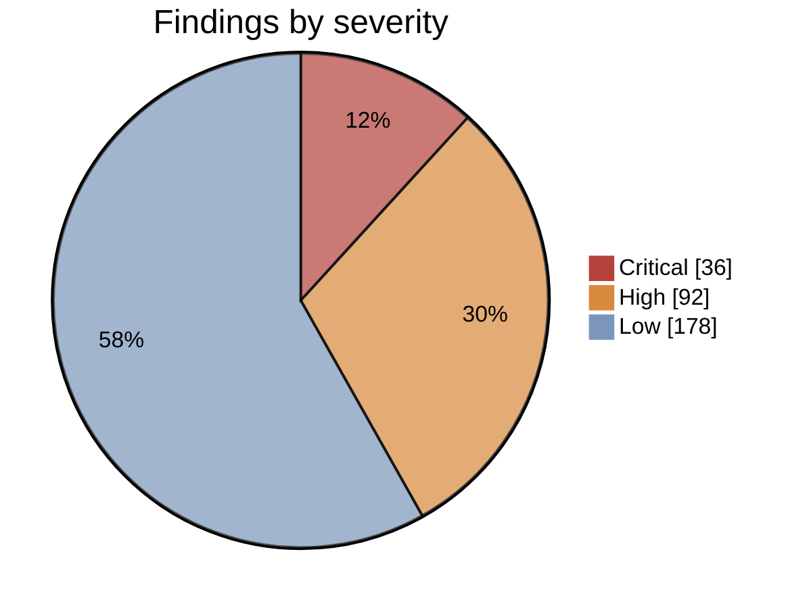
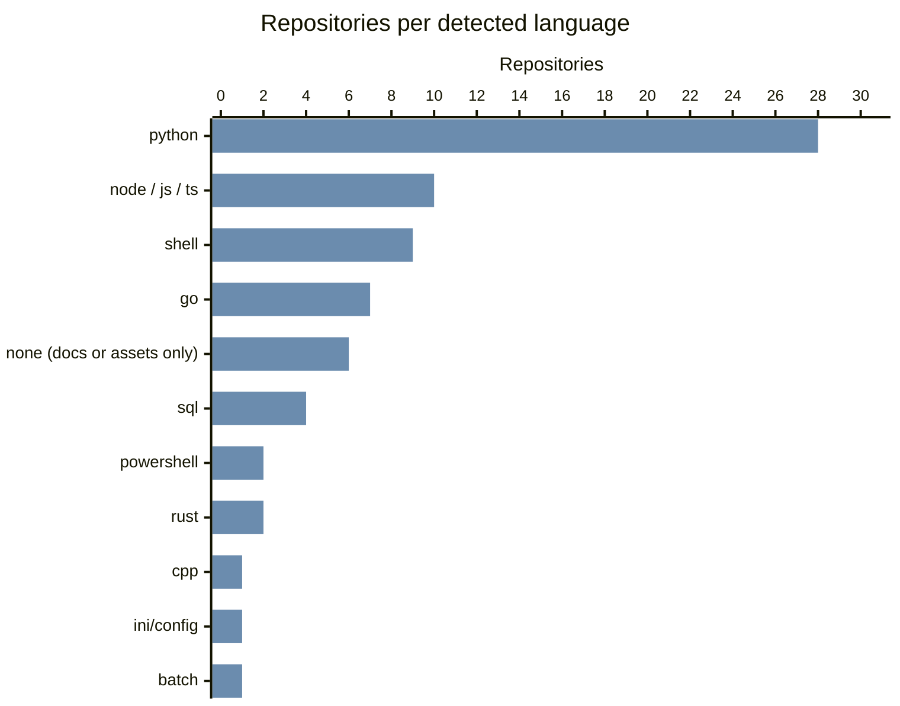
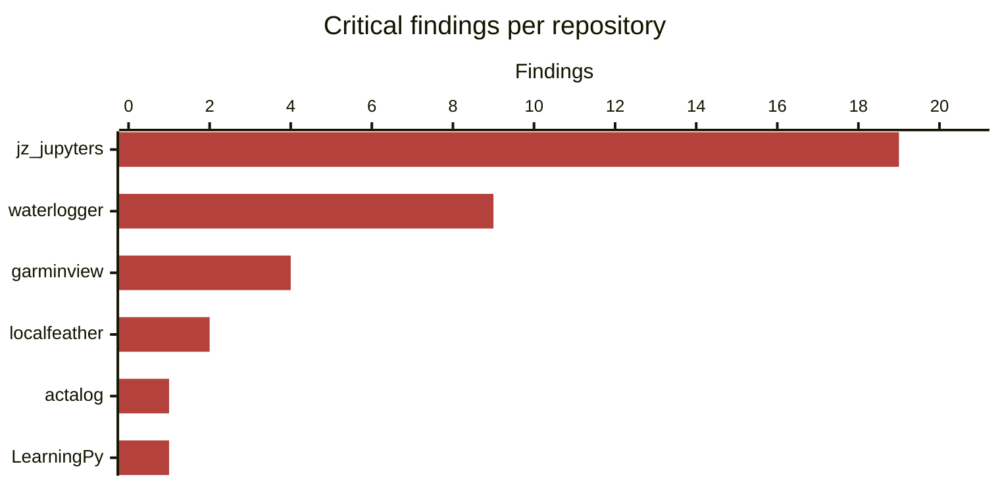
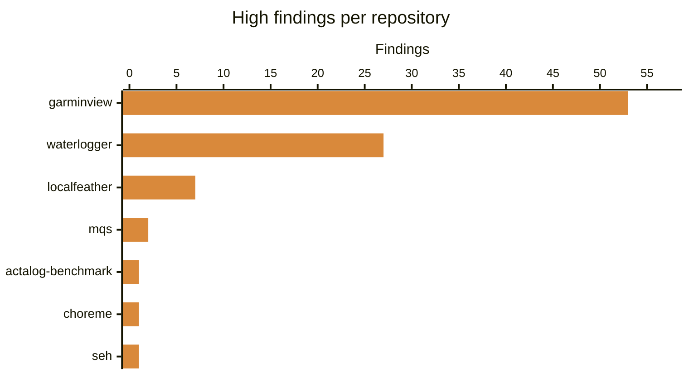

# Governance Scan Summary - johnzastrow public repositories

Generated: 2026-11-25 22:01 UTC  
Method: [governance-scan skill v1.0](https://github.com/MichaelHynesRoux/INFO-7375-Governance-Scan-Skill) (read-only inventory) applied to each public, non-fork repository of [johnzastrow](https://github.com/johnzastrow), excluding this results repository.  
Repositories scanned: **43**. Per-repo inventories: `<repo>.json`; questionnaire answers: `<repo>_Governance.md`.

> This is a technical inventory, not an approval verdict. Per the skill, judgment happens in the evaluation step that compares these facts against the business questionnaire. Full interface and data-access detection is defined only for Python and Node.js; other languages were scanned for dependencies, configuration, and secret patterns (see each JSON's `scan_metadata.notes`).

## 1. Overview

| Metric | Value |
|---|---|
| Repositories scanned | 43 |
| Total critical findings | 36 |
| Total high findings | 92 |
| Total low findings | 178 |
| Repos with at least one critical | 6 |
| Repos with at least one high | 7 |
| Repos with no severity-tagged findings | 19 |

### Findings by severity (all repos)

### Languages detected (repos per language)

A repository can contain several languages, so counts sum to more than the number of repositories.

### Critical findings per repository

Only repositories with at least one critical finding are shown.

### High findings per repository

Only repositories with at least one high finding are shown.

## 2. Matrices

### 2.1 Severity matrix

| Repository | Languages | Critical | High | Low | Total |
|---|---|--:|--:|--:|--:|
| [actalog](johnzastrow_Summary_Part1.md#actalog) | go, javascript, vue, shell, python | 1 | 0 | 29 | 30 |
| [actalog-benchmark](johnzastrow_Summary_Part1.md#actalog-benchmark) | go | 0 | 1 | 0 | 1 |
| [bittabby](johnzastrow_Summary_Part1.md#bittabby) | go, javascript | 0 | 0 | 7 | 7 |
| [choreme](johnzastrow_Summary_Part1.md#choreme) | go, typescript, vue, javascript, sql | 0 | 1 | 14 | 15 |
| [DocQGISProject](johnzastrow_Summary_Part1.md#docqgisproject) | python | 0 | 0 | 2 | 2 |
| [garminview](johnzastrow_Summary_Part1.md#garminview) | python, typescript, vue, shell | 4 | 53 | 16 | 73 |
| [gob](johnzastrow_Summary_Part1.md#gob) | - | 0 | 0 | 0 | 0 |
| [johnzastrow](johnzastrow_Summary_Part1.md#johnzastrow) | - | 0 | 0 | 0 | 0 |
| [jz_jupyters](johnzastrow_Summary_Part1.md#jz_jupyters) | python, jupyter | 19 | 0 | 1 | 20 |
| [LearningPy](johnzastrow_Summary_Part1.md#learningpy) | python | 1 | 0 | 3 | 4 |
| [lineup](johnzastrow_Summary_Part1.md#lineup) | python | 0 | 0 | 1 | 1 |
| [localfeather](johnzastrow_Summary_Part1.md#localfeather) | python, cpp, shell, sql | 2 | 7 | 20 | 29 |
| [mainegeo](johnzastrow_Summary_Part1.md#mainegeo) | - | 0 | 0 | 0 | 0 |
| [mapsplat](johnzastrow_Summary_Part1.md#mapsplat) | python | 0 | 0 | 1 | 1 |
| [mapsplat4](johnzastrow_Summary_Part1.md#mapsplat4) | python, node, shell, powershell | 0 | 0 | 1 | 1 |
| [marimo-qgis](johnzastrow_Summary_Part1.md#marimo-qgis) | python, shell | 0 | 0 | 0 | 0 |
| [metadatamgr](johnzastrow_Summary_Part1.md#metadatamgr) | python | 0 | 0 | 1 | 1 |
| [mqs](johnzastrow_Summary_Part1.md#mqs) | python, shell | 0 | 2 | 2 | 4 |
| [mqs4](johnzastrow_Summary_Part2.md#mqs4) | python | 0 | 0 | 2 | 2 |
| [ms](johnzastrow_Summary_Part2.md#ms) | python | 0 | 0 | 0 | 0 |
| [mydocmost](johnzastrow_Summary_Part2.md#mydocmost) | node | 0 | 0 | 24 | 24 |
| [myvinyl](johnzastrow_Summary_Part2.md#myvinyl) | python | 0 | 0 | 7 | 7 |
| [niva](johnzastrow_Summary_Part2.md#niva) | python, node | 0 | 0 | 1 | 1 |
| [orgphoto](johnzastrow_Summary_Part2.md#orgphoto) | python | 0 | 0 | 0 | 0 |
| [pgeo](johnzastrow_Summary_Part2.md#pgeo) | python, node | 0 | 0 | 9 | 9 |
| [photochomper](johnzastrow_Summary_Part2.md#photochomper) | python, shell | 0 | 0 | 0 | 0 |
| [postgis_linear_referencing](johnzastrow_Summary_Part2.md#postgis_linear_referencing) | sql | 0 | 0 | 0 | 0 |
| [pydataminer](johnzastrow_Summary_Part2.md#pydataminer) | python | 0 | 0 | 0 | 0 |
| [QGIS](johnzastrow_Summary_Part2.md#qgis) | batch, powershell, python, ini/config | 0 | 0 | 0 | 0 |
| [qgis-plugin-skill](johnzastrow_Summary_Part2.md#qgis-plugin-skill) | python, shell, yaml, markdown | 0 | 0 | 0 | 0 |
| [qgis-vscode-setup](johnzastrow_Summary_Part2.md#qgis-vscode-setup) | python | 0 | 0 | 0 | 0 |
| [QGISModes](johnzastrow_Summary_Part2.md#qgismodes) | python | 0 | 0 | 0 | 0 |
| [seh](johnzastrow_Summary_Part2.md#seh) | python | 0 | 1 | 1 | 2 |
| [starshipsuits](johnzastrow_Summary_Part2.md#starshipsuits) | - | 0 | 0 | 0 | 0 |
| [stratavis](johnzastrow_Summary_Part2.md#stratavis) | - | 0 | 0 | 0 | 0 |
| [surveyart](johnzastrow_Summary_Part2.md#surveyart) | python | 0 | 0 | 0 | 0 |
| [systers](johnzastrow_Summary_Part2.md#systers) | rust | 0 | 0 | 0 | 0 |
| [tictactoe](johnzastrow_Summary_Part3.md#tictactoe) | go, rust, python, javascript | 0 | 0 | 14 | 14 |
| [trilium-farmer](johnzastrow_Summary_Part3.md#trilium-farmer) | - | 0 | 0 | 0 | 0 |
| [utilities](johnzastrow_Summary_Part3.md#utilities) | shell | 0 | 0 | 0 | 0 |
| [vidstack](johnzastrow_Summary_Part3.md#vidstack) | python | 0 | 0 | 1 | 1 |
| [waterlogger](johnzastrow_Summary_Part3.md#waterlogger) | go | 9 | 27 | 16 | 52 |
| [waxgrove](johnzastrow_Summary_Part3.md#waxgrove) | go, typescript, sql | 0 | 0 | 5 | 5 |

### 2.2 Version control

| Repository | Git repo | Commits sampled | Remote | .gitignore | .gitignore gaps |
|---|---|--:|---|---|--:|
| actalog | yes | 20 | yes | yes | 3 |
| actalog-benchmark | yes | 20 | yes | yes | 1 |
| bittabby | yes | 20 | yes | yes | 0 |
| choreme | yes | 20 | yes | yes | 3 |
| DocQGISProject | yes | 20 | yes | yes | 2 |
| garminview | yes | 20 | yes | yes | 4 |
| gob | yes | 3 | yes | no | 1 |
| johnzastrow | yes | 11 | yes | no | 1 |
| jz_jupyters | yes | 20 | yes | yes | 3 |
| LearningPy | yes | 20 | yes | yes | 6 |
| lineup | yes | 20 | yes | yes | 4 |
| localfeather | yes | 20 | yes | yes | 1 |
| mainegeo | yes | 2 | yes | no | 1 |
| mapsplat | yes | 20 | yes | yes | 2 |
| mapsplat4 | yes | 20 | yes | yes | 0 |
| marimo-qgis | yes | 20 | yes | yes | 3 |
| metadatamgr | yes | 17 | yes | yes | 1 |
| mqs | yes | 20 | yes | yes | 2 |
| mqs4 | yes | 13 | yes | yes | 1 |
| ms | yes | 13 | yes | no | 1 |
| mydocmost | yes | 20 | yes | yes | 3 |
| myvinyl | yes | 20 | yes | yes | 1 |
| niva | yes | 20 | yes | yes | 1 |
| orgphoto | yes | 20 | yes | yes | 3 |
| pgeo | yes | 20 | yes | yes | 2 |
| photochomper | yes | 20 | yes | yes | 2 |
| postgis_linear_referencing | yes | 16 | yes | no | 2 |
| pydataminer | yes | 7 | yes | yes | 2 |
| QGIS | yes | 20 | yes | no | 1 |
| qgis-plugin-skill | yes | 13 | yes | yes | 2 |
| qgis-vscode-setup | yes | 1 | yes | yes | 1 |
| QGISModes | yes | 20 | yes | yes | 1 |
| seh | yes | 20 | yes | yes | 3 |
| starshipsuits | yes | 11 | yes | yes | 0 |
| stratavis | yes | 2 | yes | yes | 1 |
| surveyart | yes | 1 | yes | yes | 1 |
| systers | yes | 20 | yes | yes | 2 |
| tictactoe | yes | 19 | yes | yes | 1 |
| trilium-farmer | yes | 6 | yes | yes | 1 |
| utilities | yes | 10 | yes | yes | 1 |
| vidstack | yes | 8 | yes | yes | 4 |
| waterlogger | yes | 20 | yes | yes | 3 |
| waxgrove | yes | 20 | yes | yes | 0 |

### 2.3 Dependencies

| Repository | Ecosystems (manifests) | Declared deps | Dependency findings |
|---|---|--:|--:|
| actalog | python (0), node (4), go (1) | 65 | 6 |
| actalog-benchmark | go (2) | 8 | 2 |
| bittabby | go (2) | 14 | 3 |
| choreme | node (3), go (2) | 27 | 5 |
| DocQGISProject | python (3) | 0 | 2 |
| garminview | python (2), node (2) | 48 | 6 |
| gob | none | 0 | 0 |
| johnzastrow | none | 0 | 0 |
| jz_jupyters | python (0) | 0 | 2 |
| LearningPy | python (0) | 0 | 2 |
| lineup | python (2) | 4 | 2 |
| localfeather | python (1) | 14 | 3 |
| mainegeo | none | 0 | 0 |
| mapsplat | python (1) | 0 | 2 |
| mapsplat4 | python (3), node (0) | 0 | 4 |
| marimo-qgis | python (3) | 9 | 4 |
| metadatamgr | python (2) | 0 | 3 |
| mqs | python (5) | 0 | 3 |
| mqs4 | python (3) | 1 | 3 |
| ms | python (0) | 0 | 2 |
| mydocmost | node (5) | 249 | 5 |
| myvinyl | python (2) | 9 | 3 |
| niva | python (2), node (2) | 1 | 4 |
| orgphoto | python (2) | 5 | 2 |
| pgeo | python (6), node (2), github_actions (2) | 23 | 5 |
| photochomper | python (1) | 16 | 3 |
| postgis_linear_referencing | none | 0 | 0 |
| pydataminer | python (0) | 0 | 2 |
| QGIS | python (0), cpp (1) | 5 | 3 |
| qgis-plugin-skill | python (0) | 0 | 1 |
| qgis-vscode-setup | python (2) | 1 | 2 |
| QGISModes | python (1) | 2 | 3 |
| seh | python (2) | 8 | 4 |
| starshipsuits | github_actions (2) | 4 | 2 |
| stratavis | none | 0 | 0 |
| surveyart | python (0) | 0 | 2 |
| systers | rust (2) | 11 | 2 |
| tictactoe | python (0), node (0), go (2), rust (3) | 150 | 6 |
| trilium-farmer | none | 0 | 0 |
| utilities | shell (0) | 0 | 1 |
| vidstack | python (3) | 5 | 4 |
| waterlogger | go (2) | 9 | 3 |
| waxgrove | node (4), go (2) | 29 | 3 |

### 2.4 Secrets and credentials

| Repository | Committed secret files | Hardcoded secrets (C/H/L) | Proper handling sites | .env example |
|---|--:|---|--:|---|
| actalog | 3 | 1/0/2 | 4 | yes |
| actalog-benchmark | 0 | 0/0/0 | 2 | no |
| bittabby | 0 | 0/0/0 | 5 | yes |
| choreme | 0 | 0/1/8 | 3 | yes |
| DocQGISProject | 0 | 0/0/2 | 2 | no |
| garminview | 1 | 0/0/2 | 3 | yes |
| gob | 0 | 0/0/0 | 0 | no |
| johnzastrow | 0 | 0/0/0 | 0 | no |
| jz_jupyters | 0 | 19/0/1 | 0 | no |
| LearningPy | 0 | 1/0/3 | 0 | no |
| lineup | 0 | 0/0/0 | 0 | no |
| localfeather | 0 | 0/2/1 | 4 | yes |
| mainegeo | 0 | 0/0/0 | 0 | no |
| mapsplat | 0 | 0/0/0 | 0 | no |
| mapsplat4 | 0 | 0/0/0 | 3 | no |
| marimo-qgis | 0 | 0/0/0 | 2 | no |
| metadatamgr | 0 | 0/0/0 | 4 | no |
| mqs | 0 | 0/0/0 | 2 | no |
| mqs4 | 0 | 0/0/0 | 2 | no |
| ms | 0 | 0/0/0 | 0 | no |
| mydocmost | 0 | 0/0/3 | 5 | yes |
| myvinyl | 0 | 0/0/0 | 4 | yes |
| niva | 0 | 0/0/1 | 4 | no |
| orgphoto | 0 | 0/0/0 | 0 | no |
| pgeo | 0 | 0/0/0 | 5 | yes |
| photochomper | 0 | 0/0/0 | 0 | no |
| postgis_linear_referencing | 0 | 0/0/0 | 0 | no |
| pydataminer | 0 | 0/0/0 | 0 | no |
| QGIS | 0 | 0/0/0 | 1 | no |
| qgis-plugin-skill | 0 | 0/0/0 | 2 | no |
| qgis-vscode-setup | 0 | 0/0/0 | 1 | no |
| QGISModes | 0 | 0/0/0 | 0 | no |
| seh | 0 | 0/0/0 | 4 | yes |
| starshipsuits | 0 | 0/0/0 | 1 | no |
| stratavis | 0 | 0/0/0 | 0 | no |
| surveyart | 0 | 0/0/0 | 0 | no |
| systers | 0 | 0/0/0 | 1 | no |
| tictactoe | 0 | 0/0/0 | 5 | no |
| trilium-farmer | 0 | 0/0/0 | 1 | no |
| utilities | 0 | 0/0/0 | 0 | no |
| vidstack | 0 | 0/0/0 | 0 | no |
| waterlogger | 0 | 0/1/6 | 2 | no |
| waxgrove | 0 | 0/0/0 | 6 | no |

### 2.5 Interfaces and entry points

| Repository | Entry point types | Routes | Routes without detected auth | Network binding | CORS wide open |
|---|---|--:|--:|---|---|
| actalog | cli, scheduled, spa, web_api | 240 | 23 | 0.0.0.0 (default SERVER_HOST in configs/config.go; Docker pu | no |
| actalog-benchmark | cli | 0 | 0 | none (client only; makes outbound HTTP(S) requests to the us | no |
| bittabby | cli, scheduled_job, web_app | 70 | 7 | :8080 (all interfaces, BITT_ADDR default); compose.fluidgrid | no |
| choreme | cli, scheduled_job, web_api, web_ui | 49 | 6 | default HOST=localhost (config.go); Dockerfile sets HOST=0.0 | yes |
| DocQGISProject | cli, gui, processing_provider, qgis_plugin | 0 | 0 | none observed (no listening socket and no outbound HTTP code | no |
| garminview | cli, notebook, scheduled_job, web_api, web_ui | 69 | 69 | uvicorn --host 0.0.0.0 --port 8000 (backend/entrypoint.sh);  | no |
| gob | none | 0 | 0 | none | no |
| johnzastrow | none | 0 | 0 | none | no |
| jz_jupyters | cli, gui, notebook | 0 | 0 | none - no server or listener | no |
| LearningPy | cli, notebook | 0 | 0 | none | no |
| lineup | cli, gui | 0 | 0 | none | no |
| localfeather | cli, dev_server, device_firmware, service, web_api, web_ui | 25 | 11 | 0.0.0.0:5000 (server/run.py:43 and gunicorn --bind 0.0.0.0:5 | no |
| mainegeo | none | 0 | 0 | none | no |
| mapsplat | ci_workflow, qgis_plugin, web_static_server_generated | 1 | 1 | generated serve.py defaults to 127.0.0.1:8000; --host 0.0.0. | yes |
| mapsplat4 | cli, qgis_plugin | 1 | 1 | 127.0.0.1 by default for generated serve.py (0.0.0.0 only vi | yes |
| marimo-qgis | cli, notebook, qgis_plugin, web_api | 8 | 0 | 127.0.0.1 only (random port, bridge); marimo launched with i | no |
| metadatamgr | cli, qgis_plugin | 0 | 0 | none - desktop plugin, no listener | no |
| mqs | cli, gui, qgis_plugin, qgis_processing_scripts | 1 | 1 | 0.0.0.0 (http.server.HTTPServer(("", PORT)) in the generated | yes |
| mqs4 | cli, desktop_gui, qgis_plugin, qgis_processing_script | 0 | 0 | none | no |
| ms | background_agents, notebook | 0 | 0 | Not set in code. RUN_ON_VPS.md documents JupyterHub bind_url | no |
| mydocmost | cli, scheduled_job, web_api, web_frontend | 101 | 21 | 0.0.0.0 (HOST env default; main app PORT 3000, collab server | yes |
| myvinyl | cli, scheduled, web_app | 66 | 7 | 127.0.0.1 by default (src/myvinyl/__main__.py); container CM | no |
| niva | cli, language_server, qgis_plugin, vscode_extension | 0 | 0 | none observed (no listening socket in scanned code; LSP uses | no |
| orgphoto | cli | 0 | 0 | none | no |
| pgeo | cli, reverse_proxy, web_api, web_frontend | 8 | 0 | FastAPI Docker image runs uvicorn on 0.0.0.0:4500 inside the | no |
| photochomper | cli | 0 | 0 | none | no |
| postgis_linear_referencing | sql_script | 0 | 0 | none - no listener | no |
| pydataminer | arcgis_script_tool | 0 | 0 | none | no |
| QGIS | cli | 0 | 0 | none | no |
| qgis-plugin-skill | cli | 0 | 0 | none | no |
| qgis-vscode-setup | cli, qgis_console_script | 0 | 0 | none | no |
| QGISModes | dev_script, qgis_plugin | 0 | 0 | none | no |
| seh | cli, scheduled_job, script | 0 | 0 | none (no network listener) | no |
| starshipsuits | static_site | 0 | 0 | none (static files; served by Netlify or GitHub Pages) | no |
| stratavis | none | 0 | 0 | none | no |
| surveyart | cli | 0 | 0 | none - no listener | no |
| systers | cli | 0 | 0 | none - no listener | no |
| tictactoe | cli, web_api, web_client_wasm | 20 | 14 | 127.0.0.1 by default for the tic-tac-toe servers (go/cmd/ttt | no |
| trilium-farmer | none | 0 | 0 | not applicable (stdio transport per README; no code present) | no |
| utilities | cli | 0 | 0 | none (no listeners; port-check.sh and network-info.sh only i | no |
| vidstack | cli, script | 0 | 0 | none (no network listener) | no |
| waterlogger | service, web_app | 45 | 4 | Default config host 'localhost' port 2342; configurable to 0 | yes |
| waxgrove | background_jobs, cli, web_api, web_client | 51 | 5 | 127.0.0.1:8080 by default (internal/config/config.go); Docke | no |

### 2.6 Data access

| Repository | Databases | SQL injection risk | External APIs | File system access | Office/collab sources | Sensitive-data indicators |
|---|---|---|--:|--:|--:|--:|
| actalog | sqlite / postgresql / mysql-mariadb (selected by DB_DRIVER) | low | 3 | 5 | 3 | 6 |
| actalog-benchmark | none | none | 2 | 3 | 0 | 2 |
| bittabby | mariadb/mysql (optional, BITT_DB_DRIVER/BITT_DB_DSN), sqlite (default, modernc.org/sqlite, /data/bitt.db) | none | 2 | 2 | 2 | 5 |
| choreme | sqlite / postgresql / mysql (selected by DB_TYPE) | none | 1 | 1 | 0 | 2 |
| DocQGISProject | none | none | 0 | 3 | 0 | 2 |
| garminview | mariadb (mysql+pymysql) or sqlite, selected by GARMINVIEW_DB_BACKEND, sqlite (GarminDB files garmin.db, garmin_activities.db, garmin_monitoring.db etc.) | low | 4 | 3 | 2 | 4 |
| gob | none | none | 0 | 0 | 0 | 0 |
| johnzastrow | none | none | 0 | 0 | 0 | 0 |
| jz_jupyters | mysql, sqlite | none | 1 | 5 | 4 | 2 |
| LearningPy | sqlite | none | 4 | 3 | 2 | 4 |
| lineup | sqlite | low | 0 | 4 | 1 | 1 |
| localfeather | mariadb/mysql (pymysql via SQLAlchemy), sqlite (development fallback) | none | 0 | 2 | 0 | 3 |
| mainegeo | none | none | 0 | 0 | 0 | 0 |
| mapsplat | none | none | 1 | 4 | 0 | 0 |
| mapsplat4 | sqlite (MBTiles read) | none | 5 | 4 | 0 | 2 |
| marimo-qgis | sqlite (in-memory version probe) | none | 3 | 4 | 0 | 1 |
| metadatamgr | sqlite/geopackage | low | 0 | 5 | 0 | 3 |
| mqs | postgresql (QGIS project store), sqlite (GeoPackage inventory), sqlite (GeoPackage/SpatiaLite layer rename), sqlite (metadata manager database) | low | 2 | 4 | 0 | 4 |
| mqs4 | postgresql, sqlite (GeoPackage inventory), sqlite (GeoPackage/SpatiaLite rename), sqlite (metadata cache database) | low | 2 | 6 | 0 | 4 |
| ms | none | none | 3 | 3 | 1 | 0 |
| mydocmost | postgresql, redis | none | 7 | 2 | 2 | 4 |
| myvinyl | sqlite | none | 2 | 2 | 1 | 4 |
| niva | PostgreSQL/PostGIS and other databases via named QGIS connections (`sql @conn`, `load @conn.table`, `save @conn.table`), sqlite (GeoPackage) via stdlib sqlite3 | none | 5 | 3 | 2 | 3 |
| orgphoto | sqlite | none | 0 | 2 | 0 | 1 |
| pgeo | duckdb / sqlite (read-only Who's On First) for data preparation, postgresql (PostGIS) loader/owner role, postgresql (PostGIS) via asyncpg and PostgREST | low | 8 | 4 | 2 | 2 |
| photochomper | sqlite | none | 0 | 4 | 1 | 2 |
| postgis_linear_referencing | postgresql (PostGIS) | none | 0 | 1 | 0 | 0 |
| pydataminer | none | none | 0 | 3 | 1 | 2 |
| QGIS | sqlite (GeoPackage) | none | 4 | 4 | 0 | 1 |
| qgis-plugin-skill | none | none | 0 | 2 | 0 | 0 |
| qgis-vscode-setup | none | none | 0 | 4 | 0 | 0 |
| QGISModes | none | none | 0 | 4 | 0 | 0 |
| seh | sqlite (default), postgresql, mariadb via SQLAlchemy | low | 2 | 3 | 3 | 3 |
| starshipsuits | none | none | 0 | 0 | 0 | 0 |
| stratavis | none | none | 0 | 0 | 0 | 0 |
| surveyart | none | none | 0 | 4 | 0 | 0 |
| systers | sqlite | none | 0 | 4 | 0 | 2 |
| tictactoe | sqlite | none | 0 | 4 | 0 | 3 |
| trilium-farmer | none | none | 1 | 0 | 0 | 0 |
| utilities | none | none | 0 | 6 | 0 | 2 |
| vidstack | sqlite (GeoNames GeoPackage geonames.gpkg) | none | 0 | 5 | 0 | 2 |
| waterlogger | sqlite (default) or mariadb via gorm | none | 0 | 4 | 2 | 3 |
| waxgrove | sqlite | none | 3 | 1 | 0 | 3 |

### 2.7 Data leaving the organization

| Repository | Data sources touched | Sources where data leaves the organization |
|---|--:|---|
| actalog | 5 | SMTP server (SMTP_HOST) used to send verification, reset and announcement emails; youtube.com video links stored with WOD/movement entries |
| actalog-benchmark | 2 | ActaLog instance API (user-supplied URL) |
| bittabby | 4 | SMTP server (configurable); ntfy server (configurable, ntfy.sh style) |
| choreme | 2 | SMTP server (configured, not yet clearly used by code) |
| DocQGISProject | 2 | none |
| garminview | 5 | Actalog server (user-configured URL); Ollama / OpenAI-compatible LLM endpoint (workout note text) |
| gob | 0 | none |
| johnzastrow | 0 | none |
| jz_jupyters | 5 | none |
| LearningPy | 4 | none |
| lineup | 3 | none |
| localfeather | 2 | none |
| mainegeo | 0 | none |
| mapsplat | 3 | none |
| mapsplat4 | 4 | none |
| marimo-qgis | 4 | none |
| metadatamgr | 2 | none |
| mqs | 4 | plugins.qgis.org XML-RPC |
| mqs4 | 4 | plugins.qgis.org (plugin upload) |
| ms | 4 | none |
| mydocmost | 7 | SMTP / Postmark mail service; tel.docmost.com telemetry; Configured AI provider (OpenAI/Gemini/Ollama/compatible) |
| myvinyl | 3 | Discogs API (api.discogs.com, i.discogs.com) |
| niva | 5 | ntfy.sh (or configured ntfy server); SMTP server (user-configured, Gmail default for Gmail senders) |
| orgphoto | 2 | none |
| pgeo | 3 | none |
| photochomper | 3 | none |
| postgis_linear_referencing | 2 | none |
| pydataminer | 2 | none |
| QGIS | 2 | QGIS plugin repository (plugins.qgis.org), QGIS news feed (feed.qgis.org), OpenStreetMap tiles, Mapzen terrain tiles on s3.amazonaws.com (configured in QGIS profile ini) |
| qgis-plugin-skill | 2 | GitHub Releases (via github.token in CI) |
| qgis-vscode-setup | 2 | none |
| QGISModes | 2 | none |
| seh | 4 | SMTP server (default smtp.gmail.com) |
| starshipsuits | 0 | none |
| stratavis | 0 | none |
| surveyart | 2 | none |
| systers | 3 | none |
| tictactoe | 2 | none |
| trilium-farmer | 1 | none |
| utilities | 3 | none |
| vidstack | 3 | none |
| waterlogger | 2 | none |
| waxgrove | 3 | Spotify Web API (api.spotify.com, accounts.spotify.com); MusicBrainz API (musicbrainz.org) |

### 2.8 Configuration and deployment

| Repository | Containerized | Deploy config files | Env vars referenced | README | README covers deployment |
|---|---|--:|--:|---|---|
| actalog | yes | 11 | 52 | yes | yes |
| actalog-benchmark | no | 2 | 0 | yes | yes |
| bittabby | yes | 6 | 25 | yes | yes |
| choreme | yes | 7 | 19 | yes | yes |
| DocQGISProject | no | 4 | 2 | yes | yes |
| garminview | yes | 8 | 14 | yes | yes |
| gob | no | 0 | 0 | no | no |
| johnzastrow | no | 0 | 0 | yes | no |
| jz_jupyters | no | 0 | 0 | yes | no |
| LearningPy | no | 0 | 0 | yes | no |
| lineup | no | 0 | 0 | yes | no |
| localfeather | no | 4 | 1 | yes | yes |
| mainegeo | no | 0 | 0 | yes | no |
| mapsplat | no | 4 | 0 | yes | yes |
| mapsplat4 | no | 8 | 2 | yes | yes |
| marimo-qgis | no | 4 | 8 | yes | yes |
| metadatamgr | no | 8 | 2 | yes | yes |
| mqs | no | 5 | 2 | yes | yes |
| mqs4 | no | 2 | 2 | yes | yes |
| ms | no | 0 | 0 | yes | yes |
| mydocmost | yes | 6 | 59 | yes | yes |
| myvinyl | yes | 6 | 13 | yes | yes |
| niva | no | 4 | 32 | yes | yes |
| orgphoto | no | 3 | 0 | yes | yes |
| pgeo | yes | 11 | 20 | yes | yes |
| photochomper | no | 1 | 0 | yes | yes |
| postgis_linear_referencing | no | 0 | 0 | yes | no |
| pydataminer | no | 0 | 0 | yes | no |
| QGIS | no | 4 | 1 | yes | yes |
| qgis-plugin-skill | no | 4 | 1 | yes | yes |
| qgis-vscode-setup | no | 0 | 1 | no | no |
| QGISModes | no | 0 | 0 | yes | yes |
| seh | no | 2 | 4 | yes | yes |
| starshipsuits | no | 3 | 0 | yes | yes |
| stratavis | no | 0 | 0 | yes | no |
| surveyart | no | 0 | 0 | yes | yes |
| systers | no | 1 | 4 | yes | yes |
| tictactoe | no | 2 | 30 | yes | yes |
| trilium-farmer | no | 0 | 4 | yes | yes |
| utilities | no | 0 | 0 | yes | yes |
| vidstack | no | 1 | 0 | yes | no |
| waterlogger | yes | 9 | 1 | yes | yes |
| waxgrove | yes | 5 | 14 | yes | yes |

### 2.9 Network endpoints (all repositories)

Every external API host and network mail/collaboration source recorded in the inventories. "Leaves host network" is no for loopback or private-LAN addresses, yes otherwise; configurable endpoints count as yes because they can point off-host.

| Repository | Endpoint | Kind | Access | Leaves host network | Source file |
|---|---|---|---|---|---|
| actalog | SMTP server configured via SMTP_HOST (net/smtp, email verification, password reset, announcements) | external API | write | yes | pkg/email/email.go |
| actalog | youtube.com (video links/embeds entered on WOD and movement forms) | external API | read | yes | web/src/views/WODCreateView.vue |
| actalog | OTEL_EXPORTER_OTLP_ENDPOINT (referenced only in docker/docker-compose.yml) | external API | write | yes | docker/docker-compose.yml |
| actalog | outbound SMTP via SMTP_HOST (no mailbox read) | email_mailbox | write | yes | pkg/email/email.go |
| actalog-benchmark | user-supplied ActaLog instance (--url); committed report shows https://al.fluidgrid.site | external API | read_write | yes | internal/client/client.go |
| actalog-benchmark | same target: POST /api/auth/login, GET /api/version, /api/workouts, /api/movements, /api/wods, /api/pr-movements, /api/notifications/count; POST /api/benchmark (server-side benchmark, up to 500000 records) | external API | read_write | yes | internal/metrics/endpoints.go |
| bittabby | configurable SMTP server (BITT_SMTP_HOST) | external API | write | yes | internal/notify/notify.go |
| bittabby | ntfy server (BITT_NTFY_URL, ntfy.sh default examples) | external API | write | yes | internal/notify/notify.go |
| bittabby | SMTP host from config (net/smtp); outbound reminders only | email_mailbox | write | yes | internal/notify/notify.go |
| choreme | SMTP server from SMTP_HOST (example smtp.gmail.com in .env.example) | external API | write | yes | internal/config/config.go |
| garminview | Garmin Connect (via garmindb_cli / garminconnect library; credentials from mounted ~/.GarminDb config) | external API | read | yes | backend/garminview/api/routes/sync.py |
| garminview | Actalog server (URL and credentials stored in app_config; user-configured) | external API | read_write | yes | backend/garminview/ingestion/actalog_client.py |
| garminview | Actalog server write-back (POST of matched Garmin data) | external API | write | yes | backend/garminview/ingestion/actalog_writeback.py |
| garminview | Ollama or OpenAI-compatible LLM server (default http://localhost:11434, configurable URL; receives workout note text) | external API | write | yes | backend/garminview/ingestion/notes_parser.py |
| jz_jupyters | api.github.com | external API | read | yes | matpltlib/timeline.py |
| LearningPy | se.mantishub.io | external API | read | yes | mantis_bak.py |
| LearningPy | www.bloomberg.com | external API | read | yes | beautiful_soup/beautiful.py |
| LearningPy | 207.246.85.12 | external API | read | yes | beautiful_soup/beautiful2db.py |
| LearningPy | www.facebook.com / www.google.com / www.yahoo.com / login.live.com (Selenium tutorial examples) | external API | unclear | yes | base_selen.py |
| mapsplat | unpkg.com (maplibre-gl@4.7.1, pmtiles@3.2.0) | external API | read | yes | exporter.py |
| mapsplat4 | unpkg.com (MapLibre GL JS and PMTiles JS bundles, downloaded for offline mode and referenced by exported viewer) | external API | read | yes | exporter.py |
| mapsplat4 | build.protomaps.com / maps.protomaps.com / protomaps.github.io (basemap PMTiles and styles) | external API | read | yes | basemap_helpers.py |
| mapsplat4 | tile.openstreetmap.org, basemaps.cartocdn.com, server.arcgisonline.com, a.tile.opentopomap.org (XYZ basemap tiles) | external API | read | yes | mapsplat_dockwidget.py |
| mapsplat4 | user-supplied basemap/style URLs (HEAD/ranged GET probe, https/http only) | external API | read | yes | mapsplat_dockwidget.py |
| mapsplat4 | raw.githubusercontent.com (Protomaps license text) | external API | read | yes | scripts/gen_basemap_styles.mjs |
| marimo-qgis | github.com (downloads repository zip of example/notebooks folders) | external API | read | yes | plugin/environment.py |
| marimo-qgis | PyPI via pip (installs marimo and user-requested packages) | external API | read | yes | plugin/ui/process.py |
| marimo-qgis | astral.sh (uv install hint text only) | external API | unclear | yes | processing/launch_marimo.py |
| mqs | plugins.qgis.org (XML-RPC plugin upload) | external API | write | yes | Plugins/metadata_manager/plugin_upload.py |
| mqs | unpkg.com (MapLibre/pmtiles JS loaded by generated map HTML) and build.protomaps.com / protomaps.github.io (basemap tiles/fonts) | external API | read | yes | Plugins/mapsplat/exporter.py |
| mqs4 | plugins.qgis.org (XML-RPC upload of plugin zip with username/password) | external API | write | yes | Plugins/metadata_manager/plugin_upload.py |
| mqs4 | user-specified PostgreSQL host | external API | read_write | yes | Scripts/qgis_project_manager.py |
| ms | archive.apache.org | external API | read | yes | image_classification/image_class.ipynb |
| ms | CIFAR-10 download via keras.datasets.cifar10.load_data (upstream dataset host, not named in code) | external API | read | yes | image_classification/stage2_image_class.ipynb |
| ms | localhost:9092 (Apache Kafka broker, local) | external API | read_write | no | image_classification/stage2_image_class.ipynb |
| mydocmost | tel.docmost.com | external API | write | yes | apps/server/src/integrations/telemetry/telemetry.service.ts |
| mydocmost | api.github.com | external API | read | yes | apps/server/src/integrations/security/version.service.ts |
| mydocmost | configurable OpenAI / OpenAI-compatible / Gemini / Ollama endpoint (AI_DRIVER, OPENAI_API_URL) | external API | write | yes | apps/server/src/integrations/environment/environment.validation.ts |
| mydocmost | configurable S3 endpoint (AWS_S3_ENDPOINT) | external API | read_write | yes | apps/server/package.json |
| mydocmost | SMTP/Postmark (MAIL_DRIVER) | external API | write | yes | apps/server/src/integrations/mail/drivers/smtp.driver.ts |
| mydocmost | login.microsoftonline.com / accounts.google.com (SSO references) | external API | unclear | yes | apps/client/src |
| mydocmost | embed.diagrams.net (draw.io embed, DRAWIO_URL) | external API | read | yes | apps/client/src/features/editor |
| mydocmost | SMTP_HOST (configurable) via nodemailer; outbound only | email_mailbox | write | yes | apps/server/src/integrations/mail/drivers/smtp.driver.ts |
| myvinyl | api.discogs.com | external API | read | yes | src/myvinyl/discogs.py |
| myvinyl | i.discogs.com | external API | read | yes | src/myvinyl/discogs.py |
| niva | ntfy.sh (default; NIVA_NTFY_SERVER overridable) | external API | write | yes | niva/utilities.py |
| niva | user-configured SMTP host (smtp.gmail.com default for gmail senders) | external API | write | yes | niva/utilities.py |
| niva | user-supplied WFS/WMS/ArcGIS REST/XYZ URLs (read only, http/https only) | external API | read | yes | niva/remote.py |
| niva | github.com (marimo on-ramp release zip download) | external API | read | yes | niva/setup/marimo.py |
| niva | micro.mamba.pm (install hint text only) | external API | read | yes | niva/pdal_doctor.py |
| niva | SMTP host from NIVA_SMTP_HOST (send only, optional attachment) | email_mailbox | write | yes | niva/utilities.py |
| pgeo | www2.census.gov | external API | read | yes | scripts/fetch_data.sh |
| pgeo | download.geofabrik.de | external API | read | yes | scripts/fetch_data.sh |
| pgeo | data.whosonfirst.org | external API | read | yes | scripts/fetch_data.sh |
| pgeo | batch.openaddresses.io | external API | read | yes | scripts/fetch_data.sh |
| pgeo | stac.overturemaps.org | external API | read | yes | pgeo/src/pgeo/load/sources.py |
| pgeo | prd-tnm.s3.amazonaws.com | external API | read | yes | scripts/fetch_data.sh |
| pgeo | build.protomaps.com | external API | read | yes | scripts/fetch_data.sh |
| pgeo | raw.githubusercontent.com | external API | read | yes | scripts/vendor_web.sh |
| QGIS | plugins.qgis.org | external API | read | yes | Profiles/profiles/default/QGIS/QGIS3.ini |
| QGIS | feed.qgis.org | external API | read | yes | Profiles/profiles/default/QGIS/QGIS3.ini |
| QGIS | tile.openstreetmap.org | external API | read | yes | Profiles/profiles/default/QGIS/QGIS3.ini |
| QGIS | s3.amazonaws.com (Mapzen terrain tiles) | external API | read | yes | Profiles/profiles/default/QGIS/QGIS3.ini |
| seh | monitoringapi.solaredge.com | external API | read | yes | src/seh/api/client.py |
| seh | smtp.gmail.com (default SEH_SMTP_HOST; configurable) | external API | write | yes | src/seh/config/logging.py |
| seh | SMTP server from SEH_SMTP_HOST (default smtp.gmail.com), sends sync success/failure notifications | email_mailbox | write | yes | src/seh/config/logging.py |
| trilium-farmer | Trilium Notes ETAPI (URL from TRILIUM_URL; README example http://192.168.1.102:8080) | external API | read_write | no | README.md |
| waxgrove | api.spotify.com | external API | read_write | yes | internal/spotify/client.go |
| waxgrove | accounts.spotify.com | external API | write | yes | internal/spotify/auth.go |
| waxgrove | musicbrainz.org | external API | read | yes | internal/musicbrainz/client.go |

## 3. Repository sections

The per-repository sections, each with its data flow diagrams, are split across 3 part files so that every diagram renders on GitHub (it stops rendering Mermaid after about 30 diagrams per page) and each part prints as a manageable document.

| Part | Repositories |
|---|---|
| [Part 1](johnzastrow_Summary_Part1.md) | [actalog](johnzastrow_Summary_Part1.md#actalog), [actalog-benchmark](johnzastrow_Summary_Part1.md#actalog-benchmark), [bittabby](johnzastrow_Summary_Part1.md#bittabby), [choreme](johnzastrow_Summary_Part1.md#choreme), [DocQGISProject](johnzastrow_Summary_Part1.md#docqgisproject), [garminview](johnzastrow_Summary_Part1.md#garminview), [gob](johnzastrow_Summary_Part1.md#gob), [johnzastrow](johnzastrow_Summary_Part1.md#johnzastrow), [jz_jupyters](johnzastrow_Summary_Part1.md#jz_jupyters), [LearningPy](johnzastrow_Summary_Part1.md#learningpy), [lineup](johnzastrow_Summary_Part1.md#lineup), [localfeather](johnzastrow_Summary_Part1.md#localfeather), [mainegeo](johnzastrow_Summary_Part1.md#mainegeo), [mapsplat](johnzastrow_Summary_Part1.md#mapsplat), [mapsplat4](johnzastrow_Summary_Part1.md#mapsplat4), [marimo-qgis](johnzastrow_Summary_Part1.md#marimo-qgis), [metadatamgr](johnzastrow_Summary_Part1.md#metadatamgr), [mqs](johnzastrow_Summary_Part1.md#mqs) |
| [Part 2](johnzastrow_Summary_Part2.md) | [mqs4](johnzastrow_Summary_Part2.md#mqs4), [ms](johnzastrow_Summary_Part2.md#ms), [mydocmost](johnzastrow_Summary_Part2.md#mydocmost), [myvinyl](johnzastrow_Summary_Part2.md#myvinyl), [niva](johnzastrow_Summary_Part2.md#niva), [orgphoto](johnzastrow_Summary_Part2.md#orgphoto), [pgeo](johnzastrow_Summary_Part2.md#pgeo), [photochomper](johnzastrow_Summary_Part2.md#photochomper), [postgis_linear_referencing](johnzastrow_Summary_Part2.md#postgis_linear_referencing), [pydataminer](johnzastrow_Summary_Part2.md#pydataminer), [QGIS](johnzastrow_Summary_Part2.md#qgis), [qgis-plugin-skill](johnzastrow_Summary_Part2.md#qgis-plugin-skill), [qgis-vscode-setup](johnzastrow_Summary_Part2.md#qgis-vscode-setup), [QGISModes](johnzastrow_Summary_Part2.md#qgismodes), [seh](johnzastrow_Summary_Part2.md#seh), [starshipsuits](johnzastrow_Summary_Part2.md#starshipsuits), [stratavis](johnzastrow_Summary_Part2.md#stratavis), [surveyart](johnzastrow_Summary_Part2.md#surveyart), [systers](johnzastrow_Summary_Part2.md#systers) |
| [Part 3](johnzastrow_Summary_Part3.md) | [tictactoe](johnzastrow_Summary_Part3.md#tictactoe), [trilium-farmer](johnzastrow_Summary_Part3.md#trilium-farmer), [utilities](johnzastrow_Summary_Part3.md#utilities), [vidstack](johnzastrow_Summary_Part3.md#vidstack), [waterlogger](johnzastrow_Summary_Part3.md#waterlogger), [waxgrove](johnzastrow_Summary_Part3.md#waxgrove) |

