# Governance Scan Summary - Part 1 of 3: repository sections

Back to the [summary overview and matrices](johnzastrow_Summary.md). Part 1 | [Part 2](johnzastrow_Summary_Part2.md) | [Part 3](johnzastrow_Summary_Part3.md)

Repositories in this part: [actalog](#actalog), [actalog-benchmark](#actalog-benchmark), [bittabby](#bittabby), [choreme](#choreme), [DocQGISProject](#docqgisproject), [garminview](#garminview), [gob](#gob), [johnzastrow](#johnzastrow), [jz_jupyters](#jz_jupyters), [LearningPy](#learningpy), [lineup](#lineup), [localfeather](#localfeather), [mainegeo](#mainegeo), [mapsplat](#mapsplat), [mapsplat4](#mapsplat4), [marimo-qgis](#marimo-qgis), [metadatamgr](#metadatamgr), [mqs](#mqs)

Each section has small data flow diagrams built only from that repository's JSON. Arrows follow the recorded `access_type`: an arrow into the app means read, out of the app means write, a double-headed arrow means read/write, and a dashed line means unclear. Local data and network endpoints are drawn as separate small diagrams (split further when long) so each prints at a readable size on letter paper. Endpoints that leave the host network are labelled EXTERNAL and shaded red; loopback or private-LAN endpoints are labelled LAN. Labels are shortened; the full endpoint text is in the table under the diagrams. Local file access is shown as one node; databases and network endpoints are itemized.

### actalog

Link: https://github.com/johnzastrow/actalog | Languages: go, javascript, vue, shell, python | Findings: critical 1, high 0, low 29 | Inventory: [actalog.json](actalog.json) | Questionnaire: [actalog_Governance.md](actalog_Governance.md)

**What this application can do**

- Lets registered users log CrossFit workouts, track personal records, view progress charts, performance history, calendars and leaderboards, and import/export their data as CSV or JSON (authenticated; subscription required for write operations).
- Lets anyone without a login register (when enabled), log in, reset a password, and browse the public catalog of standard movements, WODs and workout templates.
- Lets admins manage users (create, disable, change role, force or set passwords, unlock), organizations, subscriptions, class scheduling, packages and documents, audit and email logs, data quality merges, announcements, and create/download/restore full database backups.
- Lets coaches or admins view session rosters and check in or mark no-shows for class sessions.
- Serves uploaded avatar files publicly at /uploads/* and public Swagger API documentation at /api/docs/*.

**Who can reach it:** Binds to 0.0.0.0:8080 by default and is designed to be reachable by any user who can reach the host (optionally behind a Caddy reverse proxy). Most routes require a JWT; the public routes are login/registration/password reset, version, Swagger docs, the standard movement/WOD/template catalog, /health and /uploads/*.

**Data flow**

*Local data*

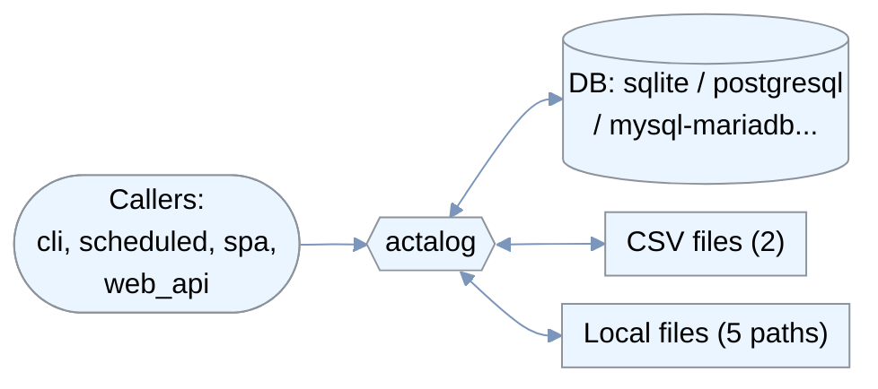

*Network endpoints*

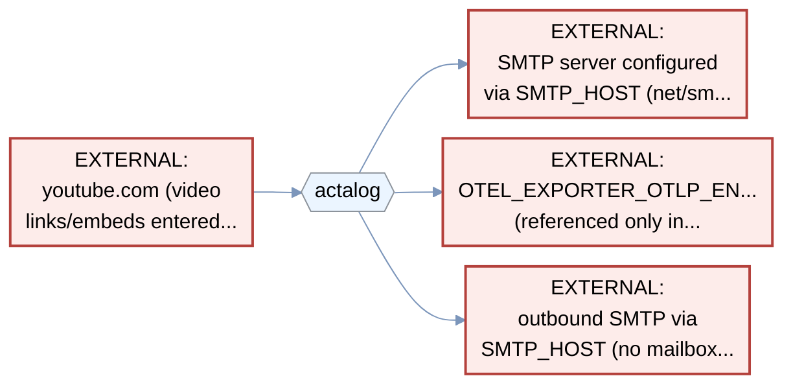

**Network endpoints**

| Endpoint | Kind | Access | Leaves host network | Source file |
|---|---|---|---|---|
| SMTP server configured via SMTP_HOST (net/smtp, email verification, password reset, announcements) | external API | write | yes | pkg/email/email.go |
| youtube.com (video links/embeds entered on WOD and movement forms) | external API | read | yes | web/src/views/WODCreateView.vue |
| OTEL_EXPORTER_OTLP_ENDPOINT (referenced only in docker/docker-compose.yml) | external API | write | yes | docker/docker-compose.yml |
| outbound SMTP via SMTP_HOST (no mailbox read) | email_mailbox | write | yes | pkg/email/email.go |

**Data sources touched**

| Source | Access | Leaves organization |
|---|---|---|
| Application database (SQLite by default; PostgreSQL or MariaDB/MySQL selectable) holding users, workouts, WODs, movements, subscriptions, audit logs | read_write | no |
| Uploaded avatars and backup zips on local volumes (uploads, backups) | read_write | no |
| SMTP server (SMTP_HOST) used to send verification, reset and announcement emails | write | yes |
| User-uploaded CSV imports (including a Wodify performance export) and CSV/JSON exports | read_write | no |
| youtube.com video links stored with WOD/movement entries | read | yes |

**Top findings**

- Critical: password-shaped string committed in docker/trouble/docker-compose.yml:22 (MARIADB_ROOT_PASSWORD error-message default), tracked and not gitignored
- Low: tracked docker/.env.postgres, docker/.env.mariadb (placeholders) and web/certs/localhost-key.pem (dev key)
- 217 of 236 /api routes sit behind JWT middleware (120 admin-only); 19 public API routes plus /health, /uploads/*, / are recorded as low
- JWT_SECRET may be empty unless APP_ENV=production; default bind 0.0.0.0; registration enabled by default

**Unauthorized-action red flags**

- docker/trouble/docker-compose.yml contains a password-shaped string tied to MARIADB_ROOT_PASSWORD in a tracked file.
- Swagger UI (/api/docs/*) and the standard catalog are served without authentication.
- JWT secret may be empty in non-production APP_ENV (default), which would make tokens forgeable if left unset.
- Admin backup download/restore and user password-set endpoints exist (admin-only); a compromised admin account exposes the full database.
- Tracked data exports contain personal data (author email and workout notes; a gym customer name).

### actalog-benchmark

Link: https://github.com/johnzastrow/actalog-benchmark | Languages: go | Findings: critical 0, high 1, low 0 | Inventory: [actalog-benchmark.json](actalog-benchmark.json) | Questionnaire: [actalog-benchmark_Governance.md](actalog-benchmark_Governance.md)

**What this application can do**

- Measures connectivity (DNS, TCP, TLS), health, API endpoint latency, frontend assets and concurrent load against a user-specified ActaLog server.
- Logs in to the target with a supplied email and password and calls authenticated API endpoints with the returned JWT.
- Can trigger the server's /api/benchmark endpoint, which generates up to 500000 records server-side.
- Writes JSON and Markdown reports and compares earlier result files.

**Who can reach it:** Local command-line tool run by the user; no listener. It reaches whatever host the user points it at, including production instances.

**Data flow**

*Local data*

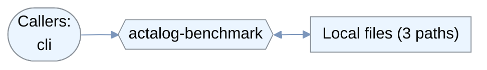

*Network endpoints*

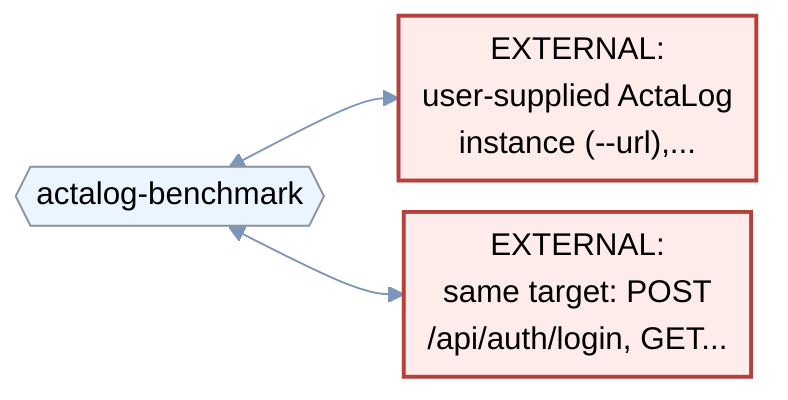

**Network endpoints**

| Endpoint | Kind | Access | Leaves host network | Source file |
|---|---|---|---|---|
| user-supplied ActaLog instance (--url); committed report shows https://al.fluidgrid.site | external API | read_write | yes | internal/client/client.go |
| same target: POST /api/auth/login, GET /api/version, /api/workouts, /api/movements, /api/wods, /api/pr-movements, /api/notifications/count; POST /api/benchmark (server-side benchmark, up to 500000 records) | external API | read_write | yes | internal/metrics/endpoints.go |

**Data sources touched**

| Source | Access | Leaves organization |
|---|---|---|
| ActaLog instance API (user-supplied URL) | read_write (login POST, GETs, server-side benchmark POST) | yes |
| Local JSON/Markdown report files | read_write | no |

**Top findings**

- Password supplied through --pass CLI flag (cmd/actalog-bench/main.go)
- Committed report discloses a personal email address and production URL
- No hardcoded secrets or secret files found

**Unauthorized-action red flags**

- Password accepted as a --pass command-line argument
- A committed report contains a personal email address and the production URL of the tested instance
- Load testing and the server-side benchmark can create heavy load or records on the target

### bittabby

Link: https://github.com/johnzastrow/bittabby | Languages: go, javascript | Findings: critical 0, high 0, low 7 | Inventory: [bittabby.json](bittabby.json) | Questionnaire: [bittabby_Governance.md](bittabby_Governance.md)

**What this application can do**

- Lets signed-in users keep shared running-balance 'tabs' for money owed between people: post charges, record payments, adjustments, late fees and interest, loan terms, and undo entries as reversing entries.
- Lets admins create users, enable/disable accounts, configure email and ntfy notification delivery, and grant a 'can reconcile' permission.
- Lets permitted users upload bank CSV exports and match, confirm, record or ignore bank lines against recorded payments.
- Sends payment reminders by email (SMTP) and ntfy when an external cron calls POST /internal/tick with the shared secret.
- Lets users upload and view profile avatars.

**Who can reach it:** Listens on :8080 (all interfaces) by default. Every application route is behind a session login (requireAuth, requireAdmin, or requireReconcile); only /healthz, /static, /sw.js, /setup, /login, /logout are open, and /internal/tick requires a bearer secret. Session cookies are only marked Secure when BITT_SECURE_COOKIES=true.

**Data flow**

*Local data*

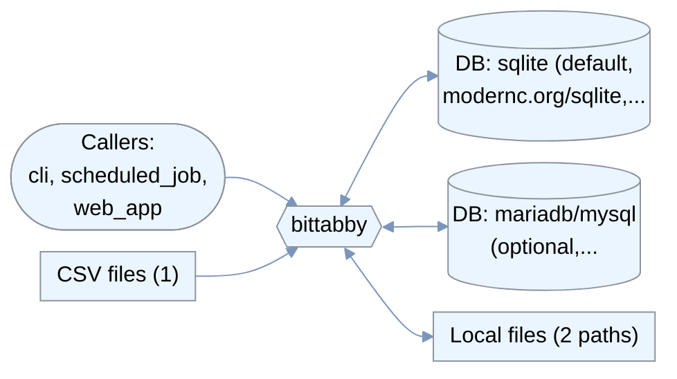

*Network endpoints*

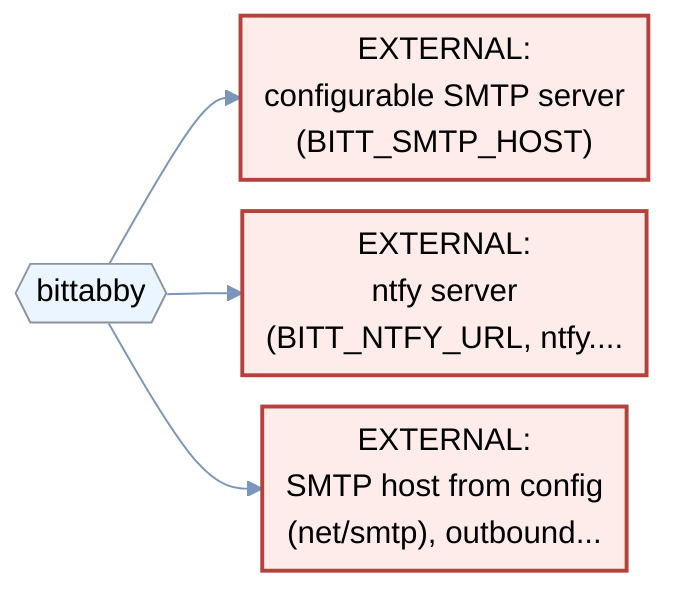

**Network endpoints**

| Endpoint | Kind | Access | Leaves host network | Source file |
|---|---|---|---|---|
| configurable SMTP server (BITT_SMTP_HOST) | external API | write | yes | internal/notify/notify.go |
| ntfy server (BITT_NTFY_URL, ntfy.sh default examples) | external API | write | yes | internal/notify/notify.go |
| SMTP host from config (net/smtp); outbound reminders only | email_mailbox | write | yes | internal/notify/notify.go |

**Data sources touched**

| Source | Access | Leaves organization |
|---|---|---|
| SQLite database file (or optional MariaDB) holding users, tabs, ledger entries, bank lines | read_write | no |
| User-uploaded bank statement CSV files | read | no |
| SMTP server (configurable) | write (reminder emails with names/amounts) | yes |
| ntfy server (configurable, ntfy.sh style) | write (reminder notifications) | yes |

**Top findings**

- No hardcoded secrets or committed secret files found outside test fixtures
- Unauthenticated routes are limited to health, static, setup, login/logout (low)
- Secure cookie flag defaults to off; compose uses :latest image tag
- Optional notification egress to SMTP and ntfy servers

**Unauthorized-action red flags**

- Financial ledger and bank statement lines are personal financial data stored unencrypted in a local SQLite/MariaDB database.
- Notification content may leave the network through SMTP and ntfy (ntfy.sh if configured).
- BITT_SECURE_COOKIES defaults to false.
- GET/POST /setup is open until the first account is created.

### choreme

Link: https://github.com/johnzastrow/choreme | Languages: go, typescript, vue, javascript, sql | Findings: critical 0, high 1, low 14 | Inventory: [choreme.json](choreme.json) | Questionnaire: [choreme_Governance.md](choreme_Governance.md)

**What this application can do**

- Lets anyone who can reach the server register a new household and its first user, and log in to receive a 24-hour JWT.
- Lets authenticated family members view and update their own profile, and (admin/manager roles) list household users and generate invites.
- Manages family savings accounts: deposits, withdrawals, transfer requests with approval, spending limits and interest rates, with role checks in handlers; a scheduler accrues interest and resets limits.
- Chore, assignment, reward, redemption, ledger, audit and report endpoints exist but are largely stubs returning placeholder responses.

**Who can reach it:** HTTP server; binds to localhost by default but the Docker image binds 0.0.0.0:8080 and compose publishes ports. Registration, login and household join are unauthenticated; all other /api/v1 routes require a JWT. CORS allows any origin.

**Data flow**

*Local data*

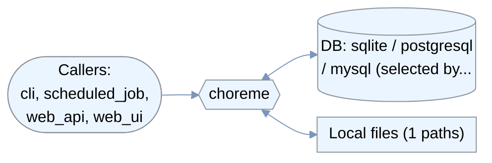

*Network endpoints*

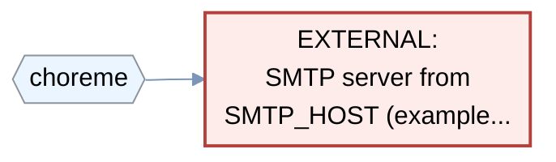

**Network endpoints**

| Endpoint | Kind | Access | Leaves host network | Source file |
|---|---|---|---|---|
| SMTP server from SMTP_HOST (example smtp.gmail.com in .env.example) | external API | write | yes | internal/config/config.go |

**Data sources touched**

| Source | Access | Leaves organization |
|---|---|---|
| Application database (SQLite file, PostgreSQL or MySQL) holding users, households, balances and transfers | read_write | no |
| SMTP server (configured, not yet clearly used by code) | write (planned notification emails) | yes |

**Top findings**

- JWT secret defaults to a hardcoded value in internal/config/config.go if JWT_SECRET is unset (high)
- Wildcard CORS with credentials; Docker image binds 0.0.0.0 and runs as root
- Placeholder credentials in docker-compose.yml (low); compiled binaries tracked in git

**Unauthorized-action red flags**

- JWT signing secret falls back to the hardcoded default 'your-secret-key' when JWT_SECRET is unset (Dockerfile does not set it); anyone who knows the default could forge tokens with any role
- docker-compose.yml ships placeholder JWT secret and weak DB passwords
- Access-Control-Allow-Origin: * with Allow-Credentials: true on all responses
- Docker container runs as root
- Financial-style data (balances, transfers) of minors stored; no rate limiting seen on login

### DocQGISProject

Link: https://github.com/johnzastrow/DocQGISProject | Languages: python | Findings: critical 0, high 0, low 2 | Inventory: [DocQGISProject.json](DocQGISProject.json) | Questionnaire: [DocQGISProject_Governance.md](DocQGISProject_Governance.md)

**What this application can do**

- Reads a QGIS project and writes Markdown, HTML, PDF and JSON documentation (layers, styles, layouts, settings) into a folder the user chooses, with credentials redacted by default.
- Rebuilds a new QGIS project file from the generated JSON, optionally remapping data folders and attaching QGIS auth configs.
- Optionally captures screenshots of QGIS dialogs, skipping pages that show data sources or logins.

**Who can reach it:** Runs locally inside QGIS (dialog, Processing toolbox, Python console). No network listener or outbound network code found.

**Data flow**

*Local data*

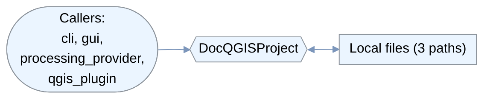

**Network endpoints**

None recorded.

**Data sources touched**

| Source | Access | Leaves organization |
|---|---|---|
| Local QGIS project files (.qgz/.qgs) and the datasets they reference (for counts and extents) | read | no |
| Output folder on local disk (reports, JSON, images, QML, QPT, rebuilt .qgz) | write | no |

**Top findings**

- Two placeholder passwords in test fixtures (low, allowlisted for detect-secrets)
- .gitignore does not exclude .env / key / credential files
- No routes, no network code, no database access found; credentials are redacted from outputs by design

**Unauthorized-action red flags**

- With redact=false or paths=absolute the generated reports/JSON could contain credentials or full home-folder paths; both default to safe values
- Generated JSON embeds the project's data-source list, which could reveal internal server names

### garminview

Link: https://github.com/johnzastrow/garminview | Languages: python, typescript, vue, shell | Findings: critical 4, high 53, low 16 | Inventory: [garminview.json](garminview.json) | Questionnaire: [garminview_Governance.md](garminview_Governance.md)

**What this application can do**

- Shows personal Garmin (and Polar/MyFitnessPal/Actalog) health and training data - sleep, HR, weight, activities, training load, nutrition - in a web dashboard, to anyone who can reach the server; no login is required.
- Lets anyone who can reach it export health metrics as CSV or JSON for any date range.
- Lets anyone who can reach it read all app configuration (including the stored Actalog password), change configuration and schedules, upload MyFitnessPal exports, trigger Garmin downloads and Actalog syncs, and import files from a server directory path.
- Runs scheduled background syncs against Garmin Connect via GarminDB and against an Actalog server, and parses workout notes with a configurable LLM endpoint.

**Who can reach it:** Whoever can reach the published frontend port (default 8080 on the host, listening on all interfaces) - the API behind it has no authentication on any route. In local development it is reachable from the same machine only if bound to localhost.

**Data flow**

*Local data*

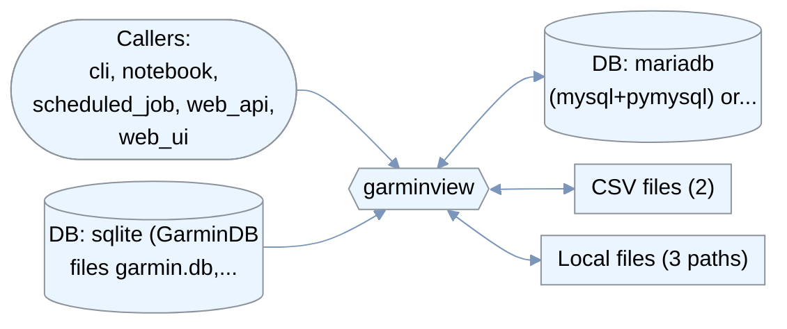

*Network endpoints*

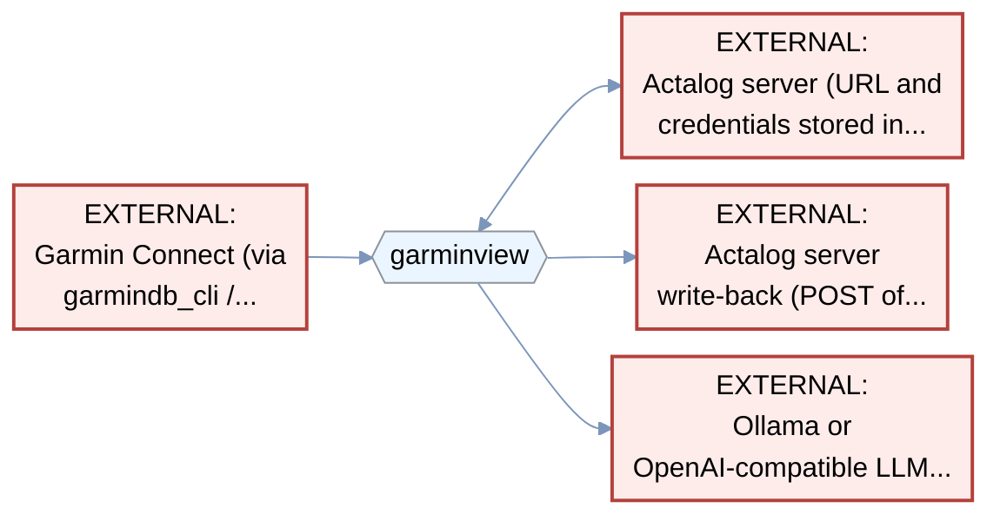

**Network endpoints**

| Endpoint | Kind | Access | Leaves host network | Source file |
|---|---|---|---|---|
| Garmin Connect (via garmindb_cli / garminconnect library; credentials from mounted ~/.GarminDb config) | external API | read | yes | backend/garminview/api/routes/sync.py |
| Actalog server (URL and credentials stored in app_config; user-configured) | external API | read_write | yes | backend/garminview/ingestion/actalog_client.py |
| Actalog server write-back (POST of matched Garmin data) | external API | write | yes | backend/garminview/ingestion/actalog_writeback.py |
| Ollama or OpenAI-compatible LLM server (default http://localhost:11434, configurable URL; receives workout note text) | external API | write | yes | backend/garminview/ingestion/notes_parser.py |

**Data sources touched**

| Source | Access | Leaves organization |
|---|---|---|
| MariaDB or SQLite application database (health, nutrition, workouts, app_config) | read_write | no |
| GarminDB SQLite files and Garmin Connect (via garmindb_cli) | read (download) | no |
| Actalog server (user-configured URL) | read_write | yes |
| Ollama / OpenAI-compatible LLM endpoint (workout note text) | write (sends text) | yes |
| MyFitnessPal and Polar export files | read | no |

**Top findings**

- No authentication on any API route, including admin, config, export and sync endpoints
- backend/.env with a credential-bearing database URL is tracked in git (critical)
- GET /admin/config exposes the stored Actalog password; /export/* returns bulk personal health data (critical)

**Unauthorized-action red flags**

- backend/.env is tracked in git and contains a database connection string with credentials (value redacted)
- GET /admin/config returns all app_config values, including the stored Actalog password in plaintext, without any authentication
- /export/csv and /export/json return bulk personal health data without authentication
- POST /admin/actalog/test-connection makes outbound requests to a caller-supplied URL (SSRF-style) without authentication
- Workout note text is sent to a configurable LLM endpoint; if that is a third-party service, user data leaves the network
- A personal MyFitnessPal export zip and sync logs are committed to the repository

### gob

Link: https://github.com/johnzastrow/gob | Languages: - | Findings: critical 0, high 0, low 0 | Inventory: [gob.json](gob.json) | Questionnaire: [gob_Governance.md](gob_Governance.md)

**What this application can do**

- Nothing executable: the repository holds a requirements/ideas note (notes.md) for forum-style software and a logo.

**Who can reach it:** No executable code or network service; content is only readable by whoever can access the GitHub repository.

**Data flow**

No data stores, files or network endpoints recorded in the inventory.

**Network endpoints**

None recorded.

**Data sources touched:** none recorded.

**Top findings**

- No code, dependencies or secrets found; notes.md lists planned forum software features
- No README and no .gitignore present

**Unauthorized-action red flags**

- None recorded.

### johnzastrow

Link: https://github.com/johnzastrow/johnzastrow | Languages: - | Findings: critical 0, high 0, low 0 | Inventory: [johnzastrow.json](johnzastrow.json) | Questionnaire: [johnzastrow_Governance.md](johnzastrow_Governance.md)

**What this application can do**

- Nothing executable: the repository only holds the README displayed on the author's GitHub profile.

**Who can reach it:** Public README on GitHub; no running application.

**Data flow**

No data stores, files or network endpoints recorded in the inventory.

**Network endpoints**

None recorded.

**Data sources touched:** none recorded.

**Top findings**

- no severity-tagged findings
- repository contains only a profile README (no code)

**Unauthorized-action red flags**

- None recorded.

### jz_jupyters

Link: https://github.com/johnzastrow/jz_jupyters | Languages: python, jupyter | Findings: critical 19, high 0, low 1 | Inventory: [jz_jupyters.json](jz_jupyters.json) | Questionnaire: [jz_jupyters_Governance.md](jz_jupyters_Governance.md)

**What this application can do**

- Reads weather, gas and electric-utility views from a MySQL 'weather' database on localhost or 192.168.1.110 using a hardcoded username and password, and plots them as charts saved to PNG files.
- Reads local CSV, Excel and SQLite files and plots or prints the contents (tutorial examples).
- Fetches the Matplotlib release list from the public GitHub API to draw a timeline chart.
- Includes tutorial notebooks and scripts for pandas, matplotlib, bokeh, and Python basics; some write to hardcoded C:\ paths.

**Who can reach it:** Nothing is served: scripts run only for whoever executes them locally and connect out to a local or private-LAN MySQL server. Because the repo is on GitHub, the hardcoded database credentials are visible to anyone who can read the repository.

**Data flow**

*Local data (part 1 of 2)*

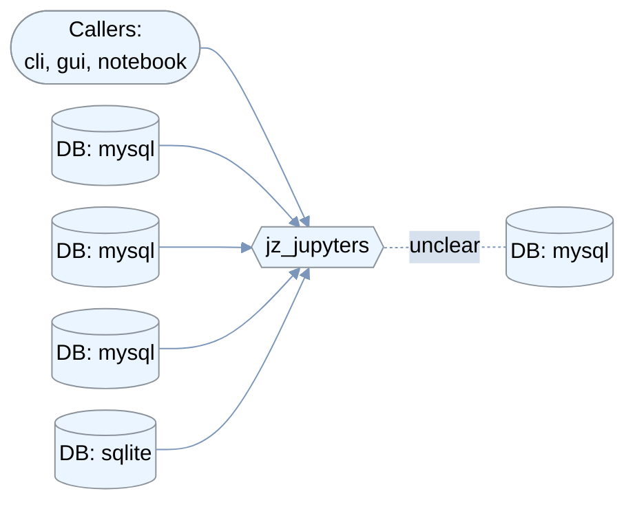

*Local data (part 2 of 2)*

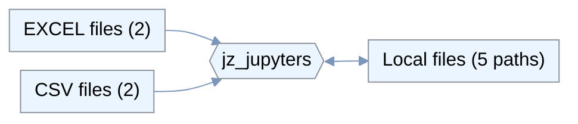

*Network endpoints*

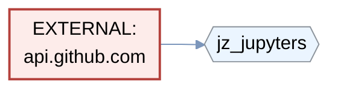

**Network endpoints**

| Endpoint | Kind | Access | Leaves host network | Source file |
|---|---|---|---|---|
| api.github.com | external API | read | yes | matpltlib/timeline.py |

**Data sources touched**

| Source | Access | Leaves organization |
|---|---|---|
| MySQL database 'weather' (localhost:3306 and 192.168.1.110:3306) | read | no |
| MySQL 'application' database on localhost (root, empty password) in a tutorial notebook | unclear | no |
| SQLite files (matpltlib/population.db and similar) | read | no |
| CSV and Excel files in the repo (data.csv, petals.xlsx, weather*.csv) | read | no |
| GitHub REST API (api.github.com) | read (public release list) | no |

**Top findings**

- Hardcoded MySQL password (user jcz) repeated across 15 tracked scripts and notebooks (19 occurrences)
- No dependency manifest despite pandas, matplotlib, sqlalchemy, numpy usage
- Committed binary data files (SQLite .db, xlsx, csv, zip)
- No server or routes - tutorial/exploration code only

**Unauthorized-action red flags**

- Same MySQL password for user 'jcz' hardcoded in 19 tracked files (scripts and notebooks), including a private LAN host address
- Hardcoded Windows paths (C:\data, C:\Code) in tutorial code
- Binary database and data files (.db, .xlsx, .csv, .zip) committed to the repo

### LearningPy

Link: https://github.com/johnzastrow/LearningPy | Languages: python | Findings: critical 1, high 0, low 3 | Inventory: [LearningPy.json](LearningPy.json) | Questionnaire: [LearningPy_Governance.md](LearningPy_Governance.md)

**What this application can do**

- Automates a browser login (Selenium/Firefox) to a MantisHub site and downloads a backup, using a username and password typed into the script.
- Scrapes stock index quotes from public web pages and stores them in a local SQLite database.
- Analyzes an electricity usage CSV in a notebook and runs assorted Python learning exercises (strings, dicts, water-chemistry calculator, birthday and age scripts).

**Who can reach it:** Run locally by whoever executes the scripts; no server, no listening ports. The repository (public GitHub remote) exposes the committed credential and data files to anyone who can read it.

**Data flow**

*Local data*

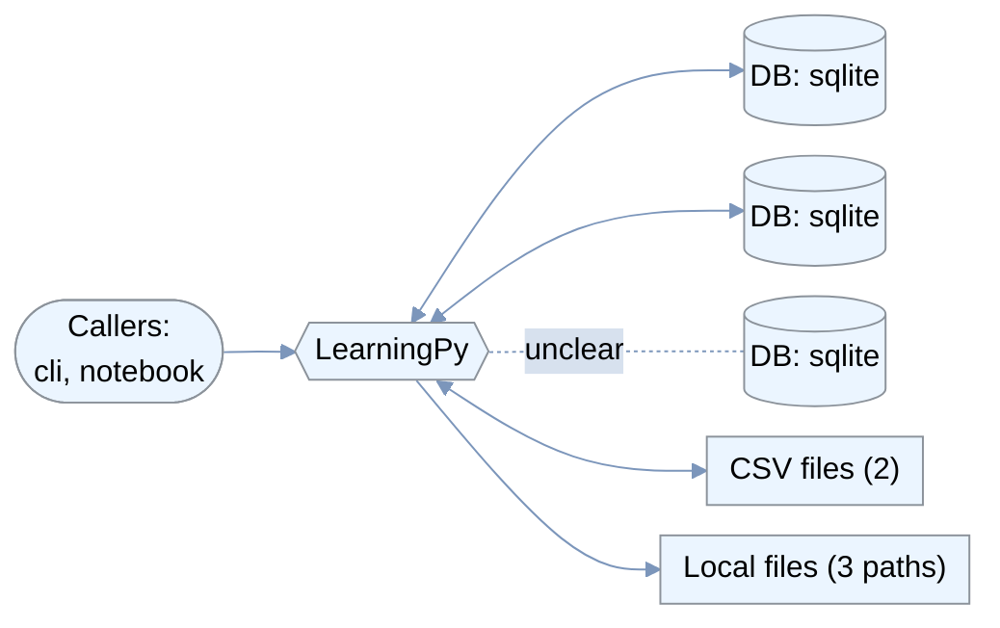

*Network endpoints*

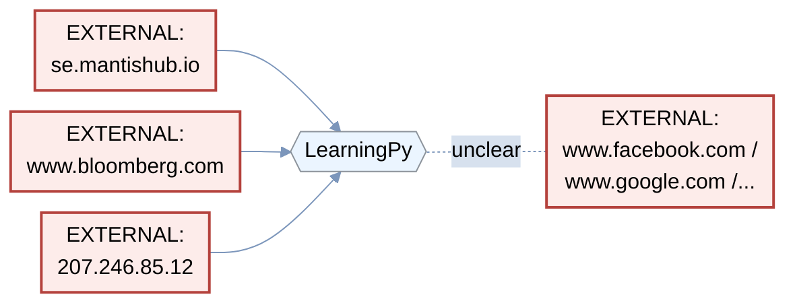

**Network endpoints**

| Endpoint | Kind | Access | Leaves host network | Source file |
|---|---|---|---|---|
| se.mantishub.io | external API | read | yes | mantis_bak.py |
| www.bloomberg.com | external API | read | yes | beautiful_soup/beautiful.py |
| 207.246.85.12 | external API | read | yes | beautiful_soup/beautiful2db.py |
| www.facebook.com / www.google.com / www.yahoo.com / login.live.com (Selenium tutorial examples) | external API | unclear | yes | base_selen.py |

**Data sources touched**

| Source | Access | Leaves organization |
|---|---|---|
| se.mantishub.io (MantisHub backup page) | read | no |
| Bloomberg and a bare-IP quote page (scraped) | read | no |
| Local SQLite files (example.db, flights.db, example2.db) | read_write | no |
| USE2023-08_12_2025.csv electricity usage | read | no |

**Top findings**

- Hardcoded real-looking MantisHub password (and email) in mantis_bak.py
- Placeholder passwords in Selenium tutorial scripts (low)
- No dependency manifest; .gitignore omits .env, *.db, *.log, .idea

**Unauthorized-action red flags**

- mantis_bak.py contains a real-looking MantisHub email and password committed to git.
- Utility usage CSV with account/meter-style identifiers and four SQLite databases are committed.
- Scripts automate logins to third-party sites (Facebook, Microsoft, MantisHub) via Selenium.

### lineup

Link: https://github.com/johnzastrow/lineup | Languages: python | Findings: critical 0, high 0, low 1 | Inventory: [lineup.json](lineup.json) | Questionnaire: [lineup_Governance.md](lineup_Governance.md)

**What this application can do**

- Loads a CSV of duplicate/similar photo groups, caches it in a local SQLite database, and shows groups with thumbnails, master markers and a list view.
- Lets the local user move or permanently delete selected image files from disk.
- Exports the database back to CSV and keeps a recent-databases list in the user's home directory.

**Who can reach it:** Desktop application run locally by the person who starts it; no network listener and no login. It acts with that user's file-system permissions.

**Data flow**

*Local data*

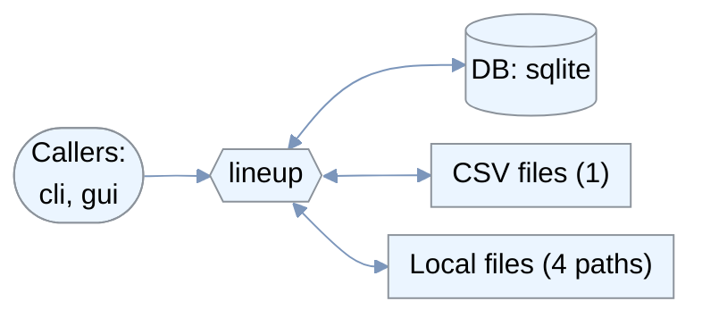

**Network endpoints**

None recorded.

**Data sources touched**

| Source | Access | Leaves organization |
|---|---|---|
| CSV duplicate report from photochomper | read | no |
| Local SQLite database .lineup_cache.db | read_write | no |
| User photo files on local disk | read_write (move/delete) | no |

**Top findings**

- Latent SQL injection pattern (f-string column name) in search_images; no untrusted caller found
- Gitignored .image_cache/ and uv.lock are tracked; cache metadata contains a local Windows user path
- App permanently deletes user files; no secrets, routes or external APIs found

**Unauthorized-action red flags**

- Permanently deletes image files (Path.unlink) with no recycle bin; no network or external data transfer found.

### localfeather

Link: https://github.com/johnzastrow/localfeather | Languages: python, cpp, shell, sql | Findings: critical 2, high 7, low 20 | Inventory: [localfeather.json](localfeather.json) | Questionnaire: [localfeather_Governance.md](localfeather_Governance.md)

**What this application can do**

- Accepts temperature/humidity/pressure readings from ESP32 devices over HTTP and stores them in MariaDB; unknown devices self-register and wait for approval.
- Lets anyone who can reach the server approve, edit or delete devices through /api/devices endpoints with no login.
- Returns the full device inventory (IP and MAC addresses, names, locations) and recent readings to any unauthenticated caller.
- Provides a login-protected web dashboard where admins approve, rename, delete devices, regenerate API keys and edit location/notes.
- Distributes ESP32 firmware over HTTP (OTA) to any caller who knows a version string; no signature or checksum handling seen.

**Who can reach it:** Bound to 0.0.0.0:5000 over plain HTTP, so reachable by anyone on the network (or internet if forwarded). The web UI requires login, but the device-management API, readings list and OTA endpoints have no authentication.

**Data flow**

*Local data*

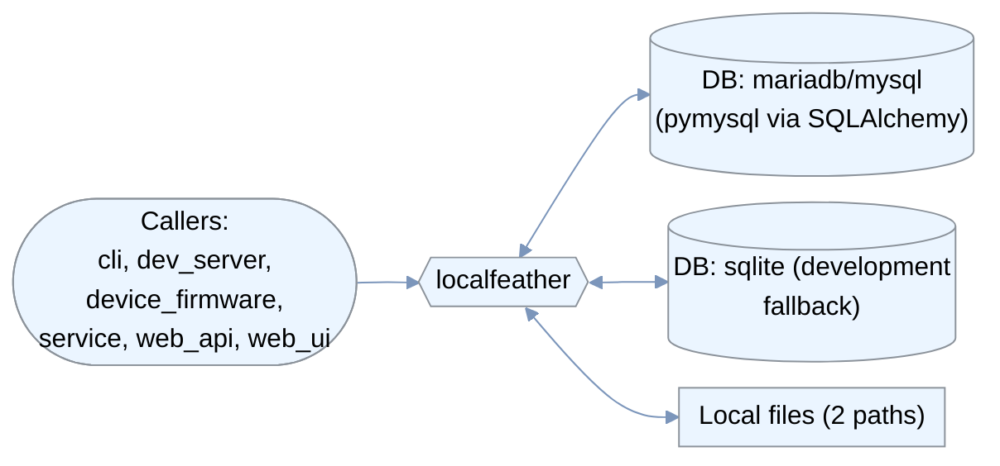

**Network endpoints**

None recorded.

**Data sources touched**

| Source | Access | Leaves organization |
|---|---|---|
| MariaDB localfeather database (users, devices, readings, firmware, updates) | read_write | no |
| SQLite development database (optional) | read_write | no |

**Top findings**

- Unauthenticated device approve/delete/update API endpoints (server/app/api/devices.py)
- Default SECRET_KEY fallback in server/app/__init__.py:30
- Seed script creates admin/admin123 account
- Flask debug=True bound to 0.0.0.0 in server/run.py
- Unauthenticated device inventory (IP/MAC) and OTA firmware download

**Unauthorized-action red flags**

- POST /api/devices/<id>/approve and DELETE /api/devices/<id> have no authentication (code comments say auth to be added)
- GET /api/devices exposes IP and MAC addresses and locations without login
- Default Flask SECRET_KEY fallback and admin123/viewer123 seed credentials
- run.py runs Flask debug=True on 0.0.0.0
- OTA firmware download is unauthenticated and no integrity verification is visible
- No CSRF protection or TLS found

### mainegeo

Link: https://github.com/johnzastrow/mainegeo | Languages: - | Findings: critical 0, high 0, low 0 | Inventory: [mainegeo.json](mainegeo.json) | Questionnaire: [mainegeo_Governance.md](mainegeo_Governance.md)

**What this application can do**

- Nothing executable: the repository stores SVG illustration files of Maine geography and terrain.

**Who can reach it:** No executable code or network service; content is only readable by whoever can access the GitHub repository.

**Data flow**

No data stores, files or network endpoints recorded in the inventory.

**Network endpoints**

None recorded.

**Data sources touched:** none recorded.

**Top findings**

- No executable code, dependencies or secrets found; repository holds SVG artwork only
- No .gitignore present

**Unauthorized-action red flags**

- None recorded.

### mapsplat

Link: https://github.com/johnzastrow/mapsplat | Languages: python | Findings: critical 0, high 0, low 1 | Inventory: [mapsplat.json](mapsplat.json) | Questionnaire: [mapsplat_Governance.md](mapsplat_Governance.md)

**What this application can do**

- Exports a QGIS project's vector and raster layers to a self-contained static web map (PMTiles + MapLibre GL JS style and HTML viewer).
- Downloads MapLibre GL JS and PMTiles JavaScript assets from unpkg.com at export time (no checksum verification) to bundle them for offline use, falling back to CDN links on failure.
- Generates a serve.py local web server that serves the exported map directory with HTTP Range support and Access-Control-Allow-Origin: * on every response.

**Who can reach it:** The plugin runs inside the user's QGIS. The generated serve.py binds to 127.0.0.1 by default (local only) with no authentication; if started with --host 0.0.0.0 it serves the exported map to anyone on the network. README documents deploying exports to static hosts and Linux VPS (Caddy/Nginx).

**Data flow**

*Local data*

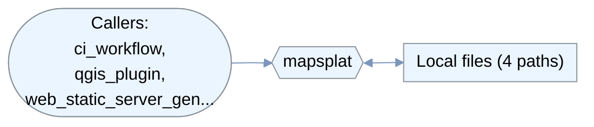

*Network endpoints*

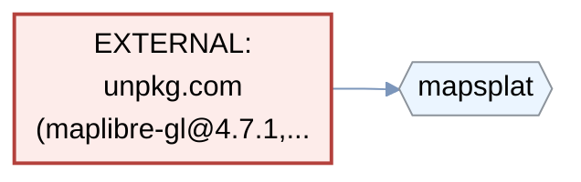

**Network endpoints**

| Endpoint | Kind | Access | Leaves host network | Source file |
|---|---|---|---|---|
| unpkg.com (maplibre-gl@4.7.1, pmtiles@3.2.0) | external API | read | yes | exporter.py |

**Data sources touched**

| Source | Access | Leaves organization |
|---|---|---|
| QGIS project layers (local vector/raster data) | read | no |
| Exported map package files in the output folder | write | no |
| unpkg.com (MapLibre/PMTiles JS assets) | read | no |

**Top findings**

- Generated serve.py has no auth and wildcard CORS, default bind 127.0.0.1 (low); becomes exposed with --host 0.0.0.0
- Remote JS assets downloaded from unpkg.com without checksum
- No dependency manifest beyond QGIS metadata.txt; CI installs unpinned pip packages

**Unauthorized-action red flags**

- Generated serve.py sends Access-Control-Allow-Origin: * with no authentication; safe by default on 127.0.0.1 but exposed if bound to 0.0.0.0
- JavaScript libraries are downloaded from unpkg.com at export time over HTTPS without integrity checks

### mapsplat4

Link: https://github.com/johnzastrow/mapsplat4 | Languages: python, node, shell, powershell | Findings: critical 0, high 0, low 1 | Inventory: [mapsplat4.json](mapsplat4.json) | Questionnaire: [mapsplat4_Governance.md](mapsplat4_Governance.md)

**What this application can do**

- Exports the layers, styling, labels and layer order of the open QGIS project into a self-contained static web map (PMTiles plus MapLibre GL JS).
- Runs ogr2ogr/GDAL and the pmtiles command line tool on the user's own layer data to build tiles.
- Optionally downloads MapLibre/PMTiles scripts and probes basemap URLs on the internet.
- Writes a serve.py helper that starts a local static web server (127.0.0.1 by default) with CORS open to all origins to preview the exported map.

**Who can reach it:** A desktop QGIS plugin used by whoever runs QGIS. The optional generated serve.py binds to 127.0.0.1 by default and has no authentication; it is reachable from the network only if started with --host 0.0.0.0. Exported maps are static and intended to be published publicly if hosted.

**Data flow**

*Local data*

```mermaid
%%{init: {"theme":"base","flowchart":{"useMaxWidth":true,"nodeSpacing":16,"rankSpacing":38,"padding":6},"themeVariables":{"background":"#ffffff","primaryColor":"#ebf5ff","primaryTextColor":"#000000","primaryBorderColor":"#8c939b","lineColor":"#7c96bb","secondaryColor":"#d7e1ee","tertiaryColor":"#c3d2e5","fontFamily":"\"Inter\", \"Noto Sans SC\", sans-serif","fontSize":"18","pie1":"#b4413c","pie2":"#d9893b","pie3":"#7c96bb","pie4":"#73A78D","pie5":"#CB9B7A","pie6":"#6B8CAE","pie7":"#c3d2e5","pie8":"#8c939b"}}}%%
flowchart LR
    APP{{"mapsplat4"}}
    U(["Callers:<br>cli, qgis_plugin"]) --> APP
    D1[("DB: sqlite (MBTiles<br>read)")]
    D1 --> APP
    F2["Local files (4 paths)"]
    APP <--> F2
    classDef ext fill:#fdecea,stroke:#b4413c,stroke-width:2px,color:#000000
```

*Network endpoints (part 1 of 2)*

```mermaid
%%{init: {"theme":"base","flowchart":{"useMaxWidth":true,"nodeSpacing":16,"rankSpacing":38,"padding":6},"themeVariables":{"background":"#ffffff","primaryColor":"#ebf5ff","primaryTextColor":"#000000","primaryBorderColor":"#8c939b","lineColor":"#7c96bb","secondaryColor":"#d7e1ee","tertiaryColor":"#c3d2e5","fontFamily":"\"Inter\", \"Noto Sans SC\", sans-serif","fontSize":"18","pie1":"#b4413c","pie2":"#d9893b","pie3":"#7c96bb","pie4":"#73A78D","pie5":"#CB9B7A","pie6":"#6B8CAE","pie7":"#c3d2e5","pie8":"#8c939b"}}}%%
flowchart LR
    APP{{"mapsplat4"}}
    E3["EXTERNAL:<br>unpkg.com (MapLibre GL<br>JS and PMTiles JS..."]
    E3 --> APP
    E4["EXTERNAL:<br>build.protomaps.com /<br>maps.protomaps.com /..."]
    E4 --> APP
    E5["EXTERNAL:<br>tile.openstreetmap.org,<br>basemaps.cartocdn.com..."]
    E5 --> APP
    E6["EXTERNAL:<br>user-supplied<br>basemap/style URLs..."]
    E6 --> APP
    class E3,E4,E5,E6 ext
    classDef ext fill:#fdecea,stroke:#b4413c,stroke-width:2px,color:#000000
```

*Network endpoints (part 2 of 2)*

```mermaid
%%{init: {"theme":"base","flowchart":{"useMaxWidth":true,"nodeSpacing":16,"rankSpacing":38,"padding":6},"themeVariables":{"background":"#ffffff","primaryColor":"#ebf5ff","primaryTextColor":"#000000","primaryBorderColor":"#8c939b","lineColor":"#7c96bb","secondaryColor":"#d7e1ee","tertiaryColor":"#c3d2e5","fontFamily":"\"Inter\", \"Noto Sans SC\", sans-serif","fontSize":"18","pie1":"#b4413c","pie2":"#d9893b","pie3":"#7c96bb","pie4":"#73A78D","pie5":"#CB9B7A","pie6":"#6B8CAE","pie7":"#c3d2e5","pie8":"#8c939b"}}}%%
flowchart LR
    APP{{"mapsplat4"}}
    E7["EXTERNAL:<br>raw.githubusercontent...<br>(Protomaps license text)"]
    E7 --> APP
    class E7 ext
    classDef ext fill:#fdecea,stroke:#b4413c,stroke-width:2px,color:#000000
```

**Network endpoints**

| Endpoint | Kind | Access | Leaves host network | Source file |
|---|---|---|---|---|
| unpkg.com (MapLibre GL JS and PMTiles JS bundles, downloaded for offline mode and referenced by exported viewer) | external API | read | yes | exporter.py |
| build.protomaps.com / maps.protomaps.com / protomaps.github.io (basemap PMTiles and styles) | external API | read | yes | basemap_helpers.py |
| tile.openstreetmap.org, basemaps.cartocdn.com, server.arcgisonline.com, a.tile.opentopomap.org (XYZ basemap tiles) | external API | read | yes | mapsplat_dockwidget.py |
| user-supplied basemap/style URLs (HEAD/ranged GET probe, https/http only) | external API | read | yes | mapsplat_dockwidget.py |
| raw.githubusercontent.com (Protomaps license text) | external API | read | yes | scripts/gen_basemap_styles.mjs |

**Data sources touched**

| Source | Access | Leaves organization |
|---|---|---|
| QGIS project layers chosen by the user (files/databases already loaded in QGIS) | read | no |
| Output folder bundle on local disk or a static host the user copies it to | write | no |
| Public basemap/tile hosts (Protomaps, OpenStreetMap, Carto, Esri, OpenTopoMap) and unpkg.com | read | no |
| MBTiles file (sqlite) | read | no |

**Top findings**

- No secrets or committed secret files; detect-secrets and bandit run in CI
- Generated serve.py has open CORS and no auth (binds 127.0.0.1 by default)
- No dependency manifest or lockfile; dev tools fetched unpinned

**Unauthorized-action red flags**

- Generated serve.py sends Access-Control-Allow-Origin: * and has no authentication (reachable beyond localhost if --host 0.0.0.0).
- Exported viewer loads MapLibre and PMTiles from unpkg.com unless offline bundling is chosen.
- Exported map bundles contain the user's layer data, which becomes public if the folder is hosted publicly.

### marimo-qgis

Link: https://github.com/johnzastrow/marimo-qgis | Languages: python, shell | Findings: critical 0, high 0, low 0 | Inventory: [marimo-qgis.json](marimo-qgis.json) | Questionnaire: [marimo-qgis_Governance.md](marimo-qgis_Governance.md)

**What this application can do**

- Runs marimo reactive notebooks on QGIS's own Python interpreter, launched from a dock inside QGIS.
- Exposes a token-protected localhost HTTP bridge that lets notebooks read the open QGIS project (layers, features, extent, selection), insert layers back into it, and run any QGIS Processing algorithm.
- Installs marimo and any packages the user names into QGIS's Python with pip, and can download example notebooks from GitHub.
- Scaffolds new notebook files and writes launch logs to disk.

**Who can reach it:** Desktop use only. The bridge binds 127.0.0.1 on a random port and requires a per-session bearer token on every request, so it is reachable only by local processes that know the token. Notebooks themselves can run arbitrary Python as the QGIS user.

**Data flow**

*Local data*

```mermaid
%%{init: {"theme":"base","flowchart":{"useMaxWidth":true,"nodeSpacing":16,"rankSpacing":38,"padding":6},"themeVariables":{"background":"#ffffff","primaryColor":"#ebf5ff","primaryTextColor":"#000000","primaryBorderColor":"#8c939b","lineColor":"#7c96bb","secondaryColor":"#d7e1ee","tertiaryColor":"#c3d2e5","fontFamily":"\"Inter\", \"Noto Sans SC\", sans-serif","fontSize":"18","pie1":"#b4413c","pie2":"#d9893b","pie3":"#7c96bb","pie4":"#73A78D","pie5":"#CB9B7A","pie6":"#6B8CAE","pie7":"#c3d2e5","pie8":"#8c939b"}}}%%
flowchart LR
    APP{{"marimo-qgis"}}
    U(["Callers:<br>cli, notebook,<br>qgis_plugin, web_api"]) --> APP
    D1[("DB: sqlite (in-memory<br>version probe)")]
    D1 --> APP
    F2["Local files (4 paths)"]
    APP --> F2
    classDef ext fill:#fdecea,stroke:#b4413c,stroke-width:2px,color:#000000
```

*Network endpoints*

```mermaid
%%{init: {"theme":"base","flowchart":{"useMaxWidth":true,"nodeSpacing":16,"rankSpacing":38,"padding":6},"themeVariables":{"background":"#ffffff","primaryColor":"#ebf5ff","primaryTextColor":"#000000","primaryBorderColor":"#8c939b","lineColor":"#7c96bb","secondaryColor":"#d7e1ee","tertiaryColor":"#c3d2e5","fontFamily":"\"Inter\", \"Noto Sans SC\", sans-serif","fontSize":"18","pie1":"#b4413c","pie2":"#d9893b","pie3":"#7c96bb","pie4":"#73A78D","pie5":"#CB9B7A","pie6":"#6B8CAE","pie7":"#c3d2e5","pie8":"#8c939b"}}}%%
flowchart LR
    APP{{"marimo-qgis"}}
    E3["EXTERNAL:<br>github.com (downloads<br>repository zip of..."]
    E3 --> APP
    E4["EXTERNAL:<br>PyPI via pip (installs<br>marimo and..."]
    E4 --> APP
    E5["EXTERNAL:<br>astral.sh (uv install<br>hint text only)"]
    APP -.-|unclear| E5
    class E3,E4,E5 ext
    classDef ext fill:#fdecea,stroke:#b4413c,stroke-width:2px,color:#000000
```

**Network endpoints**

| Endpoint | Kind | Access | Leaves host network | Source file |
|---|---|---|---|---|
| github.com (downloads repository zip of example/notebooks folders) | external API | read | yes | plugin/environment.py |
| PyPI via pip (installs marimo and user-requested packages) | external API | read | yes | plugin/ui/process.py |
| astral.sh (uv install hint text only) | external API | unclear | yes | processing/launch_marimo.py |

**Data sources touched**

| Source | Access | Leaves organization |
|---|---|---|
| Open QGIS project layers (via local bridge) | read_write | no |
| github.com repository zip (examples) | read | no |
| PyPI via pip | read | no |
| Sample GeoPackage/SpatiaLite files in repo | read | no |

**Top findings**

- No severity-tagged findings: all bridge routes require a bearer token and bind 127.0.0.1
- Unpinned pandas/numpy in pyproject.toml; runtime pip installs into QGIS Python
- Local bridge can run arbitrary Processing algorithms

**Unauthorized-action red flags**

- POST /api/run executes any Processing algorithm with caller-supplied parameters (guarded only by the local bearer token).
- Notebooks launched by the plugin execute arbitrary Python on QGIS's interpreter by design.
- pip installs of unpinned packages into the QGIS Python environment at run time.

### metadatamgr

Link: https://github.com/johnzastrow/metadatamgr | Languages: python | Findings: critical 0, high 0, low 1 | Inventory: [metadatamgr.json](metadatamgr.json) | Questionnaire: [metadatamgr_Governance.md](metadatamgr_Governance.md)

**What this application can do**

- Scans a user-selected folder tree for geospatial datasets and writes an inventory of files (format, CRS, size, metadata status) into a local GeoPackage.
- Lets a QGIS user create and edit layer metadata through a 4-step wizard with contact and link management, and saves it to a local database cache, .qmd sidecar files, or embedded GeoPackage metadata.
- Parses existing FGDC, ESRI, ISO 19115 and embedded metadata from local files to pre-fill forms.
- Shows a metadata quality dashboard with completion statistics by directory, format and CRS.
- Records the scanning user's OS username, machine hostname and OS version in the inventory records for multi-user tracking.

**Who can reach it:** Runs inside the user's own QGIS desktop session; no listener, no authentication and none needed. Anyone with filesystem access to the shared GeoPackage can read the inventory, including recorded usernames and hostnames.

**Data flow**

*Local data*

```mermaid
%%{init: {"theme":"base","flowchart":{"useMaxWidth":true,"nodeSpacing":16,"rankSpacing":38,"padding":6},"themeVariables":{"background":"#ffffff","primaryColor":"#ebf5ff","primaryTextColor":"#000000","primaryBorderColor":"#8c939b","lineColor":"#7c96bb","secondaryColor":"#d7e1ee","tertiaryColor":"#c3d2e5","fontFamily":"\"Inter\", \"Noto Sans SC\", sans-serif","fontSize":"18","pie1":"#b4413c","pie2":"#d9893b","pie3":"#7c96bb","pie4":"#73A78D","pie5":"#CB9B7A","pie6":"#6B8CAE","pie7":"#c3d2e5","pie8":"#8c939b"}}}%%
flowchart LR
    APP{{"metadatamgr"}}
    U(["Callers:<br>cli, qgis_plugin"]) --> APP
    D1[("DB: sqlite/geopackage")]
    APP <--> D1
    D2[("DB: sqlite/geopackage")]
    APP <--> D2
    F3["Local files (5 paths)"]
    APP -.-|unclear| F3
    classDef ext fill:#fdecea,stroke:#b4413c,stroke-width:2px,color:#000000
```

**Network endpoints**

None recorded.

**Data sources touched**

| Source | Access | Leaves organization |
|---|---|---|
| Local GeoPackage/SQLite inventory and metadata database (geospatial_inventory and related tables) | read_write | no |
| Local geospatial data files and metadata sidecars (shp, gpkg, FGDC/ESRI/ISO XML, .qmd) | read_write (reads datasets and metadata; writes .qmd and embedded metadata) | no |

**Top findings**

- No secrets, secret files or provider keys found; CI runs detect-secrets and bandit
- f-string SQL for table name guarded by _safe_identifier (latent, low)
- No dependency manifest; relies on QGIS host libraries
- Inventory records capture OS username, hostname and OS version
- Developer test scripts contain hardcoded Windows paths including a user profile path

**Unauthorized-action red flags**

- Records OS username and machine hostname of each scanner in the inventory database (personal/operational data stored without any stated consent or retention policy)
- Writes metadata sidecar files and embedded metadata into the user's data directories

### mqs

Link: https://github.com/johnzastrow/mqs | Languages: python, shell | Findings: critical 0, high 2, low 2 | Inventory: [mqs.json](mqs.json) | Questionnaire: [mqs_Governance.md](mqs_Governance.md)

**What this application can do**

- Inventories vector/raster files in directory trees into a GeoPackage and records the scanning OS username and file paths.
- Edits and writes QGIS .qmd metadata (including contact email/phone) for datasets via a wizard.
- Exports a QGIS project as a PMTiles web map and writes a serve.py that serves the folder over HTTP on all interfaces with permissive CORS and no login.
- Reads and edits QGIS project XML stored in a PostgreSQL table using credentials typed into a GUI.
- Renames vector layers/tables in bulk, with file backups.
- Uploads a plugin zip to plugins.qgis.org using the author's credentials.

**Who can reach it:** Desktop tools run locally by the user. The one network listener is the optional serve.py generated for exported web maps: it binds all interfaces with no authentication, so anyone on the local network can read the exported map folder while it is running.

**Data flow**

*Local data*

```mermaid
%%{init: {"theme":"base","flowchart":{"useMaxWidth":true,"nodeSpacing":16,"rankSpacing":38,"padding":6},"themeVariables":{"background":"#ffffff","primaryColor":"#ebf5ff","primaryTextColor":"#000000","primaryBorderColor":"#8c939b","lineColor":"#7c96bb","secondaryColor":"#d7e1ee","tertiaryColor":"#c3d2e5","fontFamily":"\"Inter\", \"Noto Sans SC\", sans-serif","fontSize":"18","pie1":"#b4413c","pie2":"#d9893b","pie3":"#7c96bb","pie4":"#73A78D","pie5":"#CB9B7A","pie6":"#6B8CAE","pie7":"#c3d2e5","pie8":"#8c939b"}}}%%
flowchart LR
    APP{{"mqs"}}
    U(["Callers:<br>cli, gui, qgis_plugin,<br>qgis_processing_scripts"]) --> APP
    D1[("DB: sqlite (GeoPackage<br>inventory)")]
    APP <--> D1
    D2[("DB: sqlite<br>(GeoPackage/SpatiaLit...")]
    APP <--> D2
    D3[("DB: postgresql (QGIS<br>project store)")]
    APP <--> D3
    D4[("DB: sqlite (metadata<br>manager database)")]
    APP <--> D4
    F5["Local files (4 paths)"]
    APP <--> F5
    classDef ext fill:#fdecea,stroke:#b4413c,stroke-width:2px,color:#000000
```

*Network endpoints*

```mermaid
%%{init: {"theme":"base","flowchart":{"useMaxWidth":true,"nodeSpacing":16,"rankSpacing":38,"padding":6},"themeVariables":{"background":"#ffffff","primaryColor":"#ebf5ff","primaryTextColor":"#000000","primaryBorderColor":"#8c939b","lineColor":"#7c96bb","secondaryColor":"#d7e1ee","tertiaryColor":"#c3d2e5","fontFamily":"\"Inter\", \"Noto Sans SC\", sans-serif","fontSize":"18","pie1":"#b4413c","pie2":"#d9893b","pie3":"#7c96bb","pie4":"#73A78D","pie5":"#CB9B7A","pie6":"#6B8CAE","pie7":"#c3d2e5","pie8":"#8c939b"}}}%%
flowchart LR
    APP{{"mqs"}}
    E6["EXTERNAL:<br>plugins.qgis.org<br>(XML-RPC plugin upload)"]
    APP --> E6
    E7["EXTERNAL:<br>unpkg.com<br>(MapLibre/pmtiles JS..."]
    E7 --> APP
    class E6,E7 ext
    classDef ext fill:#fdecea,stroke:#b4413c,stroke-width:2px,color:#000000
```

**Network endpoints**

| Endpoint | Kind | Access | Leaves host network | Source file |
|---|---|---|---|---|
| plugins.qgis.org (XML-RPC plugin upload) | external API | write | yes | Plugins/metadata_manager/plugin_upload.py |
| unpkg.com (MapLibre/pmtiles JS loaded by generated map HTML) and build.protomaps.com / protomaps.github.io (basemap tiles/fonts) | external API | read | yes | Plugins/mapsplat/exporter.py |

**Data sources touched**

| Source | Access | Leaves organization |
|---|---|---|
| Local vector/raster files and GeoPackages | read_write | no |
| PostgreSQL qgis_projects table (user-supplied host) | read_write | no |
| plugins.qgis.org XML-RPC | write (plugin zip upload) | yes |
| unpkg.com / protomaps hosts (loaded by exported web map in the viewer's browser) | read | no |

**Top findings**

- Generated serve.py (Plugins/mapsplat/exporter.py) binds all interfaces, CORS *, no auth
- F-string table names in SQL (inventory_processor.py, batchvectorrename.py) - local-only, low
- .gitignore does not exclude .env / key / credential files
- No committed secrets found

**Unauthorized-action red flags**

- Generated serve.py binds 0.0.0.0 with Access-Control-Allow-Origin * and no authentication
- plugin_upload.py accepts the password via -w/--password command-line option (visible in shell history/process list) though it prompts if omitted
- Inventory records the OS username of the scanner and file paths into a database

