# Governance Scan Summary - Part 2 of 3: repository sections

Back to the [summary overview and matrices](johnzastrow_Summary.md). [Part 1](johnzastrow_Summary_Part1.md) | Part 2 | [Part 3](johnzastrow_Summary_Part3.md)

Repositories in this part: [mqs4](#mqs4), [ms](#ms), [mydocmost](#mydocmost), [myvinyl](#myvinyl), [niva](#niva), [orgphoto](#orgphoto), [pgeo](#pgeo), [photochomper](#photochomper), [postgis_linear_referencing](#postgis_linear_referencing), [pydataminer](#pydataminer), [QGIS](#qgis), [qgis-plugin-skill](#qgis-plugin-skill), [qgis-vscode-setup](#qgis-vscode-setup), [QGISModes](#qgismodes), [seh](#seh), [starshipsuits](#starshipsuits), [stratavis](#stratavis), [surveyart](#surveyart), [systers](#systers)

Each section has small data flow diagrams built only from that repository's JSON. Arrows follow the recorded `access_type`: an arrow into the app means read, out of the app means write, a double-headed arrow means read/write, and a dashed line means unclear. Local data and network endpoints are drawn as separate small diagrams (split further when long) so each prints at a readable size on letter paper. Endpoints that leave the host network are labelled EXTERNAL and shaded red; loopback or private-LAN endpoints are labelled LAN. Labels are shortened; the full endpoint text is in the table under the diagrams. Local file access is shown as one node; databases and network endpoints are itemized.

### mqs4

Link: https://github.com/johnzastrow/mqs4 | Languages: python | Findings: critical 0, high 0, low 2 | Inventory: [mqs4.json](mqs4.json) | Questionnaire: [mqs4_Governance.md](mqs4_Governance.md)

**What this application can do**

- Scans user-chosen directories for geospatial files (vector, raster, metadata files) and builds an inventory GeoPackage with extents; records the scanning user name and machine name.
- Lets a user create and edit layer metadata (contacts, keywords, links) through a wizard and writes it to a local cache database and .qmd files.
- Batch-renames vector layers and their files/tables with backup copies; converts vectors into GeoPackages; extracts styles from QGIS projects.
- Reads QGIS project files, can connect to a PostgreSQL server with user-supplied credentials to read and update project content stored in a database table, and can export modified project XML.
- Includes a command-line uploader that sends a plugin zip with username and password to plugins.qgis.org.

**Who can reach it:** Desktop tools run locally by the QGIS user; no network listener and no authentication layer of their own.

**Data flow**

*Local data*

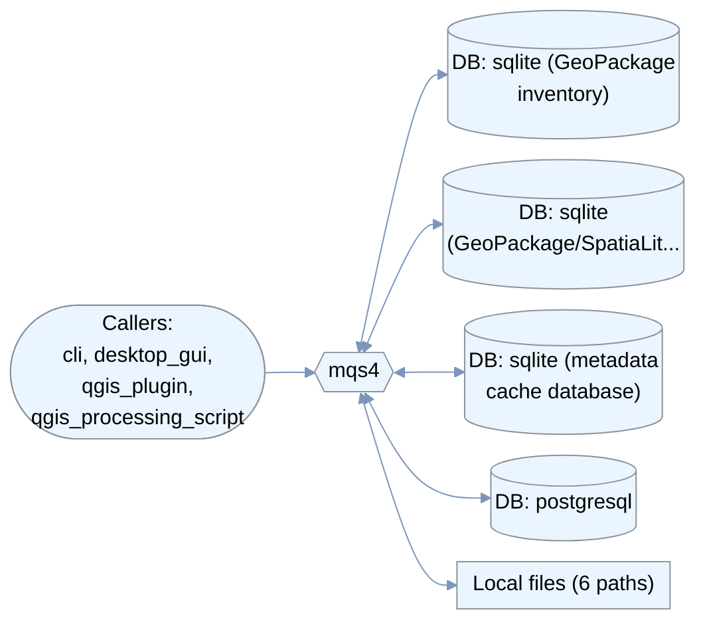

*Network endpoints*

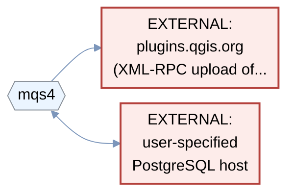

**Network endpoints**

| Endpoint | Kind | Access | Leaves host network | Source file |
|---|---|---|---|---|
| plugins.qgis.org (XML-RPC upload of plugin zip with username/password) | external API | write | yes | Plugins/metadata_manager/plugin_upload.py |
| user-specified PostgreSQL host | external API | read_write | yes | Scripts/qgis_project_manager.py |

**Data sources touched**

| Source | Access | Leaves organization |
|---|---|---|
| Local geospatial files and directories chosen by the user (scanned and renamed) | read_write | no |
| Inventory/metadata GeoPackage and SQLite cache databases | read_write | no |
| PostgreSQL database holding QGIS projects (qgis_project_manager.py, user-supplied host) | read_write | unclear (depends on the host the user enters) |
| plugins.qgis.org (plugin upload) | write (plugin zip and credentials) | yes |

**Top findings**

- Local desktop QGIS tools: no routes, no hardcoded secrets or committed secret files
- Low: f-string table names in SQL (inventory_processor.py:638/664, batchvectorrename.py:791), values come from local UI
- qgis_project_manager.py handles PostgreSQL passwords from project URIs and a GUI field
- Scripts/ requires psycopg2 but has no dependency manifest

**Unauthorized-action red flags**

- Inventory records capture the OS user name and machine host name of whoever ran the scan.
- qgis_project_manager.py parses and can display/test PostgreSQL credentials embedded in QGIS project datasource URIs.
- plugin_upload.py transmits a username and password to plugins.qgis.org over HTTPS XML-RPC (author-supplied, interactive prompt).

### ms

Link: https://github.com/johnzastrow/ms | Languages: python | Findings: critical 0, high 0, low 0 | Inventory: [ms.json](ms.json) | Questionnaire: [ms_Governance.md](ms_Governance.md)

**What this application can do**

- Downloads the public CIFAR-10 image dataset, trains CNN, ResNet and (stage 2) MobileNet classifiers, and runs them as Kafka-connected agents that classify 500 test images and compare accuracy against a Judge ensemble result.
- Downloads and starts a local Apache Kafka 3.5.0 and ZooKeeper from archive.apache.org via shell commands inside the notebook.
- Documentation describes installing JupyterHub on an Ubuntu VPS bound to 0.0.0.0:8000 and opening port 8000 in the firewall.

**Who can reach it:** Notebook project with no server of its own. Reachable by whoever runs the notebook; if the documented JupyterHub setup is followed it is exposed on all interfaces of the VPS on port 8000, protected only by JupyterHub Linux-user login.

**Data flow**

*Local data*

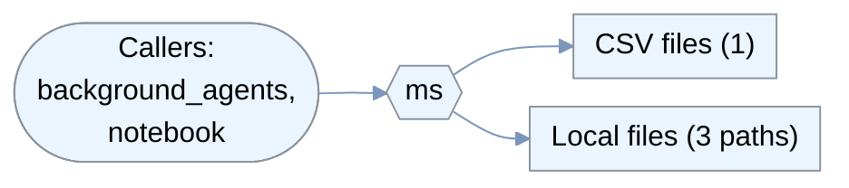

*Network endpoints*

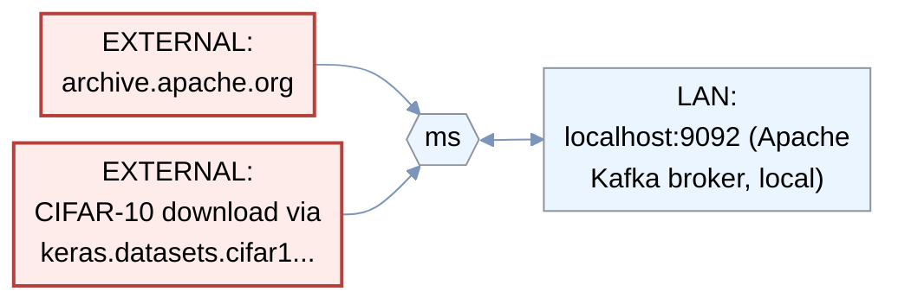

**Network endpoints**

| Endpoint | Kind | Access | Leaves host network | Source file |
|---|---|---|---|---|
| archive.apache.org | external API | read | yes | image_classification/image_class.ipynb |
| CIFAR-10 download via keras.datasets.cifar10.load_data (upstream dataset host, not named in code) | external API | read | yes | image_classification/stage2_image_class.ipynb |
| localhost:9092 (Apache Kafka broker, local) | external API | read_write | no | image_classification/stage2_image_class.ipynb |

**Data sources touched**

| Source | Access | Leaves organization |
|---|---|---|
| CIFAR-10 public dataset (keras download) | read | no |
| Local Apache Kafka broker localhost:9092 | read_write | no |
| archive.apache.org (Kafka tarball) | read | no |
| classification_results.csv and saved .keras model files | write | no |

**Top findings**

- No dependency manifest or .gitignore; packages installed via unpinned inline pip commands
- Docs show JupyterHub bound to 0.0.0.0:8000 (documentation only, not severity-tagged)
- Notebooks download and run Kafka tarball from archive.apache.org without checksum verification

**Unauthorized-action red flags**

- Documented JupyterHub configuration binds to 0.0.0.0:8000 and instructs opening the firewall port; JupyterHub gives users code execution on the host
- Notebook cells run shell commands (curl, tar, subprocess) that download and execute Kafka binaries without checksum verification
- Kafka broker configured without authentication or TLS (plaintext localhost)

### mydocmost

Link: https://github.com/johnzastrow/mydocmost | Languages: node | Findings: critical 0, high 0, low 24 | Inventory: [mydocmost.json](mydocmost.json) | Questionnaire: [mydocmost_Governance.md](mydocmost_Governance.md)

**What this application can do**

- Hosts a collaborative wiki: authenticated users create, edit (real-time via websocket), move, duplicate, version, comment on and search pages organised in spaces, with groups and role-based membership.
- Lets authenticated users upload files and images, import pages (markdown/html/zip) and export pages or whole spaces.
- Lets users publish a page to the public through a share link; anyone with the share id can read the shared page, its tree and search within it without logging in.
- Handles user sign-up, login, invitations, password reset and email notifications through a configured SMTP/Postmark server.
- Optionally sends prompts/page content to a configured AI provider (OpenAI, OpenAI-compatible, Gemini or Ollama) when AI features are enabled by environment variables.

**Who can reach it:** Server binds to 0.0.0.0 on port 3000 (collaboration server on 3001) by default and CORS is enabled with no restrictions (app.enableCors()). Almost all API routes require a JWT session; a small set of routes (login, setup, share pages, health, collab/stats) are reachable without login. Reachable by anyone on the network that can reach the host.

**Data flow**

*Local data*

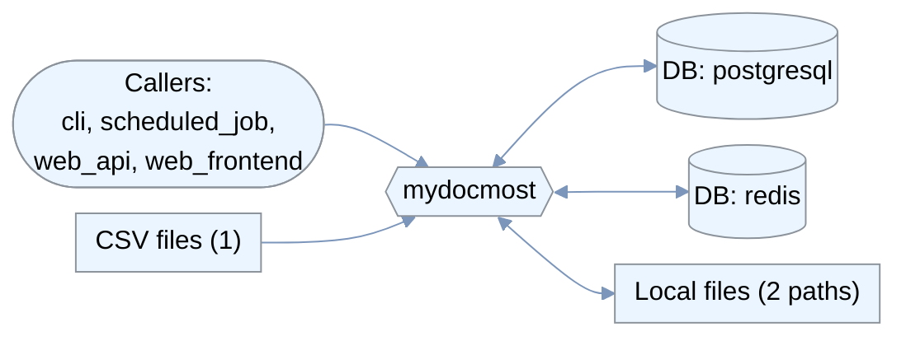

*Network endpoints (part 1 of 2)*

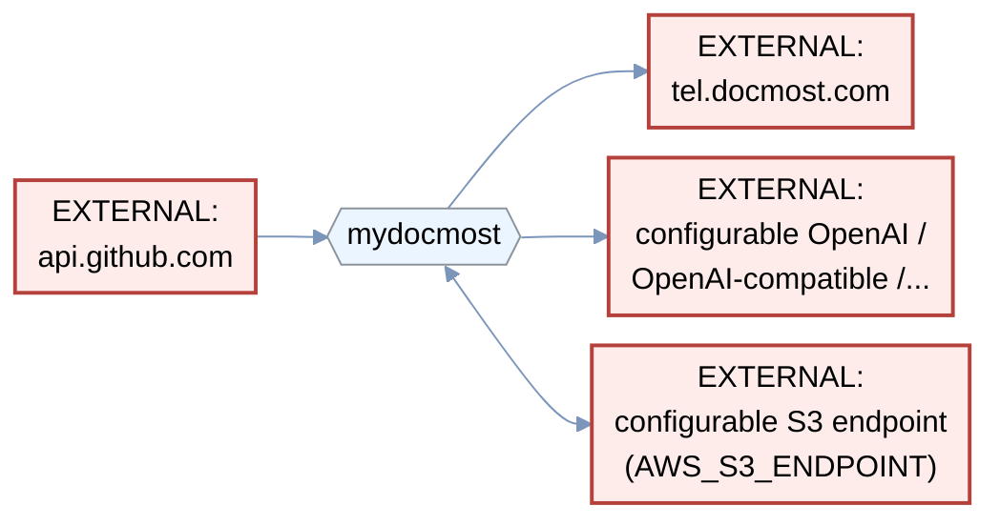

*Network endpoints (part 2 of 2)*

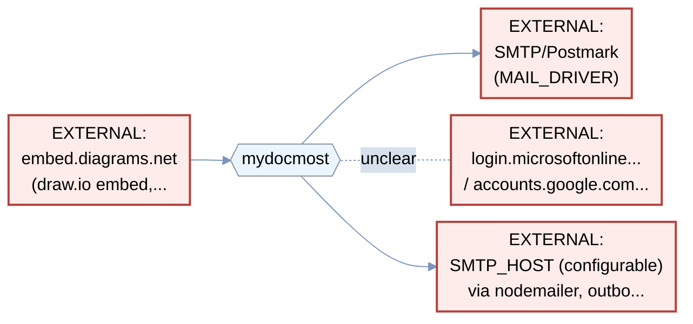

**Network endpoints**

| Endpoint | Kind | Access | Leaves host network | Source file |
|---|---|---|---|---|
| tel.docmost.com | external API | write | yes | apps/server/src/integrations/telemetry/telemetry.service.ts |
| api.github.com | external API | read | yes | apps/server/src/integrations/security/version.service.ts |
| configurable OpenAI / OpenAI-compatible / Gemini / Ollama endpoint (AI_DRIVER, OPENAI_API_URL) | external API | write | yes | apps/server/src/integrations/environment/environment.validation.ts |
| configurable S3 endpoint (AWS_S3_ENDPOINT) | external API | read_write | yes | apps/server/package.json |
| SMTP/Postmark (MAIL_DRIVER) | external API | write | yes | apps/server/src/integrations/mail/drivers/smtp.driver.ts |
| login.microsoftonline.com / accounts.google.com (SSO references) | external API | unclear | yes | apps/client/src |
| embed.diagrams.net (draw.io embed, DRAWIO_URL) | external API | read | yes | apps/client/src/features/editor |
| SMTP_HOST (configurable) via nodemailer; outbound only | email_mailbox | write | yes | apps/server/src/integrations/mail/drivers/smtp.driver.ts |

**Data sources touched**

| Source | Access | Leaves organization |
|---|---|---|
| PostgreSQL database (DATABASE_URL) | read_write | no |
| Redis (REDIS_URL) | read_write | no |
| Local disk or S3-compatible storage for attachments (STORAGE_DRIVER) | read_write | no |
| SMTP / Postmark mail service | write (sends emails with user addresses) | yes |
| tel.docmost.com telemetry | write (instance hash, version, user/page/space/workspace counts; production, self-hosted, unless DISABLE_TELEMETRY is true) | yes |
| api.github.com release check | read | no |
| Configured AI provider (OpenAI/Gemini/Ollama/compatible) | write (sends prompt and page content when AI is enabled) | yes |

**Top findings**

- Placeholder secrets (APP_SECRET, DB password) in tracked docker-compose.yml (low)
- CORS enabled without restrictions and server binds 0.0.0.0 by default
- Unauthenticated routes: login/setup/share/health and GET /api/collab/stats
- Telemetry to tel.docmost.com enabled by default in production; optional external AI providers
- No rate limiting detected

**Unauthorized-action red flags**

- Anonymous telemetry (counts of users/pages/spaces) is posted to tel.docmost.com in production unless DISABLE_TELEMETRY=true.
- GET /api/collab/stats is unauthenticated and reveals live connection and document counts.
- CORS is enabled with no origin restriction (apps/server/src/main.ts:94).
- No rate limiting / throttling library was found in the server source, including on /api/auth/login.
- Public share routes expose page content to anyone holding a share id.
- Optional AI features can send page content and prompts to external AI services.

### myvinyl

Link: https://github.com/johnzastrow/myvinyl | Languages: python | Findings: critical 0, high 0, low 7 | Inventory: [myvinyl.json](myvinyl.json) | Questionnaire: [myvinyl_Governance.md](myvinyl_Governance.md)

**What this application can do**

- Lets invited users sign in and keep a private vinyl record collection and wishlist (add, edit, soft-delete and restore albums, notes, ratings, covers, track ratings), with stats and printable reports.
- Looks up albums on Discogs with each user's own access token, stores release details, prices and value history, and syncs a user's Discogs collection through a review queue (read-only calls to Discogs).
- Lets a signed-in user export their own collection as CSV.
- Lets admins invite users via one-time links, reset passwords, disable accounts, change roles, clear stored Discogs tokens, view another user's collection and trigger database backups.

**Who can reach it:** Bound to loopback by default; the documented deployment publishes 127.0.0.1 only behind Caddy with HTTPS at a public hostname, so it is reachable by anyone on the internet who can reach that hostname, but every page except login, invite/reset links, favicon, health and static assets requires an authenticated session; there is no open sign-up.

**Data flow**

*Local data*

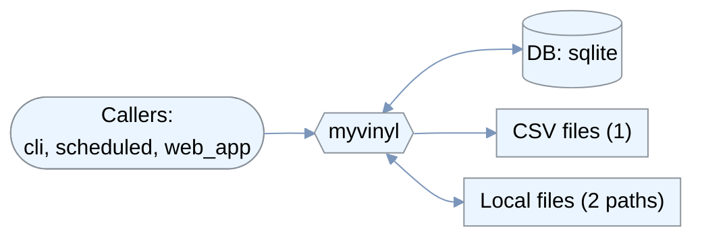

*Network endpoints*

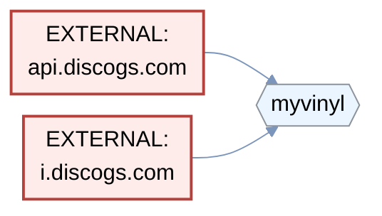

**Network endpoints**

| Endpoint | Kind | Access | Leaves host network | Source file |
|---|---|---|---|---|
| api.discogs.com | external API | read | yes | src/myvinyl/discogs.py |
| i.discogs.com | external API | read | yes | src/myvinyl/discogs.py |

**Data sources touched**

| Source | Access | Leaves organization |
|---|---|---|
| SQLite database myvinyl.db (users, albums, wishlist, sync tables, value history) | read_write | no |
| Cover image files and backups in the data directory | read_write | no |
| Discogs API (api.discogs.com, i.discogs.com) | read (search queries, release ids, barcodes and the user's token are sent out) | yes |

**Top findings**

- No severity-tagged findings above low: 7 public routes recorded as low (login, link token pages, health, static)
- Discogs API (external) receives search terms and users' access tokens by design; tokens stored AES-256-GCM encrypted
- Runtime dependency versions use >= ranges in pyproject.toml (locked in uv.lock); Docker base image not digest-pinned
- Strong baseline observed: Argon2id, CSRF tokens, rate limiting, CSP, non-root read-only container

**Unauthorized-action red flags**

- Collection metadata (artist, title, barcode search terms) and each user's Discogs token are sent to Discogs, an external third party, by design.
- Admins can view and edit any user's collection (documented feature).
- Public routes exist (login, invite/reset link pages) and are the internet-facing attack surface; they are CSRF-checked and rate-limited per the code.

### niva

Link: https://github.com/johnzastrow/niva | Languages: python, node | Findings: critical 0, high 0, low 1 | Inventory: [niva.json](niva.json) | Questionnaire: [niva_Governance.md](niva_Governance.md)

**What this application can do**

- Runs geoprocessing pipelines written in a text grammar by translating them into QGIS Processing algorithm calls, reading and writing local geospatial files and database tables the user points it at.
- Can send an ntfy push notification (default server ntfy.sh) and send SMTP email with an optional file attachment from the user's configured account.
- Can write to databases through named QGIS connections, including server-side CREATE TABLE AS SELECT, when the user's flow requests it.
- Can inventory a directory of geospatial datasets into a Markdown report and fetch layer listings from remote WFS/WMS/ArcGIS REST URLs.
- Setup command can modify the user's PATH / shell rc files and download a marimo release from GitHub.

**Who can reach it:** Local tool run by the user (CLI, QGIS plugin, LSP over stdio). No network listener or web routes were found, so it is reachable only by whoever runs it on their own machine.

**Data flow**

*Local data*

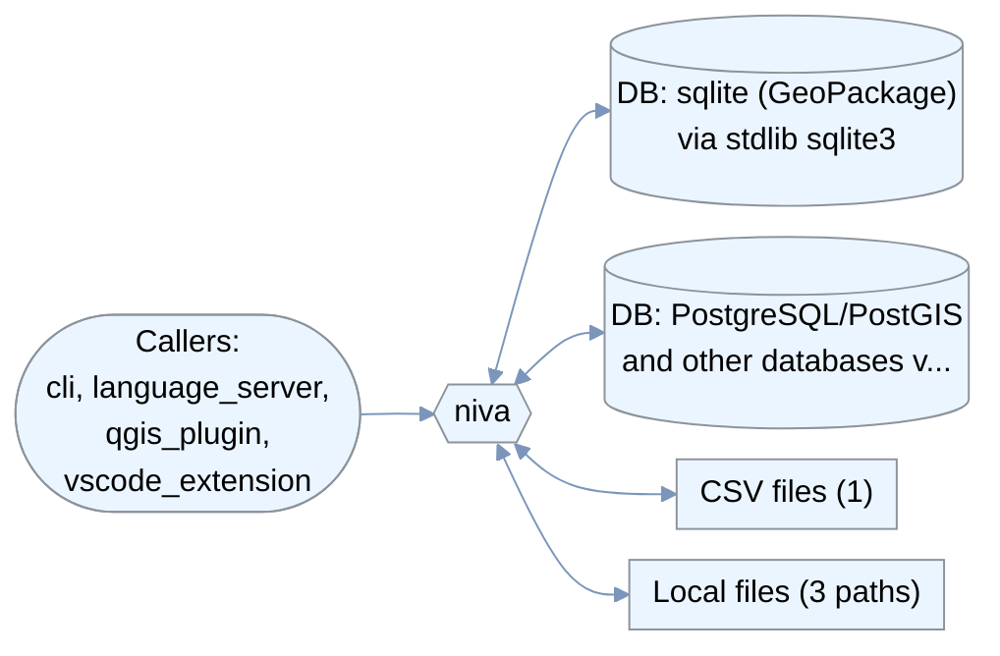

*Network endpoints (part 1 of 2)*

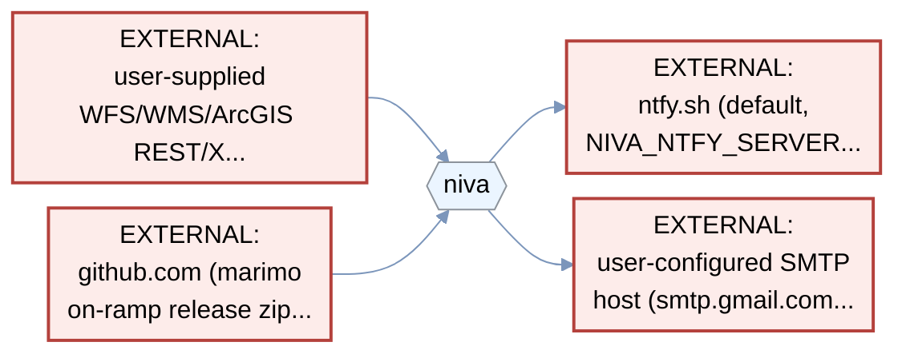

*Network endpoints (part 2 of 2)*

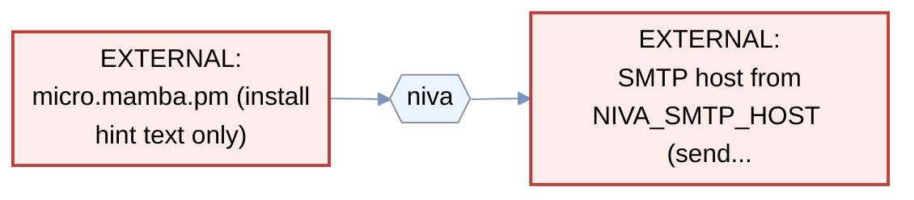

**Network endpoints**

| Endpoint | Kind | Access | Leaves host network | Source file |
|---|---|---|---|---|
| ntfy.sh (default; NIVA_NTFY_SERVER overridable) | external API | write | yes | niva/utilities.py |
| user-configured SMTP host (smtp.gmail.com default for gmail senders) | external API | write | yes | niva/utilities.py |
| user-supplied WFS/WMS/ArcGIS REST/XYZ URLs (read only, http/https only) | external API | read | yes | niva/remote.py |
| github.com (marimo on-ramp release zip download) | external API | read | yes | niva/setup/marimo.py |
| micro.mamba.pm (install hint text only) | external API | read | yes | niva/pdal_doctor.py |
| SMTP host from NIVA_SMTP_HOST (send only, optional attachment) | email_mailbox | write | yes | niva/utilities.py |

**Data sources touched**

| Source | Access | Leaves organization |
|---|---|---|
| Local geospatial files (gpkg, shp, geojson, csv, rasters, point clouds) | read_write | no |
| Databases via named QGIS connections (PostGIS, SQLite/GeoPackage) | read_write | no |
| ntfy.sh (or configured ntfy server) | write (sends user-authored notification text) | yes |
| SMTP server (user-configured, Gmail default for Gmail senders) | write (email body and optional attachment) | yes |
| Remote OGC/ArcGIS/XYZ services and GitHub downloads | read | no |

**Top findings**

- CI workflow contains a throwaway test-container Postgres password (.github/workflows/ci.yml:70), marked allowlist in detect-secrets
- notify/email verbs can send data to external hosts (ntfy.sh, SMTP)
- No web routes, no network listener; secrets resolved from env or QGIS encrypted auth store

**Unauthorized-action red flags**

- notify and email verbs can send data off the machine to ntfy.sh / an SMTP host chosen by the user; attachments can be any readable file path
- sql verb executes arbitrary user-authored SQL, including writes, against configured database connections

### orgphoto

Link: https://github.com/johnzastrow/orgphoto | Languages: python | Findings: critical 0, high 0, low 0 | Inventory: [orgphoto.json](orgphoto.json) | Questionnaire: [orgphoto_Governance.md](orgphoto_Governance.md)

**What this application can do**

- Scans a chosen folder tree of photos and videos and copies or moves each file into date-named folders (YYYY_MM_DD) in a destination folder, using EXIF dates or file timestamps.
- Detects duplicate files by SHA-256 hash and applies one of several handling modes, including selecting a master file and demoting others.
- Maintains a local SQLite hash cache and an events.log file in the destination directory.

**Who can reach it:** Command-line tool run locally by whoever invokes it; no network listener and no authentication, with the file-system permissions of the running user.

**Data flow**

*Local data*

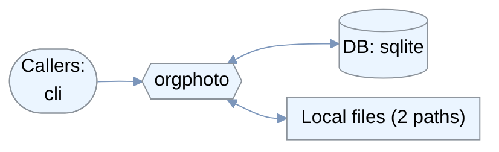

**Network endpoints**

None recorded.

**Data sources touched**

| Source | Access | Leaves organization |
|---|---|---|
| User-specified local photo/video directories | read_write | no |
| Local SQLite cache .orgphoto_cache.db and events.log in destination | read_write | no |

**Top findings**

- No secrets, routes or external APIs found
- SQLite cache uses parameterized queries (no injection path)
- Tool moves/copies user files with the user's own file permissions

**Unauthorized-action red flags**

- Moves files from the source tree when the move option is used, which can alter original photo archives; no network or external data transfer found.

### pgeo

Link: https://github.com/johnzastrow/pgeo | Languages: python, node | Findings: critical 0, high 0, low 9 | Inventory: [pgeo.json](pgeo.json) | Questionnaire: [pgeo_Governance.md](pgeo_Governance.md)

**What this application can do**

- Answers geocoding requests (forward search, structured search, autocomplete, reverse, place lookup, address) over public open-data places for a chosen US region, from a PostgreSQL/PostGIS database, with a Pelias-compatible JSON API.
- Provides a browser demo and batch tool that geocodes an uploaded CSV of up to 1,000 addresses and shows results on a map.
- Downloads public datasets (Census, OpenStreetMap, OpenAddresses, Who's On First, Overture, GNIS, Protomaps) and builds, dumps and swaps the geocoder database.
- Provisions VMs and hosts with Proxmox scripts and Ansible, including an optional nginx edge that requires hashed API keys and rate limits requests.

**Who can reach it:** By default every service binds to 127.0.0.1. The documented deployment puts an nginx edge behind a TLS terminator on a public URL; the FastAPI app itself has no authentication (api_key parameter is validated and ignored), and API-key enforcement exists only in the Ansible-managed edge (edge_require_api_key) with rate limiting. Intended exposure is a public geocoding service.

**Data flow**

*Local data*

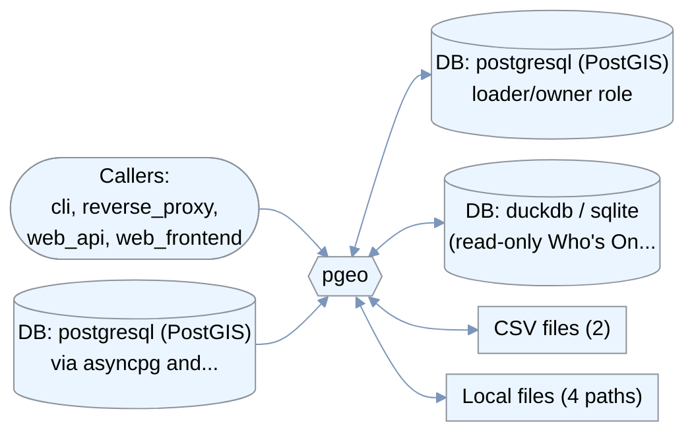

*Network endpoints (part 1 of 2)*

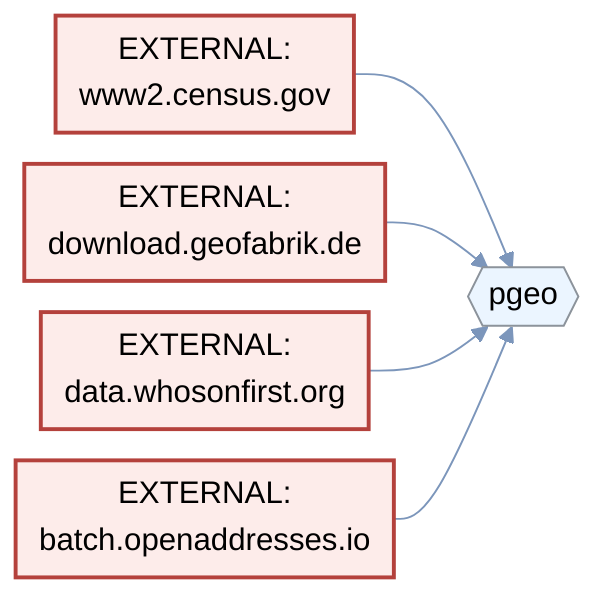

*Network endpoints (part 2 of 2)*

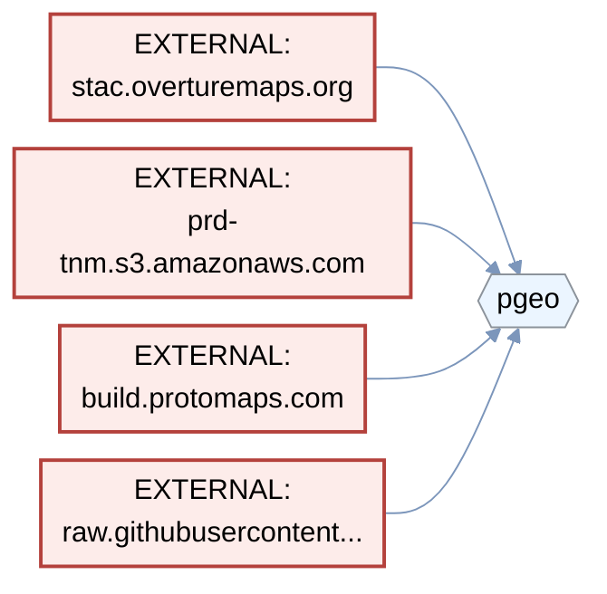

**Network endpoints**

| Endpoint | Kind | Access | Leaves host network | Source file |
|---|---|---|---|---|
| www2.census.gov | external API | read | yes | scripts/fetch_data.sh |
| download.geofabrik.de | external API | read | yes | scripts/fetch_data.sh |
| data.whosonfirst.org | external API | read | yes | scripts/fetch_data.sh |
| batch.openaddresses.io | external API | read | yes | scripts/fetch_data.sh |
| stac.overturemaps.org | external API | read | yes | pgeo/src/pgeo/load/sources.py |
| prd-tnm.s3.amazonaws.com | external API | read | yes | scripts/fetch_data.sh |
| build.protomaps.com | external API | read | yes | scripts/fetch_data.sh |
| raw.githubusercontent.com | external API | read | yes | scripts/vendor_web.sh |

**Data sources touched**

| Source | Access | Leaves organization |
|---|---|---|
| PostgreSQL/PostGIS geocoder database | read (API role) / read_write (loader) | no |
| Public open datasets (census.gov, geofabrik, whosonfirst, openaddresses, overture, GNIS, protomaps) | read | no |
| User-uploaded address CSV (browser batch tool) | read | no |

**Top findings**

- FastAPI /v1/* and /health routes lack in-app authentication; auth is delegated to the nginx edge (auth_detected unclear)
- f-string role password SQL in pgeo/src/pgeo/load/cli.py:78 is validated alphanumeric and operator-controlled (low)
- No hardcoded secrets; secrets via env/gitignored files; actions pinned by SHA; gitleaks in CI

**Unauthorized-action red flags**

- FastAPI routes have no application-level authentication; access control depends on the nginx edge configuration (not enforced in app code)
- Batch tool sends user-supplied addresses to the deployment's own geocoder only; no third-party AI or SaaS destination observed

### photochomper

Link: https://github.com/johnzastrow/photochomper | Languages: python, shell | Findings: critical 0, high 0, low 0 | Inventory: [photochomper.json](photochomper.json) | Questionnaire: [photochomper_Governance.md](photochomper_Governance.md)

**What this application can do**

- Scans chosen photo/video folders for exact and similar duplicates using SHA-256 and perceptual hashes (images and videos).
- Writes duplicate reports to CSV, JSON and SQLite, including file paths and EXIF metadata such as GPS and camera details.
- Can delete, move or copy duplicate files, with backup and rollback, from an interactive TUI.
- Keeps a local SQLite hash cache to speed up repeat scans; packages to a Windows exe with PyInstaller.

**Who can reach it:** Local command-line/TUI tool run by whoever starts it; no network listener and no login. It acts with that user's file-system permissions.

**Data flow**

*Local data*

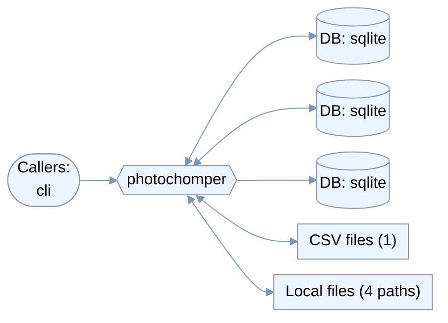

**Network endpoints**

None recorded.

**Data sources touched**

| Source | Access | Leaves organization |
|---|---|---|
| User photo and video directories on local disk | read_write (scan, delete/move/copy) | no |
| Local SQLite hash cache and report databases | read_write | no |
| CSV/JSON report files | write | no |

**Top findings**

- No secrets, routes or external APIs found
- Tool deletes/moves user files (backup and rollback present)
- Dependencies use >= ranges with no committed lockfile; build tools listed as runtime deps

**Unauthorized-action red flags**

- Deletes files and directories (shutil.rmtree for directories); mitigated by a backup copy and rollback in src/actions.py
- Reports contain GPS coordinates and full local file paths
- No network or external data transfer found

### postgis_linear_referencing

Link: https://github.com/johnzastrow/postgis_linear_referencing | Languages: sql | Findings: critical 0, high 0, low 0 | Inventory: [postgis_linear_referencing.json](postgis_linear_referencing.json) | Questionnaire: [postgis_linear_referencing_Governance.md](postgis_linear_referencing_Governance.md)

**What this application can do**

- Creates an observations table (greatpond.obs: name, desc, severity_int, size, point geometry in EPSG:6348) and a GIST index in a PostGIS database.
- Matches each observation point to its nearest trail line within 200 m and computes its linear-referencing measure along the trail, then builds events, event_points and segments tables.
- Drops and recreates the output tables greatpond.events, greatpond.event_points and greatpond.segments each time it is run (DROP TABLE IF EXISTS).

**Who can reach it:** Not a running service: the script is executed manually by someone who already has database access. Access is governed entirely by the PostgreSQL role used, which is not specified in the repo.

**Data flow**

*Local data*

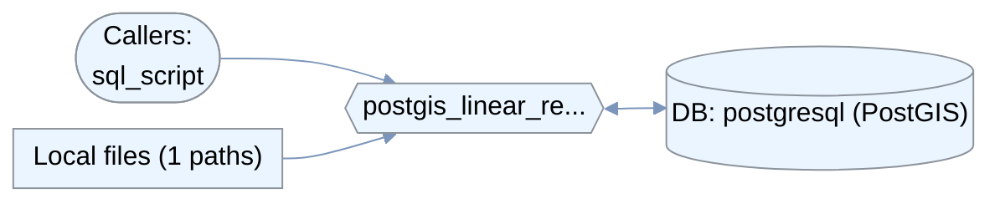

**Network endpoints**

None recorded.

**Data sources touched**

| Source | Access | Leaves organization |
|---|---|---|
| PostgreSQL/PostGIS schema 'greatpond': tables obs (input), trails (input), events, event_points, segments (outputs) | read_write | no |
| sample shapefile vertices.shp in the repo | read | no |

**Top findings**

- No secrets, credentials, hosts or code beyond one SQL script
- Script uses DROP TABLE IF EXISTS on output tables in a hardcoded schema
- No .gitignore; Windows Thumbs.db committed
- No dependency manifest or deployment documentation (none applicable)

**Unauthorized-action red flags**

- Script drops and recreates tables in schema 'greatpond' without confirmation (destructive if the same names are used elsewhere)
- No role or privilege handling is defined in the script

### pydataminer

Link: https://github.com/johnzastrow/pydataminer | Languages: python | Findings: critical 0, high 0, low 0 | Inventory: [pydataminer.json](pydataminer.json) | Questionnaire: [pydataminer_Governance.md](pydataminer_Governance.md)

**What this application can do**

- Walks a folder tree of GIS data with ArcPy, extracts each dataset's metadata (title, keywords, abstract, contact, coordinate system, extents, dates) and writes it to an Excel workbook.
- Creates and deletes temporary XML metadata files in a user-specified folder during the run.

**Who can reach it:** Run locally by a user inside ArcGIS (script tool) on their own machine; there is no network service.

**Data flow**

*Local data*

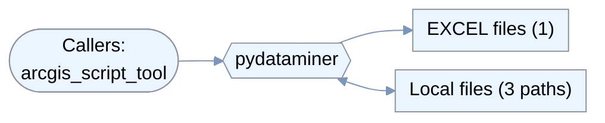

**Network endpoints**

None recorded.

**Data sources touched**

| Source | Access | Leaves organization |
|---|---|---|
| GIS datasets under a user-supplied input folder (file geodatabases, shapefiles, rasters, Access workspaces) | read | no |
| Output Excel (.xls) workbook and temp XML folder | write | no |

**Top findings**

- No secrets, routes or databases found; local ArcPy script tool
- No dependency manifest; vendored xlwt/ANTLR in committed zips
- Zip archives not inspected beyond a read-only grep

**Unauthorized-action red flags**

- Committed zip archives contain a script that writes service layer passwords into a report and vendored third-party code (not analysed in depth).

### QGIS

Link: https://github.com/johnzastrow/QGIS | Languages: batch, powershell, python, ini/config | Findings: critical 0, high 0, low 0 | Inventory: [QGIS.json](QGIS.json) | Questionnaire: [QGIS_Governance.md](QGIS_Governance.md)

**What this application can do**

- Provides a copied/portable Windows QGIS installation tree plus scripts that regenerate embedded absolute paths after the tree is moved (reinitialize via PowerShell and bin/textreplace.exe).
- Ships QGIS user profiles (default, Viewer, Viewer2) with plugin repository and basemap tile connection settings.
- Includes a Python validator that checks the tree for required runtime files.

**Who can reach it:** Desktop software run locally by whoever copies the tree; no network listener or authentication layer exists in the repo's own code.

**Data flow**

*Local data*

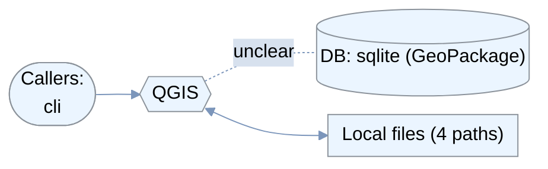

*Network endpoints*

```mermaid
%%{init: {"theme":"base","flowchart":{"useMaxWidth":true,"nodeSpacing":16,"rankSpacing":38,"padding":6},"themeVariables":{"background":"#ffffff","primaryColor":"#ebf5ff","primaryTextColor":"#000000","primaryBorderColor":"#8c939b","lineColor":"#7c96bb","secondaryColor":"#d7e1ee","tertiaryColor":"#c3d2e5","fontFamily":"\"Inter\", \"Noto Sans SC\", sans-serif","fontSize":"18","pie1":"#b4413c","pie2":"#d9893b","pie3":"#7c96bb","pie4":"#73A78D","pie5":"#CB9B7A","pie6":"#6B8CAE","pie7":"#c3d2e5","pie8":"#8c939b"}}}%%
flowchart LR
    APP{{"QGIS"}}
    E3["EXTERNAL:<br>plugins.qgis.org"]
    E3 --> APP
    E4["EXTERNAL:<br>feed.qgis.org"]
    E4 --> APP
    E5["EXTERNAL:<br>tile.openstreetmap.org"]
    E5 --> APP
    E6["EXTERNAL:<br>s3.amazonaws.com (Mapzen<br>terrain tiles)"]
    E6 --> APP
    class E3,E4,E5,E6 ext
    classDef ext fill:#fdecea,stroke:#b4413c,stroke-width:2px,color:#000000
```

**Network endpoints**

| Endpoint | Kind | Access | Leaves host network | Source file |
|---|---|---|---|---|
| plugins.qgis.org | external API | read | yes | Profiles/profiles/default/QGIS/QGIS3.ini |
| feed.qgis.org | external API | read | yes | Profiles/profiles/default/QGIS/QGIS3.ini |
| tile.openstreetmap.org | external API | read | yes | Profiles/profiles/default/QGIS/QGIS3.ini |
| s3.amazonaws.com (Mapzen terrain tiles) | external API | read | yes | Profiles/profiles/default/QGIS/QGIS3.ini |

**Data sources touched**

| Source | Access | Leaves organization |
|---|---|---|
| data.gpkg (tracked GeoPackage, 44 MB) | unclear | no |
| QGIS plugin repository (plugins.qgis.org), QGIS news feed (feed.qgis.org), OpenStreetMap tiles, Mapzen terrain tiles on s3.amazonaws.com (configured in QGIS profile ini) | read | yes |

**Top findings**

- No .gitignore in the repository
- Machine-specific absolute paths with the author's Windows user name committed (bin/qgis-bin.env, .claude/settings.local.json, .vscode/settings.json)
- Batch/PowerShell content is out of scope for skill v1.0; only inventory and pattern checks were run
- No hardcoded secrets or secret-shaped files found

**Unauthorized-action red flags**

- No secrets found, but tracked files embed the author's Windows user name and local directory layout (bin/qgis-bin.env, .claude/settings.local.json, .vscode/settings.json, portable/TODO.md).
- Without a .gitignore, nothing prevents credentials, logs or assistant settings from being committed.
- QGIS profile ini files configure outbound requests to public plugin, news and tile services.

### qgis-plugin-skill

Link: https://github.com/johnzastrow/qgis-plugin-skill | Languages: python, shell, yaml, markdown | Findings: critical 0, high 0, low 0 | Inventory: [qgis-plugin-skill.json](qgis-plugin-skill.json) | Questionnaire: [qgis-plugin-skill_Governance.md](qgis-plugin-skill_Governance.md)

**What this application can do**

- Provides guidance and reference documents that teach an AI coding agent how to write, debug, package and publish QGIS plugins.
- Builds a plugin zip from a manifest and verifies it, and can copy it into a local QGIS profile.
- Release workflow validates version consistency and creates a GitHub Release using the workflow token.

**Who can reach it:** No network service. Scripts run locally by whoever invokes them; the release workflow runs in GitHub Actions with contents: write permission.

**Data flow**

*Local data*

```mermaid
%%{init: {"theme":"base","flowchart":{"useMaxWidth":true,"nodeSpacing":16,"rankSpacing":38,"padding":6},"themeVariables":{"background":"#ffffff","primaryColor":"#ebf5ff","primaryTextColor":"#000000","primaryBorderColor":"#8c939b","lineColor":"#7c96bb","secondaryColor":"#d7e1ee","tertiaryColor":"#c3d2e5","fontFamily":"\"Inter\", \"Noto Sans SC\", sans-serif","fontSize":"18","pie1":"#b4413c","pie2":"#d9893b","pie3":"#7c96bb","pie4":"#73A78D","pie5":"#CB9B7A","pie6":"#6B8CAE","pie7":"#c3d2e5","pie8":"#8c939b"}}}%%
flowchart LR
    APP{{"qgis-plugin-skill"}}
    U(["Callers:<br>cli"]) --> APP
    F1["Local files (2 paths)"]
    APP <--> F1
    classDef ext fill:#fdecea,stroke:#b4413c,stroke-width:2px,color:#000000
```

**Network endpoints**

None recorded.

**Data sources touched**

| Source | Access | Leaves organization |
|---|---|---|
| Local plugin source tree and local QGIS profile directory | read_write | no |
| GitHub Releases (via github.token in CI) | write | yes |

**Top findings**

- No secrets, routes or databases found; this is a documentation and build-tooling skill
- Release workflow grants contents: write (needed to create releases); .gitignore does not list .env or key files

**Unauthorized-action red flags**

- none found

### qgis-vscode-setup

Link: https://github.com/johnzastrow/qgis-vscode-setup | Languages: python | Findings: critical 0, high 0, low 0 | Inventory: [qgis-vscode-setup.json](qgis-vscode-setup.json) | Questionnaire: [qgis-vscode-setup_Governance.md](qgis-vscode-setup_Governance.md)

**What this application can do**

- Generates VS Code settings and a .env file so a developer gets IntelliSense and import resolution for the QGIS Python API (auto-detects Windows/WSL2 QGIS installs).
- parcel_hook_generator.py draws a Z-shaped hook line between two selected parcel polygons and writes it to a chosen QGIS line layer.
- hook_lines.py adds hook barbs to lines of a named layer and outputs them to an in-memory layer.

**Who can reach it:** Local developer machine only: scripts run in the user's QGIS console and the setup helper is a local command; no network listener or authentication layer.

**Data flow**

*Local data*

```mermaid
%%{init: {"theme":"base","flowchart":{"useMaxWidth":true,"nodeSpacing":16,"rankSpacing":38,"padding":6},"themeVariables":{"background":"#ffffff","primaryColor":"#ebf5ff","primaryTextColor":"#000000","primaryBorderColor":"#8c939b","lineColor":"#7c96bb","secondaryColor":"#d7e1ee","tertiaryColor":"#c3d2e5","fontFamily":"\"Inter\", \"Noto Sans SC\", sans-serif","fontSize":"18","pie1":"#b4413c","pie2":"#d9893b","pie3":"#7c96bb","pie4":"#73A78D","pie5":"#CB9B7A","pie6":"#6B8CAE","pie7":"#c3d2e5","pie8":"#8c939b"}}}%%
flowchart LR
    APP{{"qgis-vscode-setup"}}
    U(["Callers:<br>cli, qgis_console_script"]) --> APP
    F1["Local files (4 paths)"]
    APP <--> F1
    classDef ext fill:#fdecea,stroke:#b4413c,stroke-width:2px,color:#000000
```

**Network endpoints**

None recorded.

**Data sources touched**

| Source | Access | Leaves organization |
|---|---|---|
| Layers loaded in the open QGIS project (user-selected parcel polygon and output line layers) | read_write | no |
| .vscode/settings.json and .env in the project root (generated, gitignored) | write | no |

**Top findings**

- No secrets, network calls or databases found
- dev_setup/configure.py runs a configured Python executable via subprocess (fixed arguments, path from local config)
- No root README; dev-only qgis-stubs dependency is unpinned in pyproject.toml (locked in uv.lock)

**Unauthorized-action red flags**

- None found: no network calls, credentials or database access in the code. The setup helper runs a configured Python executable via subprocess with fixed arguments.

### QGISModes

Link: https://github.com/johnzastrow/QGISModes | Languages: python | Findings: critical 0, high 0, low 0 | Inventory: [QGISModes.json](QGISModes.json) | Questionnaire: [QGISModes_Governance.md](QGISModes_Governance.md)

**What this application can do**

- Lets a QGIS desktop user define several simplified QGIS interfaces ('modes') as JSON files and switch between them at runtime by showing or hiding toolbars, panels, menus and processing algorithms.
- Imports and exports mode definition files to and from user-chosen locations on the local file system.
- Stores the active mode in QGIS settings and user modes in the active QGIS profile folder.

**Who can reach it:** Runs only inside the local QGIS desktop session of whoever installs it; no network listener, no authentication layer, no remote interface.

**Data flow**

*Local data*

```mermaid
%%{init: {"theme":"base","flowchart":{"useMaxWidth":true,"nodeSpacing":16,"rankSpacing":38,"padding":6},"themeVariables":{"background":"#ffffff","primaryColor":"#ebf5ff","primaryTextColor":"#000000","primaryBorderColor":"#8c939b","lineColor":"#7c96bb","secondaryColor":"#d7e1ee","tertiaryColor":"#c3d2e5","fontFamily":"\"Inter\", \"Noto Sans SC\", sans-serif","fontSize":"18","pie1":"#b4413c","pie2":"#d9893b","pie3":"#7c96bb","pie4":"#73A78D","pie5":"#CB9B7A","pie6":"#6B8CAE","pie7":"#c3d2e5","pie8":"#8c939b"}}}%%
flowchart LR
    APP{{"QGISModes"}}
    U(["Callers:<br>dev_script, qgis_plugin"]) --> APP
    F1["Local files (4 paths)"]
    APP <--> F1
    classDef ext fill:#fdecea,stroke:#b4413c,stroke-width:2px,color:#000000
```

**Network endpoints**

None recorded.

**Data sources touched**

| Source | Access | Leaves organization |
|---|---|---|
| Mode definition JSON files (bundled src/qgismodes/modes/ and per-profile qgismodes/modes/ folder) | read_write | no |
| QGIS profile settings (QgsSettings key qgismodes/mode) | unclear (read/write of plugin settings) | no |

**Top findings**

- No committed secrets, no network or database access found in plugin source
- Developer tools in tools/ use exec(compile(...)) on files from a hardcoded author-specific Windows path (not part of the shipped plugin)
- No dependency manifest beyond QGIS metadata.txt; optional jsonschema import is undeclared
- Project README states the repo is an early skeleton, not a working plugin

**Unauthorized-action red flags**

- No outbound network calls, credentials or database access found in the plugin source.
- Developer helper scripts in tools/ execute script text read from a hardcoded local path via exec() inside the QGIS console; they are not loaded by the plugin itself.

### seh

Link: https://github.com/johnzastrow/seh | Languages: python | Findings: critical 0, high 1, low 1 | Inventory: [seh.json](seh.json) | Questionnaire: [seh_Governance.md](seh_Governance.md)

**What this application can do**

- Downloads solar-installation monitoring data (sites, equipment, energy, power, storage, meters, alerts, telemetry) from the SolarEdge monitoring API using an API key and stores it in a SQLite, PostgreSQL or MariaDB database.
- Exports stored data to JSON, CSV or Excel files and dumps the database using sqlite3, pg_dump or mysqldump.
- Can send email notifications (via a configurable SMTP server) when a sync succeeds or fails.

**Who can reach it:** Command-line tool run by the user or a cron/systemd job; no network listener and no user authentication layer. Reach is limited to whoever can run it and read its .env and database.

**Data flow**

*Local data*

```mermaid
%%{init: {"theme":"base","flowchart":{"useMaxWidth":true,"nodeSpacing":16,"rankSpacing":38,"padding":6},"themeVariables":{"background":"#ffffff","primaryColor":"#ebf5ff","primaryTextColor":"#000000","primaryBorderColor":"#8c939b","lineColor":"#7c96bb","secondaryColor":"#d7e1ee","tertiaryColor":"#c3d2e5","fontFamily":"\"Inter\", \"Noto Sans SC\", sans-serif","fontSize":"18","pie1":"#b4413c","pie2":"#d9893b","pie3":"#7c96bb","pie4":"#73A78D","pie5":"#CB9B7A","pie6":"#6B8CAE","pie7":"#c3d2e5","pie8":"#8c939b"}}}%%
flowchart LR
    APP{{"seh"}}
    U(["Callers:<br>cli, scheduled_job,<br>script"]) --> APP
    D1[("DB: sqlite (default),<br>postgresql, mariadb v...")]
    APP <--> D1
    O2["EXCEL files (1)"]
    APP --> O2
    O3["CSV files (1)"]
    APP --> O3
    F4["Local files (3 paths)"]
    APP --> F4
    classDef ext fill:#fdecea,stroke:#b4413c,stroke-width:2px,color:#000000
```

*Network endpoints*

```mermaid
%%{init: {"theme":"base","flowchart":{"useMaxWidth":true,"nodeSpacing":16,"rankSpacing":38,"padding":6},"themeVariables":{"background":"#ffffff","primaryColor":"#ebf5ff","primaryTextColor":"#000000","primaryBorderColor":"#8c939b","lineColor":"#7c96bb","secondaryColor":"#d7e1ee","tertiaryColor":"#c3d2e5","fontFamily":"\"Inter\", \"Noto Sans SC\", sans-serif","fontSize":"18","pie1":"#b4413c","pie2":"#d9893b","pie3":"#7c96bb","pie4":"#73A78D","pie5":"#CB9B7A","pie6":"#6B8CAE","pie7":"#c3d2e5","pie8":"#8c939b"}}}%%
flowchart LR
    APP{{"seh"}}
    E5["EXTERNAL:<br>monitoringapi.solared..."]
    E5 --> APP
    E6["EXTERNAL:<br>smtp.gmail.com (default<br>SEH_SMTP_HOST,..."]
    APP --> E6
    E7["EXTERNAL:<br>SMTP server from<br>SEH_SMTP_HOST (defaul..."]
    APP --> E7
    class E5,E6,E7 ext
    classDef ext fill:#fdecea,stroke:#b4413c,stroke-width:2px,color:#000000
```

**Network endpoints**

| Endpoint | Kind | Access | Leaves host network | Source file |
|---|---|---|---|---|
| monitoringapi.solaredge.com | external API | read | yes | src/seh/api/client.py |
| smtp.gmail.com (default SEH_SMTP_HOST; configurable) | external API | write | yes | src/seh/config/logging.py |
| SMTP server from SEH_SMTP_HOST (default smtp.gmail.com), sends sync success/failure notifications | email_mailbox | write | yes | src/seh/config/logging.py |

**Data sources touched**

| Source | Access | Leaves organization |
|---|---|---|
| SolarEdge Monitoring API (monitoringapi.solaredge.com) | read | no |
| Relational database from SEH_DATABASE_URL (SQLite default) | read_write | no |
| SMTP server (default smtp.gmail.com) | write (notification emails) | yes |
| Export files (JSON, CSV, XLSX) and database dumps | write | no |

**Top findings**

- mysqldump invoked with password on the command line in src/seh/cli.py:1438 (high)
- f-string DROP VIEW statements in src/seh/db/views.py use internal constants only (low)
- Committed export files (energy.json, energy.xlsx, CSV) expose a site ID and residence-style site name

**Unauthorized-action red flags**

- mysqldump path puts the database password on the command line (cli.py:1438)
- SolarEdge API key is sent as a URL query parameter (client.py:87) over HTTPS
- Notification emails may be sent through a personal Gmail account by default configuration (smtp.gmail.com)
- Repo commits export files containing a site ID and a residence-style site name

### starshipsuits

Link: https://github.com/johnzastrow/starshipsuits | Languages: - | Findings: critical 0, high 0, low 0 | Inventory: [starshipsuits.json](starshipsuits.json) | Questionnaire: [starshipsuits_Governance.md](starshipsuits_Governance.md)

**What this application can do**

- Serves a public single-page 'coming soon' website for the Starship Suits fursuit studio; no forms, scripts, backend or contact route.

**Who can reach it:** Public static site intended for the open internet (starshipsuits.com via Netlify; optional GitHub Pages staging). No authentication, which is appropriate for a public static page; no data is exposed beyond the published web/ directory.

**Data flow**

No data stores, files or network endpoints recorded in the inventory.

**Network endpoints**

None recorded.

**Data sources touched:** none recorded.

**Top findings**

- No severity-tagged findings; static site with CSP and security headers in netlify.toml
- GitHub Actions referenced by version tag rather than commit SHA (informational)

**Unauthorized-action red flags**

- None recorded.

### stratavis

Link: https://github.com/johnzastrow/stratavis | Languages: - | Findings: critical 0, high 0, low 0 | Inventory: [stratavis.json](stratavis.json) | Questionnaire: [stratavis_Governance.md](stratavis_Governance.md)

**What this application can do**

- Nothing is executable yet: the repository holds only design documents for a planned multi-user web application that stores, edits and visualizes time-based (and optionally spatial) event data in timeline and map viewers.

**Who can reach it:** Not applicable: there is no running code. The design documents describe a planned FastAPI service with JWT login, public read access and role-gated editing, deployable locally, on a LAN or on a VPS behind HTTPS.

**Data flow**

No data stores, files or network endpoints recorded in the inventory.

**Network endpoints**

None recorded.

**Data sources touched:** none recorded.

**Top findings**

- No source code in the repository - documentation only
- No secrets or secret-shaped files found
- Design documents (not code) describe planned FastAPI/GeoPackage/JWT stack; rescan once implementation exists

**Unauthorized-action red flags**

- No code present, so no red flags in implementation. The design document plans a JWT_SECRET environment variable and bcrypt password hashing; these should be re-scanned when code exists.

### surveyart

Link: https://github.com/johnzastrow/surveyart | Languages: python | Findings: critical 0, high 0, low 0 | Inventory: [surveyart.json](surveyart.json) | Questionnaire: [surveyart_Governance.md](surveyart_Governance.md)

**What this application can do**

- Batch-converts vector files (SVG, PDF, EPS, AI and others) to other formats by calling Inkscape on files in a chosen folder tree.
- Extracts hex color values from SVG files, and generates color palettes from images or SVGs as JSON, CSS or palette files.
- Builds image contact-sheet montages by calling ImageMagick.
- Generates HTML style guides and optimizes SVG files using svgo, scour or built-in compression.

**Who can reach it:** Runs only as a command-line tool by whoever executes it on their own machine; no network listener and no authentication.

**Data flow**

*Local data*

```mermaid
%%{init: {"theme":"base","flowchart":{"useMaxWidth":true,"nodeSpacing":16,"rankSpacing":38,"padding":6},"themeVariables":{"background":"#ffffff","primaryColor":"#ebf5ff","primaryTextColor":"#000000","primaryBorderColor":"#8c939b","lineColor":"#7c96bb","secondaryColor":"#d7e1ee","tertiaryColor":"#c3d2e5","fontFamily":"\"Inter\", \"Noto Sans SC\", sans-serif","fontSize":"18","pie1":"#b4413c","pie2":"#d9893b","pie3":"#7c96bb","pie4":"#73A78D","pie5":"#CB9B7A","pie6":"#6B8CAE","pie7":"#c3d2e5","pie8":"#8c939b"}}}%%
flowchart LR
    APP{{"surveyart"}}
    U(["Callers:<br>cli"]) --> APP
    F1["Local files (4 paths)"]
    APP <--> F1
    classDef ext fill:#fdecea,stroke:#b4413c,stroke-width:2px,color:#000000
```

**Network endpoints**

None recorded.

**Data sources touched**

| Source | Access | Leaves organization |
|---|---|---|
| Local image and vector files in user-chosen directories | read | no |
| Output files written to user-chosen locations (converted images, JSON/CSS, HTML, SVG) | write | no |

**Top findings**

- No findings with severity: no secrets, no network access, no database
- Dependencies are undeclared (no manifest): Pillow plus external programs Inkscape and ImageMagick
- Subprocess calls use argument lists (no shell), but file names and options from the filesystem and command line reach external programs
- Single commit; no tests or CI present

**Unauthorized-action red flags**

- none found - no credentials, no network calls and no external data flows; the tool executes locally installed programs (Inkscape, ImageMagick, svgo, scour) with file names derived from the scanned folder

### systers

Link: https://github.com/johnzastrow/systers | Languages: rust | Findings: critical 0, high 0, low 0 | Inventory: [systers.json](systers.json) | Questionnaire: [systers_Governance.md](systers_Governance.md)

**What this application can do**

- Collects CPU, memory, disk and load metrics from the local Linux host and stores them in a local SQLite database (syswriter).
- Scans local system logs (syslog, messages, kern.log, auth.log) for error and warning patterns and stores matching entries in the database.
- Generates terminal or file summary reports from the stored data with configurable thresholds (sysreport).
- Optionally runs enhanced checks by invoking apt, dnf, lsblk, smartctl, systemctl and du, including 'apt update', to report updates, disk health, failed services and large directories.
- Deletes data older than a configurable retention period.

**Who can reach it:** Command-line tools run by whoever executes them on the host; no network listener and no authentication. Database file permissions are the default umask (docs/SECURITY_EVALUATION.md notes this as a recommendation). Reading /var/log/auth.log typically requires elevated privileges.

**Data flow**

*Local data*

```mermaid
%%{init: {"theme":"base","flowchart":{"useMaxWidth":true,"nodeSpacing":16,"rankSpacing":38,"padding":6},"themeVariables":{"background":"#ffffff","primaryColor":"#ebf5ff","primaryTextColor":"#000000","primaryBorderColor":"#8c939b","lineColor":"#7c96bb","secondaryColor":"#d7e1ee","tertiaryColor":"#c3d2e5","fontFamily":"\"Inter\", \"Noto Sans SC\", sans-serif","fontSize":"18","pie1":"#b4413c","pie2":"#d9893b","pie3":"#7c96bb","pie4":"#73A78D","pie5":"#CB9B7A","pie6":"#6B8CAE","pie7":"#c3d2e5","pie8":"#8c939b"}}}%%
flowchart LR
    APP{{"systers"}}
    U(["Callers:<br>cli"]) --> APP
    D1[("DB: sqlite")]
    APP <--> D1
    F2["Local files (4 paths)"]
    APP <--> F2
    classDef ext fill:#fdecea,stroke:#b4413c,stroke-width:2px,color:#000000
```

**Network endpoints**

None recorded.

**Data sources touched**

| Source | Access | Leaves organization |
|---|---|---|
| Local SQLite database (system_metrics and log_entries tables) | read_write | no |
| Local host log files under /var/log (including auth.log) | read | no |
| Local host metrics via sysinfo and system commands | read | no |

**Top findings**

- No secrets, keys or credentials found in source or config
- Tracked file 'dsg' holds shell history with a personal email address
- Stores auth.log extracts in a local SQLite file with default permissions
- Executes external system commands (no shell, fixed program names) including 'apt update'
- Cargo.lock committed; dependencies in semver ranges

**Unauthorized-action red flags**

- Reads authentication logs (/var/log/auth.log) and stores extracts in an unencrypted SQLite file with default permissions
- Runs 'apt update' as part of a check, which changes package lists and may need sudo
- TODO lists a planned feature to send alerts and summaries over SMTP (not implemented in source as of this scan)

