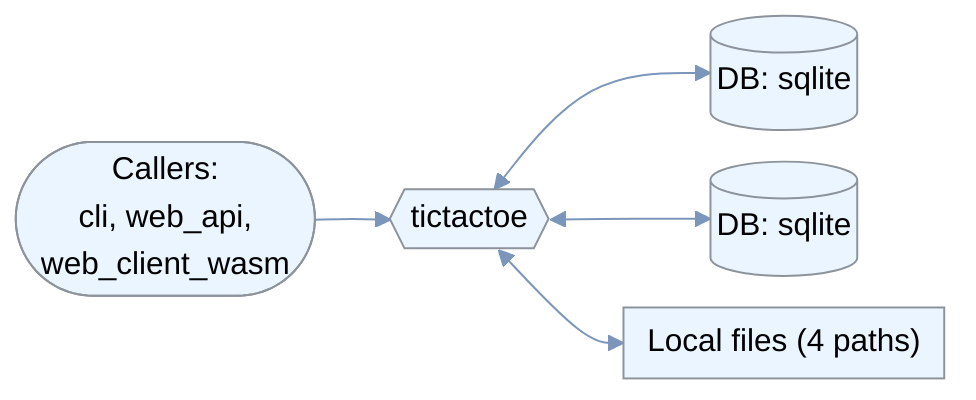
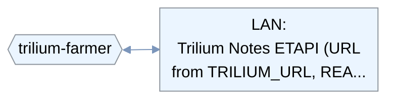
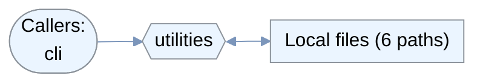
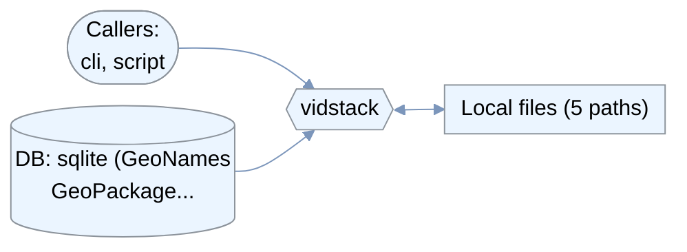
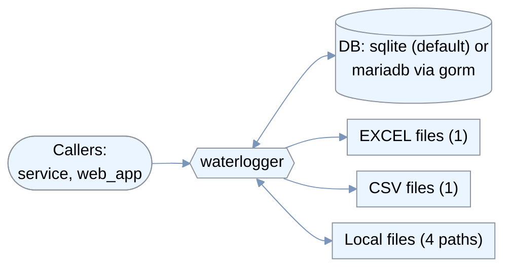
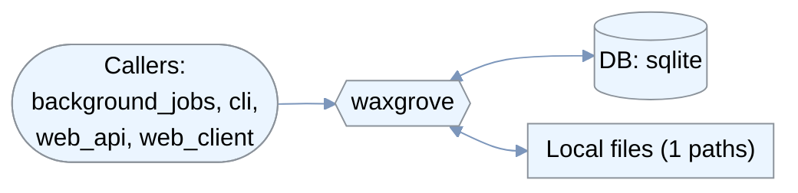
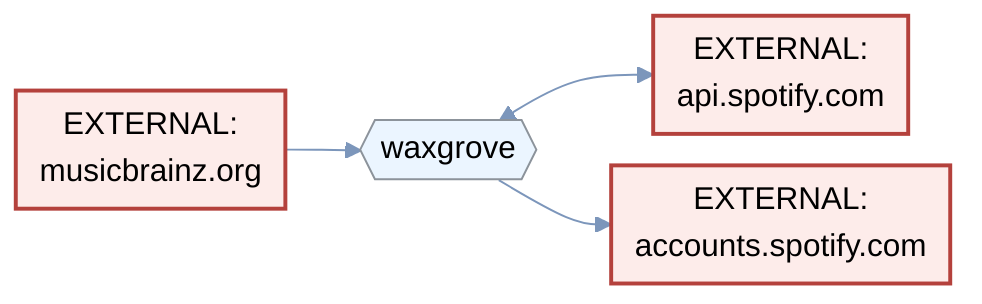

# Governance Scan Summary - Part 3 of 3: repository sections

Back to the [summary overview and matrices](johnzastrow_Summary.md). [Part 1](johnzastrow_Summary_Part1.md) | [Part 2](johnzastrow_Summary_Part2.md) | Part 3

## Contents

- [3.38 tictactoe](#tictactoe)
- [3.39 trilium-farmer](#trilium-farmer)
- [3.40 utilities](#utilities)
- [3.41 vidstack](#vidstack)
- [3.42 waterlogger](#waterlogger)
- [3.43 waxgrove](#waxgrove)

Each section has small data flow diagrams built only from that repository's JSON. Arrows follow the recorded `access_type`: an arrow into the app means read, out of the app means write, a double-headed arrow means read/write, and a dashed line means unclear. Local data and network endpoints are drawn as separate small diagrams (split further when long) so each prints at a readable size on letter paper. Endpoints that leave the host network are labelled EXTERNAL and shaded red; loopback or private-LAN endpoints are labelled LAN. Labels are shortened; the full endpoint text is in the table under the diagrams. Local file access is shown as one node; databases and network endpoints are itemized.

## 3.38 tictactoe

Link: https://github.com/johnzastrow/tictactoe | Languages: go, rust, python, javascript | Findings: critical 0, high 0, low 14 | Inventory: [tictactoe.json](tictactoe.json) | Questionnaire: [tictactoe_Governance.md](tictactoe_Governance.md)

#### 3.38.1 What this application can do

- Lets two players play tic-tac-toe on one shared live game from a terminal UI and a browser tab at the same time, served locally with no login (127.0.0.1 only), in both a Rust and a Go implementation.
- Runs 'pt', a projects-and-tasks business-style app (grid, board, timeline, dashboard views) with terminal and WebAssembly web clients over a shared SQLite database; users log in with a password and see and edit projects, programs, templates and tasks according to their role.
- Runs a 'demo' control gallery server (no login) used only to exercise UI widgets in four clients.
- Seeds the pt database with demo users and data and prints or accepts a seed password.

#### 3.38.2 Who can reach it

By default only the local machine (loopback bind with Host/Origin allowlists). The pt and demo servers can be bound to other interfaces, but refuse non-loopback binds without TLS unless --allow-plaintext is given. The tic-tac-toe servers have no authentication (loopback only); the pt server requires login for /ws, /api/me and /api/logout with login throttling.

#### 3.38.3 Data flow

*Figure 61. tictactoe - data flow, local data.*

#### 3.38.4 Network endpoints

None recorded.

#### 3.38.5 Data sources touched

**Table 63.** tictactoe - data sources touched.

| Source | Access | Leaves organization |
|---|---|---|
| pt SQLite database file (users with Argon2id hashes, programs, projects, templates, tasks, activity) | read_write | no |
| local client config files (session token, preferences) | read_write | no |

#### 3.38.6 Top findings

- No secrets, secret files or provider keys found; passwords hashed with Argon2id; password values in grep hits are test fixtures
- Servers bind loopback by default; non-loopback bind requires TLS or an explicit --allow-plaintext flag
- Tic-tac-toe and demo WebSocket endpoints are unauthenticated (low: loopback only, no sensitive data)
- SQL built with format! only for internal table/column names; values are parameterized
- No .env/key patterns in .gitignore, and no CI workflow or Dockerfile present

#### 3.38.7 Unauthorized-action red flags

- none found - no external API calls, no hardcoded credentials, no data leaving the host observed
- --allow-plaintext option permits serving the authenticated pt app over plain HTTP on a non-loopback interface (explicit opt-in)
- tic-tac-toe and demo WebSocket endpoints have no authentication (loopback default)

## 3.39 trilium-farmer

Link: https://github.com/johnzastrow/trilium-farmer | Languages: - | Findings: critical 0, high 0, low 0 | Inventory: [trilium-farmer.json](trilium-farmer.json) | Questionnaire: [trilium-farmer_Governance.md](trilium-farmer_Governance.md)

#### 3.39.1 What this application can do

- Per README and spec only (no code committed): lets Claude Code list, read, search, create and update notes in a Trilium Notes instance through its ETAPI, using a locally spawned stdio process.

#### 3.39.2 Who can reach it

No server code present. Per README the tool runs as a stdio subprocess of Claude Code, so it is reachable only by the local user running it; it uses a Trilium API token to reach the Trilium host on the network.

#### 3.39.3 Data flow

*Figure 62. trilium-farmer - data flow, network endpoints.*

#### 3.39.4 Network endpoints

**Table 64.** trilium-farmer - network endpoints.

| Endpoint | Kind | Access | Leaves host network | Source file |
|---|---|---|---|---|
| Trilium Notes ETAPI (URL from TRILIUM_URL; README example http://192.168.1.102:8080) | external API | read_write | no | README.md |

#### 3.39.5 Data sources touched

**Table 65.** trilium-farmer - data sources touched.

| Source | Access | Leaves organization |
|---|---|---|
| Trilium Notes instance via ETAPI (documented, not implemented in repo) | read_write | no |

#### 3.39.6 Top findings

- Repository contains documentation only; no source code to scan
- Documented token handled via TRILIUM_TOKEN env var; README example uses a placeholder token and an http:// URL

#### 3.39.7 Unauthorized-action red flags

- Documented write access (create_note, update_note) to the whole Trilium note tree with a full-access token; the spec describes TRILIUM_ALLOWED_ROOTS and a private-label filter as mitigations, but they cannot be verified because no code is present.
- README example uses a plain http:// URL to the Trilium host, so the token would travel unencrypted on the LAN.

## 3.40 utilities

Link: https://github.com/johnzastrow/utilities | Languages: shell | Findings: critical 0, high 0, low 0 | Inventory: [utilities.json](utilities.json) | Questionnaire: [utilities_Governance.md](utilities_Governance.md)

#### 3.40.1 What this application can do

- Reports system, memory, disk, network, listening-port and service status on the local Linux host.
- Lists local user accounts and shows login history and failed login attempts from system logs, when run with sufficient privileges.
- Searches and tails system logs.
- Deletes old log files under a chosen directory (default /var/log) and creates compressed backups of a chosen directory.
- Provides a Bash script template with logging, argument parsing and cleanup traps.

#### 3.40.2 Who can reach it

Local command-line scripts run by whoever has shell access; no network service. Several reads (auth.log, lastlog) and the /var/log cleanup need elevated privileges.

#### 3.40.3 Data flow

*Figure 63. utilities - data flow, local data.*

#### 3.40.4 Network endpoints

None recorded.

#### 3.40.5 Data sources touched

**Table 66.** utilities - data sources touched.

| Source | Access | Leaves organization |
|---|---|---|
| Local system logs and account files (/var/log, /etc/passwd, lastlog) | read | no |
| User-chosen log directory (clean-old-logs.sh) | write (deletes files) | no |
| User-chosen source and backup directories (backup-directory.sh) | read_write | no |

#### 3.40.6 Top findings

- no severity-tagged findings
- clean-old-logs.sh deletes logs (default /var/log) with no path guard beyond optional dry run

#### 3.40.7 Unauthorized-action red flags

- clean-old-logs.sh permanently deletes logs with rm -f, which affects audit trails if run with the default /var/log path outside dry-run mode
- check-user-activity.sh and list-users.sh expose account and failed-login information to whoever runs them

## 3.41 vidstack

Link: https://github.com/johnzastrow/vidstack | Languages: python | Findings: critical 0, high 0, low 1 | Inventory: [vidstack.json](vidstack.json) | Questionnaire: [vidstack_Governance.md](vidstack_Governance.md)

#### 3.41.1 What this application can do

- Recursively finds .mov videos in a chosen directory, sorts them by creation date, generates title slides (date, path, GPS place name, keywords, people tags) and merges everything into one compilation video using FFmpeg.
- Looks up place names for GPS coordinates in a local GeoNames GeoPackage (offline, read-only).

#### 3.41.2 Who can reach it

Local command-line tool run by the user; no network listener and no authentication needed. Reach is limited to whoever runs it on their machine.

#### 3.41.3 Data flow

*Figure 64. vidstack - data flow, local data.*

#### 3.41.4 Network endpoints

None recorded.

#### 3.41.5 Data sources touched

**Table 67.** vidstack - data sources touched.

| Source | Access | Leaves organization |
|---|---|---|
| Local video files (.mov) under input_directory | read | no |
| Compiled output video, temp files and generated config YAML | write | no |
| Local geonames.gpkg (SQLite) | read | no |

#### 3.41.6 Top findings

- eval() on ffprobe r_frame_rate in metadata_extractor.py:421 (low)
- SQLite query in gps_location.py is parameterized (no injection path)
- Dependencies use >= ranges only; requirements.txt and pyproject.toml disagree on pyexiv2

#### 3.41.7 Unauthorized-action red flags

- Uses eval() on ffprobe output (metadata_extractor.py:421); ffprobe emits a normalized fraction so exploitation is unlikely but dynamic evaluation of externally derived text is present
- Title slides can embed GPS coordinates and full file paths from personal videos into the produced video

## 3.42 waterlogger

Link: https://github.com/johnzastrow/waterlogger | Languages: go | Findings: critical 9, high 27, low 16 | Inventory: [waterlogger.json](waterlogger.json) | Questionnaire: [waterlogger_Governance.md](waterlogger_Governance.md)

#### 3.42.1 What this application can do

- Lets logged-in users manage pools, test kits, water-test samples and chemical adjustments, with LSI/RSI and dosing calculations.
- Lets users create, edit and delete other users, export all data (JSON, CSV, Excel, Markdown), download a database backup and upload a backup to import into the database.
- Because the session cookie holds only the numeric user ID and the server accepts any value, anyone who can reach the server can send 'session=1' and act as user 1 without a password, reaching all of the above including user management and backup import.

#### 3.42.2 Who can reach it

Default bind is localhost:2342 (local only). Docker compose and the documented server deployment expose it on the network (2342, plus phpMyAdmin 8080 with the tools profile). Session check is forgeable, so reachability equals full access.

#### 3.42.3 Data flow

*Figure 65. waterlogger - data flow, local data.*

#### 3.42.4 Network endpoints

None recorded.

#### 3.42.5 Data sources touched

**Table 68.** waterlogger - data sources touched.

| Source | Access | Leaves organization |
|---|---|---|
| SQLite file or MariaDB database (users, pools, kits, samples, adjustments) | read_write | no |
| Exports and backup files (JSON, CSV, XLSX, Markdown) and temp/ directory | write | no |

#### 3.42.6 Top findings

- Forgeable session cookie: validateSession trusts the cookie value as the user ID (internal/middleware/auth.go) - all authenticated routes effectively unauthenticated
- Wildcard CORS with credentials on all routes (internal/middleware/cors.go)
- docker-compose.yml hardcodes DB passwords and publishes phpMyAdmin with preset credentials
- Setup wizard is open until the first user is created

#### 3.42.7 Unauthorized-action red flags

- Authentication bypass: session cookie is just the user ID and validateSession returns it unchanged (internal/middleware/auth.go)
- Wildcard CORS (Access-Control-Allow-Origin: *) with credentials header on every route
- Session cookie is not marked Secure; no CSRF protection or login rate limiting found; password policy only requires non-empty
- docker-compose publishes phpMyAdmin with preconfigured DB credentials and hardcoded DB passwords
- Committed backup/test JSON and cookie files with usernames and emails

## 3.43 waxgrove

Link: https://github.com/johnzastrow/waxgrove | Languages: go, typescript, sql | Findings: critical 0, high 0, low 5 | Inventory: [waxgrove.json](waxgrove.json) | Questionnaire: [waxgrove_Governance.md](waxgrove_Governance.md)

#### 3.43.1 What this application can do

- Lets invited friends register and log in to a self-hosted web app, build playlists of songs identified by ISRC / MusicBrainz IDs, and share them with each other.
- Searches song metadata from MusicBrainz (sends search text to musicbrainz.org) and stores songs platform-neutrally.
- Connects a user's own Spotify developer app (user supplies client ID and secret, stored encrypted), imports Spotify playlists, and exports Waxgrove playlists to Spotify as background jobs.
- Lets users rate, tag and comment on shared playlists, fork them, and export or erase their own data (JSPF export, privacy export, account deletion).
- Serves its own React PWA from the Go binary.

#### 3.43.2 Who can reach it

Default bind is loopback; the compose deployment publishes only to host 127.0.0.1 and expects a TLS reverse proxy in front. All data routes require a session cookie; only health, instance, version, register (invite-only by default) and login are public. Reachability beyond localhost depends on the deployer's proxy, which is not in the repo.

#### 3.43.3 Data flow

*Figure 66. waxgrove - data flow, local data.*

*Figure 67. waxgrove - data flow, network endpoints.*

#### 3.43.4 Network endpoints

**Table 69.** waxgrove - network endpoints.

| Endpoint | Kind | Access | Leaves host network | Source file |
|---|---|---|---|---|
| api.spotify.com | external API | read_write | yes | internal/spotify/client.go |
| accounts.spotify.com | external API | write | yes | internal/spotify/auth.go |
| musicbrainz.org | external API | read | yes | internal/musicbrainz/client.go |

#### 3.43.5 Data sources touched

**Table 70.** waxgrove - data sources touched.

| Source | Access | Leaves organization |
|---|---|---|
| SQLite database (users, sessions, playlists, records, annotations, jobs, encrypted provider credentials) | read_write | no |
| Spotify Web API (api.spotify.com, accounts.spotify.com) | read_write (reads playlists, creates/updates playlists; OAuth token exchange) | yes |
| MusicBrainz API (musicbrainz.org) | read (search queries sent) | yes |

#### 3.43.6 Top findings

- No hardcoded secrets or committed secret files; secrets come from environment and are encrypted at rest (AES-256-GCM)
- All data routes use authed middleware; only 5 public routes (health, instance, version, register, login)
- SQL uses placeholders; no string-built queries found
- Runs non-root in a distroless container with healthcheck; default bind loopback
- Outbound data flows to Spotify and MusicBrainz by design

#### 3.43.7 Unauthorized-action red flags

- Data leaves to third parties by design: users' Spotify playlist data and Spotify tokens flow to/from api.spotify.com, and search text goes to musicbrainz.org
- POST /api/register is public (invite code required unless WAXGROVE_INVITE_ONLY is turned off; production refuses open registration per config.go check)

